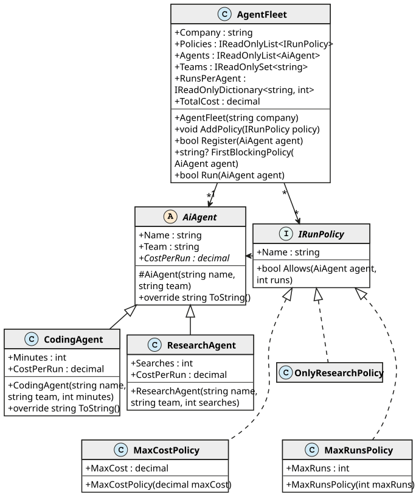

# KI-Agenten in einer Firma

Immer mehr Firmen lassen Arbeit von KI-Agenten erledigen. Ein KI-Agent ist ein Programm, das eine
Aufgabe mit KI selbstständig bearbeitet. Jeder Durchlauf (*run*) eines Agenten kostet Geld. Ein
Startup entwickelt daher eine Software, mit der eine Firma alle Agenten verwaltet (*AgentFleet*).

Ein Agent muss zuerst registriert werden. Vor jedem Durchlauf prüft die *AgentFleet* ihre
Richtlinien (*policies*):

1. Erlauben alle Richtlinien den Durchlauf, zählt die *AgentFleet* ihn.
2. Verbietet mindestens eine Richtlinie den Durchlauf, wird er abgelehnt und nicht gezählt.

Es gibt 2 Arten von Agenten:

- Ein Rechercheagent (*ResearchAgent*) sucht im Internet und kostet Geld pro Suche.
- Ein Programmieragent (*CodingAgent*) schreibt Code und kostet Geld pro Minute.

Alle Preise und Regeln in dieser Aufgabe sind erfunden.

## Klassenmodell



<sup>PlantUML Quelle: [klassenmodell.puml](klassenmodell.puml)</sup>

## Klassenbeschreibung

Alle Properties im Modell sind **read-only**. Sie dürfen also keinen *public set* haben. Private
Felder, die du für die Implementierung brauchst, legst du selbst an.

#### Klasse AiAgent

Die abstrakte Basisklasse für einen KI-Agenten.

- **Name** ist der Name des Agenten, zum Beispiel *Scout*.
- **Team** ist das Team in der Firma, für das der Agent arbeitet.
- Der Konstruktor ist *protected*. Ist *name* oder *team* ein leerer String, wirft er eine
  *ArgumentException*.
- **CostPerRun** ist ein abstraktes Property. Es liefert die Kosten für einen Durchlauf in Euro.
- **ToString()** überschreibt die Methode von *object*. Sie liefert einen String in dieser Form:
  ```text
  Scout (Marketing)
  ```

#### Klasse ResearchAgent

- **Searches** ist die Anzahl der Suchen pro Durchlauf. Ist *searches* kleiner als 1, wirft der
  Konstruktor eine *ArgumentException*.
- **CostPerRun**: Bei bis zu 20 Suchen (also auch bei genau 20) kostet jede Suche 0.05 Euro. Bei
  mehr als 20 Suchen kostet jede Suche nur 0.03 Euro. 20 Suchen kosten also 1.00 Euro, 21 Suchen
  kosten 0.63 Euro.

#### Klasse CodingAgent

- **Minutes** ist die Dauer eines Durchlaufs in Minuten. Ist *minutes* kleiner als 1, wirft der
  Konstruktor eine *ArgumentException*.
- **CostPerRun**: Eine Minute kostet 0.15 Euro. Der Mindestpreis ist aber 1.00 Euro. 12 Minuten
  kosten also 1.80 Euro, 5 Minuten kosten 1.00 Euro.
- **ToString()** hängt die Minuten an den String der Basisklasse an. Verwende dafür *ToString()*
  der Basisklasse. Beispiel:
  ```text
  Builder (Backend) - 12 min
  ```

#### Interface IRunPolicy und die Richtlinien

Das Interface beschreibt eine Richtlinie für einen Durchlauf.

- **Name** ist der Name der Richtlinie.
- **Allows()** liefert *true*, wenn die Richtlinie einen weiteren Durchlauf erlaubt. Der Parameter
  *runs* ist die Anzahl der Durchläufe, die dieser Agent schon gemacht hat.

Implementiere das Interface in 3 Klassen. Jede Klasse hat die Members aus dem Interface, daher
zeigt das Klassenmodell sie nicht.

| Klasse             | Name         | Allows() liefert true, wenn ...                              |
|--------------------|--------------|--------------------------------------------------------------|
| MaxRunsPolicy      | MaxRuns      | *runs* kleiner als *MaxRuns* ist.                            |
| MaxCostPolicy      | MaxCost      | *CostPerRun* des Agenten nicht größer als *MaxCost* ist.     |
| OnlyResearchPolicy | OnlyResearch | der Agent ein *ResearchAgent* ist.                           |

#### Klasse AgentFleet

Die Klasse speichert die Richtlinien und alle Agenten einer Firma.

- **Company** wird im Konstruktor gesetzt.
- **Policies** und **Agents** liefern die Richtlinien und die Agenten als *IReadOnlyList*.
  Speichere die Daten intern in *private readonly* Listen. Die Properties dürfen nicht die
  internen Listen selbst liefern. Verwende *AsReadOnly()*.
- **Teams** liefert die Namen aller Teams der registrierten Agenten. Jeder Name kommt nur einmal
  vor. Speichere die Namen intern in einem *HashSet* und verwende auch hier *AsReadOnly()*.
- **RunsPerAgent** liefert ein Dictionary. Der Key ist der *Name* des Agenten, der Value ist die
  Anzahl seiner Durchläufe. Speichere die Daten intern in einem *Dictionary* und verwende auch
  hier *AsReadOnly()*.
- **AddPolicy()** fügt die Richtlinie am Ende der Liste ein.
- **Register()** registriert einen Agenten. Die Schritte stehen im nächsten Abschnitt.
- **FirstBlockingPolicy()** geht in der Reihenfolge der Liste durch die Richtlinien. Sie liefert
  den *Name* der ersten Richtlinie, die den Durchlauf nicht erlaubt. Erlauben alle Richtlinien den
  Durchlauf, liefert sie *null*. Die Methode zählt nichts. Übergib die aktuelle Anzahl der
  Durchläufe dieses Agenten an *Allows()*.
- **Run()** zählt einen Durchlauf, wenn das möglich ist. Sie liefert dann *true*. Die Schritte
  stehen im nächsten Abschnitt.
- **TotalCost** ist die Summe aller Kosten. Rechne für jeden Agenten die Anzahl seiner Durchläufe
  mal *CostPerRun*. Gibt es keine Agenten, ist der Wert 0.

#### So arbeiten Register() und Run()

**Register()**

1. Gibt es schon einen Agenten mit diesem *Name*, liefere *false*. Prüfe das mit
   `ContainsKey()` des Dictionarys.
2. Füge den Agenten am Ende der Liste ein.
3. Füge *Team* in das *HashSet* ein. Ist der Name schon vorhanden, ignoriert das *HashSet* den
   Aufruf.
4. Setze die Anzahl der Durchläufe mit dem Indexer auf 0, also `runsPerAgent[agent.Name] = 0`.
5. Liefere *true*.

**Run()**

1. Ist der Agent nicht in der Liste der Agenten, liefere *false*.
2. Verwende *FirstBlockingPolicy()*. Wenn diese Methode einen Namen liefert, liefere *false*.
3. Erhöhe den Value im Dictionary um 1.
4. Liefere *true*.

**Beispiel** mit der Richtlinie *MaxRunsPolicy* und *MaxRuns* 2:

| Aufruf                 | Durchläufe davor | Ergebnis von Run()                    |
|------------------------|-----------------:|---------------------------------------|
| 1. Aufruf von *Run()*  |                0 | *true*                                |
| 2. Aufruf von *Run()*  |                1 | *true*                                |
| 3. Aufruf von *Run()*  |                2 | *false* (2 ist nicht kleiner als 2)   |

> [!TIP]
> - `Math.Max(a, b)` liefert den größeren Wert.
> - Ein *decimal* Literal schreibst du mit *M* am Ende, z. B. `0.05M`.
> - Den Typ eines Objekts prüfst du mit *is*, z. B. `agent is ResearchAgent`.
> - Die aktuelle Anzahl der Durchläufe liest du mit `TryGetValue()`. Gibt es den Key nicht, hat
>   die *out* Variable den Wert 0.

## Durchzuführende Arbeiten

Öffne die Solution *AiAgentFleet.sln* in diesem Ordner. Im Projekt *AiAgentFleet.Application*
gibt es für jede Klasse und das Interface schon eine leere Datei. Verwende den Namespace
*AiAgentFleet.Application*. Die Dateien *Program.cs* und *TestHelpers.cs* darfst du **nicht**
ändern.

*Program.cs* ist ein Testprogramm. Es kompiliert erst, wenn alle Klassen mit allen Properties und
Methoden aus dem Modell existieren. Achte auch auf die Namen der Konstruktorparameter, denn das
Testprogramm verwendet sie (z. B. `searches: 8`). Lege daher zuerst alle Klassen an. Methoden
und Properties, die du noch nicht implementiert hast, werfen eine *NotImplementedException*.
Danach startest du das Programm im Ordner *AiAgentFleet.Application* mit `dotnet run`. Es zeigt
bei jeder Prüfung *OK* oder *FAILED*. Wirft eine Prüfung eine Exception, gilt sie als nicht
erfüllt.

Eine vollständige Lösung zeigt bei allen 40 Prüfungen *OK*. Am Ende zeigt das Programm die
erreichten Punkte und die Note:

```text
Result of the program in C:\...\AiAgentFleet.Application:
40 of 40 checks passed.
53 of 53 points. Grade: Sehr gut.
```

## Bewertung

Um eine positive Beurteilung erreichen zu können, muss das Programm kompilieren. Programme, die
nicht kompilieren, werden mit *Nicht genügend* bewertet. Die Tabelle zeigt alle Prüfungen des
Testprogramms. Die Texte sind die Texte der Bildschirmausgabe. Jede Prüfung mit *OK* bringt die
Punkte in der Spalte *P*.

| Nr | Prüfung (53 Punkte in Summe)                                                               | P |
|---:|--------------------------------------------------------------------------------------------|--:|
|    | ***Checking class implementation***                                                        |   |
|  1 | AiAgent is abstract.                                                                       | 1 |
|  2 | AiAgent has a protected constructor.                                                       | 1 |
|  3 | AiAgent is immutable.                                                                      | 1 |
|  4 | AiAgent.CostPerRun is an abstract decimal property.                                        | 1 |
|  5 | ResearchAgent has no default constructor and is immutable.                                 | 1 |
|  6 | CodingAgent has no default constructor and is immutable.                                   | 1 |
|  7 | IRunPolicy is an interface.                                                                | 1 |
|  8 | MaxRunsPolicy, MaxCostPolicy and OnlyResearchPolicy implement IRunPolicy.                  | 1 |
|  9 | AgentFleet has no default constructor and is immutable.                                    | 1 |
| 10 | AgentFleet.Agents and Policies are IReadOnlyList.                                          | 1 |
| 11 | AgentFleet.Teams is IReadOnlySet\<string>.                                                 | 1 |
| 12 | AgentFleet.RunsPerAgent is IReadOnlyDictionary\<string, int>.                              | 1 |
|    | ***Checking constructors***                                                                |   |
| 13 | Constructor of ResearchAgent sets the values.                                              | 1 |
| 14 | Constructor of CodingAgent sets the values.                                                | 1 |
| 15 | Constructor of AgentFleet sets the values. Agents and Policies are empty.                  | 1 |
| 16 | AiAgent throws an ArgumentException if name or team is empty.                              | 1 |
| 17 | ResearchAgent throws an ArgumentException if searches is less than 1.                      | 1 |
| 18 | CodingAgent throws an ArgumentException if minutes is less than 1.                         | 1 |
|    | ***Checking ResearchAgent and CodingAgent***                                               |   |
| 19 | A research agent with 20 searches costs 1.00 EUR.                                          | 1 |
| 20 | A research agent with 21 searches costs 0.63 EUR.                                          | 1 |
| 21 | A coding agent with 12 minutes costs 1.80 EUR.                                             | 2 |
| 22 | A coding agent with 5 minutes costs the minimum price of 1.00 EUR.                         | 2 |
| 23 | AiAgent.ToString() returns Name and Team.                                                  | 1 |
| 24 | CodingAgent.ToString() adds the minutes.                                                   | 2 |
|    | ***Checking run policies***                                                                |   |
| 25 | The names are MaxRuns, MaxCost and OnlyResearch.                                           | 1 |
| 26 | OnlyResearchPolicy allows research agents and rejects coding agents.                       | 1 |
| 27 | MaxCostPolicy compares the cost of a run with MaxCost.                                     | 2 |
| 28 | MaxRunsPolicy allows a run below MaxRuns.                                                  | 2 |
| 29 | MaxRunsPolicy rejects a run if MaxRuns is reached.                                         | 2 |
|    | ***Checking AgentFleet.Register()***                                                       |   |
| 30 | Agents, Policies, Teams and RunsPerAgent do not return the internal collections.           | 1 |
| 31 | Register() adds the agent with 0 runs and returns true.                                    | 1 |
| 32 | Register() returns false if the name already exists.                                       | 2 |
| 33 | Register() adds a second agent at the end of the list. Teams contains every team only once. | 1 |
|    | ***Checking runs and costs***                                                              |   |
| 34 | Without agents TotalCost is 0, RunsPerAgent and Teams are empty.                           | 1 |
| 35 | Run() counts the runs of the agent and returns true.                                       | 2 |
| 36 | Run() returns false if the agent is not registered.                                        | 2 |
| 37 | Run() does not count a rejected run and works with every IRunPolicy.                       | 2 |
| 38 | Run() passes the current number of runs to the policies.                                   | 2 |
| 39 | TotalCost is the sum of runs x CostPerRun of all agents.                                   | 2 |
| 40 | FirstBlockingPolicy() returns the name of the first blocking policy or null.               | 2 |

53 - 47 Punkte: Sehr gut, 46 - 40 Punkte: Gut, 39 - 34 Punkte: Befriedigend, 33 - 27 Punkte:
Genügend, 26 - 0 Punkte: Nicht genügend.

## Cheat Sheet: .NET Klassen und Methoden

Das Projekt hat keine *ImplicitUsings*. Schreibe daher bei Bedarf diese Zeilen an den Anfang der
Datei:

- `using System;` für *Math* und *ArgumentException*
- `using System.Collections.Generic;` für *List*, *HashSet*, *Dictionary* und die *IReadOnly*
  Interfaces

| Member                                   | Liefert | Bedeutung                                                    |
|------------------------------------------|---------|--------------------------------------------------------------|
| ***List\<T>***, erzeugen mit `new List<T>()` oder `new()` |  |                                                 |
| `list.Add(item)`                         | void    | Fügt das Element am Ende ein.                                |
| `list.Contains(item)`                    | bool    | *true*, wenn das Element in der Liste ist.                   |
| `list.Count`                             | int     | Anzahl der Elemente.                                         |
| `list[index]`                            | T       | Element an dieser Position. Erster Index ist 0.              |
| `list.AsReadOnly()`                      | Wrapper | Für ein Property vom Typ *IReadOnlyList\<T>*.                |
| ***HashSet\<T>***, erzeugen mit `new HashSet<T>()` oder `new()` |  |                                           |
| `set.Add(item)`                          | bool    | *false*, wenn der Wert schon vorhanden ist.                  |
| `set.Contains(item)`                     | bool    | *true*, wenn der Wert vorhanden ist.                         |
| `set.Count`                              | int     | Anzahl der Werte.                                            |
| `set.AsReadOnly()`                       | Wrapper | Für ein Property vom Typ *IReadOnlySet\<T>*.                 |
| ***Dictionary\<TKey, TValue>***, erzeugen mit `new Dictionary<TKey, TValue>()` oder `new()` | | |
| `dict[key]`                              | TValue  | Liest den Value. Exception, wenn der Key fehlt.              |
| `dict[key] = value`                      |         | Legt den Key an oder überschreibt den Value.                 |
| `dict.ContainsKey(key)`                  | bool    | *true*, wenn es den Key gibt.                                |
| `dict.TryGetValue(key, out var v)`       | bool    | Fehlt der Key: *false*, und *v* ist 0 (bei Zahlen).          |
| `dict.Count`                             | int     | Anzahl der Einträge.                                         |
| `dict.Keys`                              |         | Alle Keys, verwendbar mit *foreach*.                         |
| `dict.Values`                            |         | Alle Values, verwendbar mit *foreach*.                       |
| `dict.AsReadOnly()`                      | Wrapper | Für *IReadOnlyDictionary\<TKey, TValue>*.                    |
| ***Read-only Interfaces*** (nur Lesen, kein *Add()*) |  |                                                       |
| *IReadOnlyList\<T>*                      |         | `Count`, `[index]`, *foreach*                                |
| *IReadOnlySet\<T>*                       |         | `Count`, `Contains()`, *foreach*                             |
| *IReadOnlyDictionary\<TKey, TValue>*     |         | `Count`, `[key]`, `ContainsKey()`, `TryGetValue()`, `Keys`, `Values`, *foreach* |
| ***Weitere Klassen***                    |         |                                                              |
| `Math.Max(a, b)`                         | Zahl    | Der größere Wert, auch für *decimal*.                        |
| `Math.Min(a, b)`                         | Zahl    | Der kleinere Wert, auch für *decimal*.                       |
| `throw new ArgumentException("Text");`   |         | Wirft eine Exception mit diesem Text.                        |
| `public override string ToString()`      |         | Überschreibt die Methode von *object*.                       |
