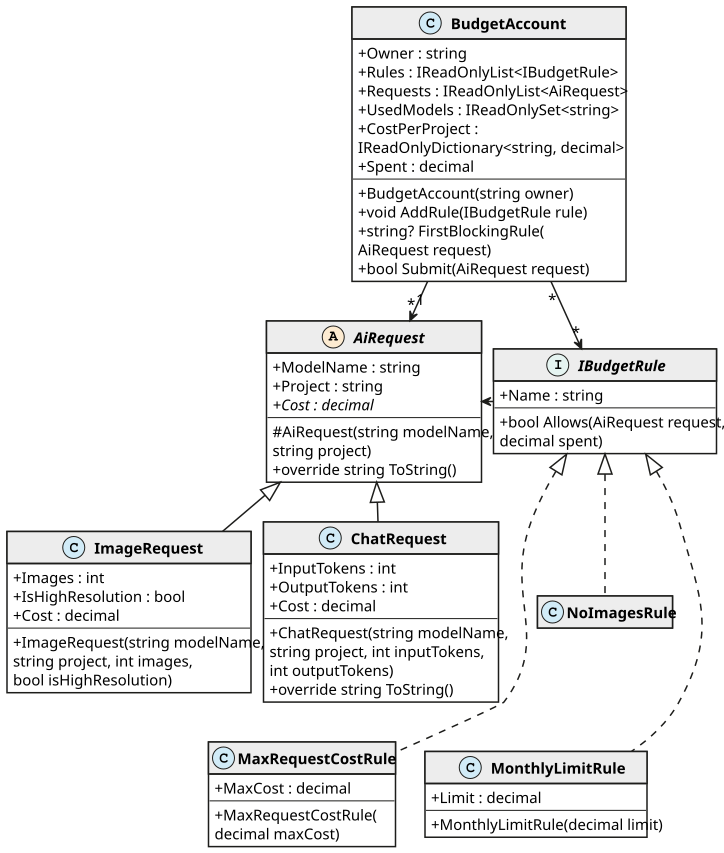

# KI-Budget in einer Firma

Firmen bezahlen immer mehr Geld für KI-Dienste. Ein Startup entwickelt daher einen Dienst, mit dem
eine Firma diese Kosten kontrollieren kann. Jede Person in der Firma bekommt ein Budgetkonto
(*BudgetAccount*). Jede Anfrage an einen KI-Dienst (*AiRequest*) geht zuerst an dieses Konto.

Das Konto prüft die Anfrage mit seinen Regeln (*rules*):

1. Erlauben alle Regeln die Anfrage, speichert das Konto sie.
2. Verbietet mindestens eine Regel die Anfrage, wird sie abgelehnt und nicht gespeichert.

Es gibt 2 Arten von Anfragen:

- Eine Textanfrage (*ChatRequest*) kostet Geld pro Token. Ein Token ist ein kleines Stück Text,
  ungefähr ein Teil von einem Wort. Die Tokens der Frage heißen *input tokens*, die Tokens der
  Antwort heißen *output tokens*.
- Eine Bildanfrage (*ImageRequest*) kostet Geld pro Bild.

Alle Preise und Regeln in dieser Aufgabe sind erfunden.

## Klassenmodell



<sup>PlantUML Quelle: [klassenmodell.puml](klassenmodell.puml)</sup>

## Klassenbeschreibung

Alle Properties im Modell sind **read-only**. Sie dürfen also keinen *public set* haben. Private
Felder, die du für die Implementierung brauchst, legst du selbst an.

#### Klasse AiRequest

Die abstrakte Basisklasse für eine Anfrage an einen KI-Dienst.

- **ModelName** ist der Name des KI-Modells, zum Beispiel *TextBot*.
- **Project** ist der Name des Projekts, für das die Anfrage gemacht wird.
- Der Konstruktor ist *protected*. Ist *modelName* oder *project* ein leerer String, wirft er
  eine *ArgumentException*.
- **Cost** ist ein abstraktes Property. Es liefert die Kosten der Anfrage in Euro.
- **ToString()** überschreibt die Methode von *object*. Sie liefert einen String in dieser Form:
  ```text
  PixelGen (App)
  ```

#### Klasse ChatRequest

- **InputTokens** ist die Anzahl der Tokens in der Frage, **OutputTokens** ist die Anzahl der
  Tokens in der Antwort. Ist einer der beiden Werte kleiner als 1, wirft der Konstruktor eine
  *ArgumentException*.
- **Cost**: Ein Input Token kostet 0.0001 Euro, ein Output Token kostet 0.0004 Euro. Der
  Mindestpreis ist aber 0.05 Euro. Eine Anfrage mit 10000 Input Tokens und 5000 Output Tokens
  kostet also 1.00 + 2.00 = 3.00 Euro. Eine Anfrage mit 100 Input Tokens und 50 Output Tokens
  kostet 0.05 Euro.
- **ToString()** hängt die Summe der Tokens an den String der Basisklasse an. Verwende dafür
  *ToString()* der Basisklasse. Beispiel:
  ```text
  TextBot (Website) - 150 tokens
  ```

#### Klasse ImageRequest

- **Images** ist die Anzahl der Bilder. Ist *images* kleiner als 1, wirft der Konstruktor eine
  *ArgumentException*.
- **IsHighResolution** ist *true*, wenn die Bilder eine hohe Auflösung haben.
- **Cost**: Ein Bild kostet 0.04 Euro. Ein Bild mit hoher Auflösung kostet 0.10 Euro. 3 Bilder
  mit hoher Auflösung kosten also 0.30 Euro.

#### Interface IBudgetRule und die Regeln

Das Interface beschreibt eine Regel für das Budget.

- **Name** ist der Name der Regel.
- **Allows()** liefert *true*, wenn die Regel die Anfrage erlaubt. Der Parameter *spent* ist der
  Betrag, der vor dieser Anfrage schon ausgegeben wurde.

Implementiere das Interface in 3 Klassen. Jede Klasse hat die Members aus dem Interface, daher
zeigt das Klassenmodell sie nicht.

| Klasse             | Name           | Allows() liefert true, wenn ...                                     |
|--------------------|----------------|---------------------------------------------------------------------|
| MonthlyLimitRule   | MonthlyLimit   | *spent* plus *Cost* der Anfrage nicht größer als *Limit* ist.       |
| MaxRequestCostRule | MaxRequestCost | *Cost* der Anfrage nicht größer als *MaxCost* ist.                  |
| NoImagesRule       | NoImages       | die Anfrage kein *ImageRequest* ist.                                |

#### Klasse BudgetAccount

Die Klasse speichert die Regeln und alle gespeicherten Anfragen einer Person.

- **Owner** wird im Konstruktor gesetzt.
- **Rules** und **Requests** liefern die Regeln und die Anfragen als *IReadOnlyList*. Speichere
  die Daten intern in *private readonly* Listen. Die Properties dürfen nicht die internen Listen
  selbst liefern. Verwende *AsReadOnly()*.
- **UsedModels** liefert die Namen aller verwendeten Modelle. Jeder Name kommt nur einmal vor.
  Speichere die Namen intern in einem *HashSet* und verwende auch hier *AsReadOnly()*.
- **AddRule()** fügt die Regel am Ende der Liste ein.
- **Spent** ist die Summe von *Cost* aller gespeicherten Anfragen. Gibt es keine Anfragen, ist
  der Wert 0.
- **CostPerProject** liefert ein Dictionary. Der Key ist der Name des Projekts, der Value ist die
  Summe von *Cost* für dieses Projekt. Gibt es keine Anfragen, ist das Dictionary leer.
- **FirstBlockingRule()** geht in der Reihenfolge der Liste durch die Regeln. Sie liefert den
  *Name* der ersten Regel, die die Anfrage nicht erlaubt. Erlauben alle Regeln die Anfrage,
  liefert sie *null*. Die Methode speichert nichts. Übergib den aktuellen Wert von *Spent* an
  *Allows()*.
- **Submit()** speichert die Anfrage, wenn das möglich ist. Sie liefert dann *true*. Die
  Schritte stehen im nächsten Abschnitt.

#### So arbeitet Submit()

1. Ist die Anfrage schon in der Liste, liefere *false*.
2. Verwende *FirstBlockingRule()*. Wenn diese Methode einen Namen liefert, liefere *false*.
3. Füge die Anfrage am Ende der Liste ein.
4. Füge *ModelName* in das *HashSet* ein. Ist der Name schon vorhanden, ignoriert das *HashSet*
   den Aufruf.
5. Liefere *true*.

**Beispiel** mit der Regel *MonthlyLimitRule* und *Limit* 5.00 Euro:

| Anfrage                     | Cost | Spent davor | Ergebnis von Submit()   |
|-----------------------------|-----:|------------:|-------------------------|
| Chat mit 10000 / 5000 Tokens | 3.00 |        0.00 | *true*                  |
| Chat mit 10000 / 5000 Tokens | 3.00 |        3.00 | *false* (6.00 > 5.00)   |
| 3 Bilder, normale Auflösung | 0.12 |        3.00 | *true*                  |

#### So berechnest du CostPerProject

Das Property berechnet das Dictionary bei jedem Aufruf neu.

1. Lege ein neues, leeres `Dictionary<string, decimal>` an.
2. Gehe mit *foreach* durch alle gespeicherten Anfragen.
3. Lies die bisherigen Kosten des Projekts mit `TryGetValue()`. Gibt es den Key noch nicht, hat
   die *out* Variable den Wert 0.
4. Weise die Summe aus den bisherigen Kosten und *Cost* der Anfrage dem Indexer zu, also
   `costs[request.Project]`. Der Indexer legt den Key an, wenn es ihn noch nicht gibt. Sonst
   überschreibt er den alten Wert.
5. Liefere nach der Schleife das Dictionary zurück. *Dictionary* implementiert
   *IReadOnlyDictionary*, du kannst es also direkt zurückgeben.

> [!TIP]
> - `Math.Max(a, b)` liefert den größeren Wert.
> - Ein *decimal* Literal schreibst du mit *M* am Ende, z. B. `0.05M`.
> - Den Typ eines Objekts prüfst du mit *is*, z. B. `request is ImageRequest`.

## Durchzuführende Arbeiten

Öffne die Solution *AiBudget.sln* in diesem Ordner. Im Projekt *AiBudget.Application* gibt es
für jede Klasse und das Interface schon eine leere Datei. Verwende den Namespace
*AiBudget.Application*. Die Dateien *Program.cs* und *TestHelpers.cs* darfst du **nicht**
ändern.

*Program.cs* ist ein Testprogramm. Es kompiliert erst, wenn alle Klassen mit allen Properties und
Methoden aus dem Modell existieren. Achte auch auf die Namen der Konstruktorparameter, denn das
Testprogramm verwendet sie (z. B. `inputTokens: 100`). Lege daher zuerst alle Klassen an.
Methoden und Properties, die du noch nicht implementiert hast, werfen eine
*NotImplementedException*. Danach startest du das Programm im Ordner *AiBudget.Application* mit
`dotnet run`. Es zeigt bei jeder Prüfung *OK* oder *FAILED*. Wirft eine Prüfung eine Exception,
gilt sie als nicht erfüllt.

Eine vollständige Lösung zeigt bei allen 40 Prüfungen *OK*. Am Ende zeigt das Programm die
erreichten Punkte und die Note:

```text
Result of the program in C:\...\AiBudget.Application:
40 of 40 checks passed.
53 of 53 points. Grade: Sehr gut.
```

## Bewertung

Um eine positive Beurteilung erreichen zu können, muss das Programm kompilieren. Programme, die
nicht kompilieren, werden mit *Nicht genügend* bewertet. Die Tabelle zeigt alle Prüfungen des
Testprogramms. Die Texte sind die Texte der Bildschirmausgabe. Jede Prüfung mit *OK* bringt die
Punkte in der Spalte *P*.

| Nr | Prüfung (53 Punkte in Summe)                                                   | P |
|---:|--------------------------------------------------------------------------------|--:|
|    | ***Checking class implementation***                                            |   |
|  1 | AiRequest is abstract.                                                         | 1 |
|  2 | AiRequest has a protected constructor.                                         | 1 |
|  3 | AiRequest is immutable.                                                        | 1 |
|  4 | AiRequest.Cost is an abstract decimal property.                                | 1 |
|  5 | ChatRequest has no default constructor and is immutable.                       | 1 |
|  6 | ImageRequest has no default constructor and is immutable.                      | 1 |
|  7 | IBudgetRule is an interface.                                                   | 1 |
|  8 | MonthlyLimitRule, MaxRequestCostRule and NoImagesRule implement IBudgetRule.   | 1 |
|  9 | BudgetAccount has no default constructor and is immutable.                     | 1 |
| 10 | BudgetAccount.Requests and Rules are IReadOnlyList.                            | 1 |
| 11 | BudgetAccount.UsedModels is IReadOnlySet\<string>.                             | 1 |
| 12 | BudgetAccount.CostPerProject is IReadOnlyDictionary\<string, decimal>.         | 1 |
|    | ***Checking constructors***                                                    |   |
| 13 | Constructor of ChatRequest sets the values.                                    | 1 |
| 14 | Constructor of ImageRequest sets the values.                                   | 1 |
| 15 | Constructor of BudgetAccount sets the values. Requests and Rules are empty.    | 1 |
| 16 | AiRequest throws an ArgumentException if modelName or project is empty.        | 1 |
| 17 | ChatRequest throws an ArgumentException if a token count is less than 1.       | 1 |
| 18 | ImageRequest throws an ArgumentException if images is less than 1.             | 1 |
|    | ***Checking ChatRequest and ImageRequest***                                    |   |
| 19 | 3 images with normal resolution cost 0.12 EUR.                                 | 1 |
| 20 | 3 images with high resolution cost 0.30 EUR.                                   | 1 |
| 21 | A chat with 10000 input and 5000 output tokens costs 3.00 EUR.                 | 2 |
| 22 | A chat with 100 input and 50 output tokens costs the minimum price of 0.05 EUR. | 2 |
| 23 | AiRequest.ToString() returns ModelName and Project.                            | 1 |
| 24 | ChatRequest.ToString() adds the number of tokens.                              | 2 |
|    | ***Checking budget rules***                                                    |   |
| 25 | The names are MonthlyLimit, MaxRequestCost and NoImages.                       | 1 |
| 26 | NoImagesRule allows chats and rejects images.                                  | 1 |
| 27 | MaxRequestCostRule compares the cost of the request with MaxCost.              | 2 |
| 28 | MonthlyLimitRule allows a request that reaches the limit exactly.              | 2 |
| 29 | MonthlyLimitRule rejects a request above the limit.                            | 2 |
|    | ***Checking BudgetAccount.Submit()***                                          |   |
| 30 | Requests, Rules and UsedModels do not return the internal collections.         | 1 |
| 31 | Submit() adds the request and returns true.                                    | 1 |
| 32 | Submit() returns false if the request is already in the list.                  | 2 |
| 33 | Submit() adds a second request at the end of the list.                         | 1 |
|    | ***Checking rules and costs in BudgetAccount***                                |   |
| 34 | Without requests Spent is 0, CostPerProject and UsedModels are empty.          | 1 |
| 35 | Spent is the sum of all costs.                                                 | 2 |
| 36 | CostPerProject has one entry for every project with the sum of the costs.      | 2 |
| 37 | UsedModels contains every model only once.                                     | 2 |
| 38 | Submit() does not save a rejected request and works with every IBudgetRule.    | 2 |
| 39 | Submit() passes the current value of Spent to the rules.                       | 2 |
| 40 | FirstBlockingRule() returns the name of the first blocking rule or null.       | 2 |

53 - 47 Punkte: Sehr gut, 46 - 40 Punkte: Gut, 39 - 34 Punkte: Befriedigend, 33 - 27 Punkte:
Genügend, 26 - 0 Punkte: Nicht genügend.

## Cheat Sheet: .NET Klassen und Methoden

Das Projekt hat keine *ImplicitUsings*. Schreibe daher bei Bedarf diese Zeilen an den Anfang der
Datei:

- `using System;` für *Math* und *ArgumentException*
- `using System.Collections.Generic;` für *List*, *HashSet*, *Dictionary* und die *IReadOnly*
  Interfaces

| Member                                   | Liefert | Bedeutung                                                    |
|------------------------------------------|---------|--------------------------------------------------------------|
| ***List\<T>***, erzeugen mit `new List<T>()` oder `new()` |  |                                                 |
| `list.Add(item)`                         | void    | Fügt das Element am Ende ein.                                |
| `list.Contains(item)`                    | bool    | *true*, wenn das Element in der Liste ist.                   |
| `list.Count`                             | int     | Anzahl der Elemente.                                         |
| `list[index]`                            | T       | Element an dieser Position. Erster Index ist 0.              |
| `list.AsReadOnly()`                      | Wrapper | Für ein Property vom Typ *IReadOnlyList\<T>*.                |
| ***HashSet\<T>***, erzeugen mit `new HashSet<T>()` oder `new()` |  |                                           |
| `set.Add(item)`                          | bool    | *false*, wenn der Wert schon vorhanden ist.                  |
| `set.Contains(item)`                     | bool    | *true*, wenn der Wert vorhanden ist.                         |
| `set.Count`                              | int     | Anzahl der Werte.                                            |
| `set.AsReadOnly()`                       | Wrapper | Für ein Property vom Typ *IReadOnlySet\<T>*.                 |
| ***Dictionary\<TKey, TValue>***, erzeugen mit `new Dictionary<TKey, TValue>()` oder `new()` | | |
| `dict[key]`                              | TValue  | Liest den Value. Exception, wenn der Key fehlt.              |
| `dict[key] = value`                      |         | Legt den Key an oder überschreibt den Value.                 |
| `dict.ContainsKey(key)`                  | bool    | *true*, wenn es den Key gibt.                                |
| `dict.TryGetValue(key, out var v)`       | bool    | Fehlt der Key: *false*, und *v* ist 0 (bei Zahlen).          |
| `dict.Count`                             | int     | Anzahl der Einträge.                                         |
| `dict.Keys`                              |         | Alle Keys, verwendbar mit *foreach*.                         |
| `dict.Values`                            |         | Alle Values, verwendbar mit *foreach*.                       |
| `dict.AsReadOnly()`                      | Wrapper | Für *IReadOnlyDictionary\<TKey, TValue>*.                    |
| ***Read-only Interfaces*** (nur Lesen, kein *Add()*) |  |                                                       |
| *IReadOnlyList\<T>*                      |         | `Count`, `[index]`, *foreach*                                |
| *IReadOnlySet\<T>*                       |         | `Count`, `Contains()`, *foreach*                             |
| *IReadOnlyDictionary\<TKey, TValue>*     |         | `Count`, `[key]`, `ContainsKey()`, `TryGetValue()`, `Keys`, `Values`, *foreach* |
| ***Weitere Klassen***                    |         |                                                              |
| `Math.Max(a, b)`                         | Zahl    | Der größere Wert, auch für *decimal*.                        |
| `Math.Min(a, b)`                         | Zahl    | Der kleinere Wert, auch für *decimal*.                       |
| `throw new ArgumentException("Text");`   |         | Wirft eine Exception mit diesem Text.                        |
| `public override string ToString()`      |         | Überschreibt die Methode von *object*.                       |
