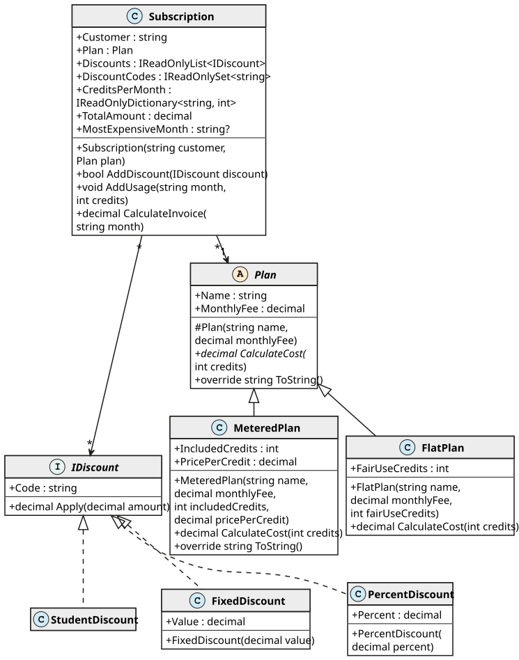

# Abos für einen KI-Dienst

Viele Menschen bezahlen für KI-Dienste ein Abo (*subscription*). Ein Startup baut einen solchen
Dienst und braucht dafür eine Software für die Rechnungen. Jede Kundin und jeder Kunde hat ein Abo
(*Subscription*) mit genau einem Tarif (*Plan*). Der Dienst rechnet die Nutzung in *Credits* ab.
Ein Credit ist eine Einheit für die Nutzung, zum Beispiel für eine Frage an die KI.

Am Ende eines Monats erstellt das System die Rechnung (*invoice*):

1. Es berechnet die Kosten des Tarifs aus den Credits dieses Monats.
2. Es zieht alle Rabatte (*discounts*) des Abos ab, in der Reihenfolge der Liste.

Es gibt 2 Arten von Tarifen:

- Beim Flatrate-Tarif (*FlatPlan*) zahlst du einen festen Preis. Wenn du zu viele Credits
  verbrauchst, wird der Monat teurer.
- Beim Tarif nach Verbrauch (*MeteredPlan*) sind einige Credits im Preis enthalten. Jeder weitere
  Credit kostet extra.

Alle Preise und Regeln in dieser Aufgabe sind erfunden.

## Klassenmodell



<sup>PlantUML Quelle: [klassenmodell.puml](klassenmodell.puml)</sup>

## Klassenbeschreibung

Alle Properties im Modell sind **read-only**. Sie dürfen also keinen *public set* haben. Private
Felder, die du für die Implementierung brauchst, legst du selbst an.

#### Klasse Plan

Die abstrakte Basisklasse für einen Tarif.

- **Name** ist der Name des Tarifs, zum Beispiel *Pro*.
- **MonthlyFee** ist die Grundgebühr pro Monat in Euro.
- Der Konstruktor ist *protected*. Ist *name* ein leerer String oder ist *monthlyFee* kleiner
  als 0, wirft er eine *ArgumentException*.
- **CalculateCost()** ist eine abstrakte Methode. Sie liefert die Kosten eines Monats in Euro für
  die übergebene Anzahl an Credits.
- **ToString()** überschreibt die Methode von *object*. Sie liefert einen String in dieser Form:
  ```text
  Plan: Pro
  ```

#### Klasse FlatPlan

- **FairUseCredits** ist die Anzahl an Credits, die zum normalen Preis erlaubt ist. Ist
  *fairUseCredits* kleiner als 1, wirft der Konstruktor eine *ArgumentException*.
- **CalculateCost()**: Bis zu *FairUseCredits* (also auch genau bei diesem Wert) liefert die
  Methode *MonthlyFee*. Bei mehr Credits liefert sie 150 % von *MonthlyFee*. Mit *MonthlyFee*
  20 Euro und *FairUseCredits* 1000 kosten 1000 Credits also 20 Euro und 1001 Credits 30 Euro.

#### Klasse MeteredPlan

- **IncludedCredits** ist die Anzahl an Credits, die in *MonthlyFee* enthalten ist. Ist
  *includedCredits* kleiner als 1, wirft der Konstruktor eine *ArgumentException*.
- **PricePerCredit** ist der Preis für jeden weiteren Credit.
- **CalculateCost()**: Die Methode liefert *MonthlyFee* plus die Kosten für die Credits über
  *IncludedCredits*. Mit *MonthlyFee* 10 Euro, *IncludedCredits* 500 und *PricePerCredit*
  0.02 Euro kosten 800 Credits also 10 + 300 × 0.02 = 16 Euro. 400 Credits kosten 10 Euro, denn
  es gibt keine negativen Zusatzkosten.
- **ToString()** hängt die enthaltenen Credits an den String der Basisklasse an. Verwende dafür
  *ToString()* der Basisklasse. Beispiel:
  ```text
  Plan: Basic - 500 credits included
  ```

#### Interface IDiscount und die Rabatte

Das Interface beschreibt einen Rabatt.

- **Code** ist der Code des Rabatts.
- **Apply()** liefert den Betrag, der nach diesem Rabatt noch zu zahlen ist.

Implementiere das Interface in 3 Klassen. Jede Klasse hat die Members aus dem Interface, daher
zeigt das Klassenmodell sie nicht.

| Klasse          | Code    | Apply() liefert ...                                                                                            |
|-----------------|---------|----------------------------------------------------------------------------------------------------------------|
| PercentDiscount | PERCENT | den Betrag, verringert um *Percent* Prozent. 50 Euro mit 20 % ergeben 40 Euro.                                  |
| FixedDiscount   | FIXED   | den Betrag minus *Value*. Das Ergebnis ist aber nie kleiner als 0.                                              |
| StudentDiscount | STUDENT | den halben Betrag. Der Rabatt ist aber höchstens 10 Euro. 15 Euro ergeben 7.50 Euro, 40 Euro ergeben 30 Euro.   |

#### Klasse Subscription

Die Klasse speichert die Rabatte und die verbrauchten Credits einer Person.

- **Customer** und **Plan** werden im Konstruktor gesetzt.
- **Discounts** liefert die Rabatte als *IReadOnlyList*. Speichere die Daten intern in einer
  *private readonly* Liste. Das Property darf nicht die interne Liste selbst liefern. Verwende
  *AsReadOnly()*.
- **DiscountCodes** liefert die Codes aller Rabatte. Speichere die Codes intern in einem
  *HashSet* und verwende auch hier *AsReadOnly()*.
- **CreditsPerMonth** liefert ein Dictionary mit den Credits jedes Monats. Der Key ist der Monat
  als String, zum Beispiel *2026-11*, der Value ist die Summe der Credits. Speichere die Daten
  intern in einem *Dictionary* und verwende auch hier *AsReadOnly()*.
- **AddDiscount()** fügt den Rabatt am Ende der Liste ein und liefert *true*. Gibt es schon einen
  Rabatt mit diesem *Code*, fügt die Methode nichts ein und liefert *false*.
- **AddUsage()** addiert die Credits zum Monat. Ist *credits* kleiner als 1, wirft die Methode
  eine *ArgumentException* und ändert nichts.
- **CalculateInvoice()** liefert den Betrag der Rechnung für einen Monat. Die Schritte stehen im
  nächsten Abschnitt.
- **TotalAmount** ist die Summe der Rechnungen aller Monate in *CreditsPerMonth*. Gibt es keine
  Nutzung, ist der Wert 0.
- **MostExpensiveMonth** liefert den Monat mit der höchsten Rechnung. Gibt es keine Nutzung,
  liefert das Property *null*. Haben 2 Monate die gleiche Rechnung, kannst du einen der beiden
  liefern. Mit *foreach* über das Property *Keys* des Dictionarys bekommst du alle Monate.

#### So arbeitet CalculateInvoice()

1. Lies die Credits des Monats aus dem Dictionary. Verwende `TryGetValue()`. Gibt es den Key
   nicht, hat die *out* Variable den Wert 0.
2. Berechne den Betrag mit *CalculateCost()* von *Plan*.
3. Gehe mit *foreach* durch die Rabatte in der Reihenfolge der Liste. Das Ergebnis von *Apply()*
   ist der Betrag für den nächsten Rabatt.
4. Liefere den Betrag zurück.

**Beispiel** mit einem *FlatPlan* mit *MonthlyFee* 100 Euro und diesen Rabatten in der Liste:

| Rabatt                       | Betrag davor | Betrag danach |
|------------------------------|-------------:|--------------:|
| *PercentDiscount* mit 20 %   |       100.00 |         80.00 |
| *FixedDiscount* mit 10 Euro  |        80.00 |         70.00 |

#### So arbeitet AddUsage()

1. Prüfe *credits* und wirf bei Bedarf die *ArgumentException*.
2. Lies die bisherigen Credits des Monats mit `TryGetValue()`. Gibt es den Key noch nicht,
   liefert `TryGetValue()` *false*, und die *out* Variable hat den Wert 0. Du brauchst für diesen
   Fall also kein eigenes *if*.
3. Weise die Summe aus den bisherigen Credits und *credits* dem Indexer zu, also
   `creditsPerMonth[month]`. Der Indexer legt den Key an, wenn es ihn noch nicht gibt. Sonst
   überschreibt er den alten Wert.

> [!TIP]
> - `Math.Min(a, b)` liefert den kleineren Wert, `Math.Max(a, b)` den größeren Wert.
> - Ein *decimal* Literal schreibst du mit *M* am Ende, z. B. `0.5M`.
> - `set.Add(x)` liefert bei einem *HashSet* *false*, wenn der Wert schon vorhanden ist.

## Durchzuführende Arbeiten

Öffne die Solution *AiSubscription.sln* in diesem Ordner. Im Projekt *AiSubscription.Application*
gibt es für jede Klasse und das Interface schon eine leere Datei. Verwende den Namespace
*AiSubscription.Application*. Die Dateien *Program.cs* und *TestHelpers.cs* darfst du **nicht**
ändern.

*Program.cs* ist ein Testprogramm. Es kompiliert erst, wenn alle Klassen mit allen Properties und
Methoden aus dem Modell existieren. Achte auch auf die Namen der Konstruktorparameter, denn das
Testprogramm verwendet sie (z. B. `fairUseCredits: 1000`). Lege daher zuerst alle Klassen an.
Methoden und Properties, die du noch nicht implementiert hast, werfen eine
*NotImplementedException*. Danach startest du das Programm im Ordner
*AiSubscription.Application* mit `dotnet run`. Es zeigt bei jeder Prüfung *OK* oder *FAILED*.
Wirft eine Prüfung eine Exception, gilt sie als nicht erfüllt.

Eine vollständige Lösung zeigt bei allen 40 Prüfungen *OK*. Am Ende zeigt das Programm die
erreichten Punkte und die Note:

```text
Result of the program in C:\...\AiSubscription.Application:
40 of 40 checks passed.
53 of 53 points. Grade: Sehr gut.
```

## Bewertung

Um eine positive Beurteilung erreichen zu können, muss das Programm kompilieren. Programme, die
nicht kompilieren, werden mit *Nicht genügend* bewertet. Die Tabelle zeigt alle Prüfungen des
Testprogramms. Die Texte sind die Texte der Bildschirmausgabe. Jede Prüfung mit *OK* bringt die
Punkte in der Spalte *P*.

| Nr | Prüfung (53 Punkte in Summe)                                                                     | P |
|---:|--------------------------------------------------------------------------------------------------|--:|
|    | ***Checking class implementation***                                                              |   |
|  1 | Plan is abstract.                                                                                | 1 |
|  2 | Plan has a protected constructor.                                                                | 1 |
|  3 | Plan is immutable.                                                                               | 1 |
|  4 | Plan.CalculateCost() is an abstract method that returns decimal.                                 | 1 |
|  5 | FlatPlan has no default constructor and is immutable.                                            | 1 |
|  6 | MeteredPlan has no default constructor and is immutable.                                         | 1 |
|  7 | IDiscount is an interface.                                                                       | 1 |
|  8 | PercentDiscount, FixedDiscount and StudentDiscount implement IDiscount.                          | 1 |
|  9 | Subscription has no default constructor and is immutable.                                        | 1 |
| 10 | Subscription.Discounts is IReadOnlyList\<IDiscount>.                                             | 1 |
| 11 | Subscription.DiscountCodes is IReadOnlySet\<string>.                                             | 1 |
| 12 | Subscription.CreditsPerMonth is IReadOnlyDictionary\<string, int>.                               | 1 |
|    | ***Checking constructors***                                                                      |   |
| 13 | Constructor of FlatPlan sets the values.                                                         | 1 |
| 14 | Constructor of MeteredPlan sets the values.                                                      | 1 |
| 15 | Constructor of Subscription sets the values. Discounts is empty.                                 | 1 |
| 16 | Plan throws an ArgumentException if name is empty or monthlyFee is negative.                     | 1 |
| 17 | FlatPlan throws an ArgumentException if fairUseCredits is less than 1.                           | 1 |
| 18 | MeteredPlan throws an ArgumentException if includedCredits is less than 1.                       | 1 |
|    | ***Checking FlatPlan and MeteredPlan***                                                          |   |
| 19 | FlatPlan costs MonthlyFee if credits are equal to FairUseCredits.                                | 1 |
| 20 | FlatPlan costs 150 % of MonthlyFee above FairUseCredits.                                         | 1 |
| 21 | MeteredPlan charges every credit above IncludedCredits.                                          | 2 |
| 22 | MeteredPlan costs only MonthlyFee up to IncludedCredits.                                         | 2 |
| 23 | Plan.ToString() returns the name.                                                                | 1 |
| 24 | MeteredPlan.ToString() adds the included credits.                                                | 2 |
|    | ***Checking discounts***                                                                         |   |
| 25 | The codes are PERCENT, FIXED and STUDENT.                                                        | 1 |
| 26 | FixedDiscount subtracts the value. The result is never negative.                                 | 1 |
| 27 | PercentDiscount reduces the amount by the percentage.                                            | 2 |
| 28 | StudentDiscount returns 50 % of the amount.                                                      | 2 |
| 29 | StudentDiscount reduces the amount by 10 EUR at most.                                            | 2 |
|    | ***Checking Subscription.AddDiscount()***                                                        |   |
| 30 | Discounts, DiscountCodes and CreditsPerMonth do not return the internal collections.             | 1 |
| 31 | AddDiscount() adds the discount and the code and returns true.                                   | 1 |
| 32 | AddDiscount() returns false if the code already exists.                                          | 2 |
| 33 | AddDiscount() adds a second discount at the end of the list.                                     | 1 |
|    | ***Checking usage and invoices***                                                                |   |
| 34 | Without usage CreditsPerMonth is empty, TotalAmount is 0 and MostExpensiveMonth is null.         | 1 |
| 35 | AddUsage() adds the credits to the month.                                                        | 2 |
| 36 | AddUsage() throws an ArgumentException if credits is less than 1.                                | 2 |
| 37 | CalculateInvoice() uses the plan. A month without usage costs CalculateCost(0).                  | 2 |
| 38 | CalculateInvoice() applies the discounts in the order of the list and works with every IDiscount. | 2 |
| 39 | TotalAmount is the sum of the invoices of all months with usage.                                 | 2 |
| 40 | MostExpensiveMonth returns the month with the highest invoice.                                   | 2 |

53 - 47 Punkte: Sehr gut, 46 - 40 Punkte: Gut, 39 - 34 Punkte: Befriedigend, 33 - 27 Punkte:
Genügend, 26 - 0 Punkte: Nicht genügend.

## Cheat Sheet: .NET Klassen und Methoden

Das Projekt hat keine *ImplicitUsings*. Schreibe daher bei Bedarf diese Zeilen an den Anfang der
Datei:

- `using System;` für *Math* und *ArgumentException*
- `using System.Collections.Generic;` für *List*, *HashSet*, *Dictionary* und die *IReadOnly*
  Interfaces

| Member                                   | Liefert | Bedeutung                                                    |
|------------------------------------------|---------|--------------------------------------------------------------|
| ***List\<T>***, erzeugen mit `new List<T>()` oder `new()` |  |                                                 |
| `list.Add(item)`                         | void    | Fügt das Element am Ende ein.                                |
| `list.Contains(item)`                    | bool    | *true*, wenn das Element in der Liste ist.                   |
| `list.Count`                             | int     | Anzahl der Elemente.                                         |
| `list[index]`                            | T       | Element an dieser Position. Erster Index ist 0.              |
| `list.AsReadOnly()`                      | Wrapper | Für ein Property vom Typ *IReadOnlyList\<T>*.                |
| ***HashSet\<T>***, erzeugen mit `new HashSet<T>()` oder `new()` |  |                                           |
| `set.Add(item)`                          | bool    | *false*, wenn der Wert schon vorhanden ist.                  |
| `set.Contains(item)`                     | bool    | *true*, wenn der Wert vorhanden ist.                         |
| `set.Count`                              | int     | Anzahl der Werte.                                            |
| `set.AsReadOnly()`                       | Wrapper | Für ein Property vom Typ *IReadOnlySet\<T>*.                 |
| ***Dictionary\<TKey, TValue>***, erzeugen mit `new Dictionary<TKey, TValue>()` oder `new()` | | |
| `dict[key]`                              | TValue  | Liest den Value. Exception, wenn der Key fehlt.              |
| `dict[key] = value`                      |         | Legt den Key an oder überschreibt den Value.                 |
| `dict.ContainsKey(key)`                  | bool    | *true*, wenn es den Key gibt.                                |
| `dict.TryGetValue(key, out var v)`       | bool    | Fehlt der Key: *false*, und *v* ist 0 (bei Zahlen).          |
| `dict.Count`                             | int     | Anzahl der Einträge.                                         |
| `dict.Keys`                              |         | Alle Keys, verwendbar mit *foreach*.                         |
| `dict.Values`                            |         | Alle Values, verwendbar mit *foreach*.                       |
| `dict.AsReadOnly()`                      | Wrapper | Für *IReadOnlyDictionary\<TKey, TValue>*.                    |
| ***Read-only Interfaces*** (nur Lesen, kein *Add()*) |  |                                                       |
| *IReadOnlyList\<T>*                      |         | `Count`, `[index]`, *foreach*                                |
| *IReadOnlySet\<T>*                       |         | `Count`, `Contains()`, *foreach*                             |
| *IReadOnlyDictionary\<TKey, TValue>*     |         | `Count`, `[key]`, `ContainsKey()`, `TryGetValue()`, `Keys`, `Values`, *foreach* |
| ***Weitere Klassen***                    |         |                                                              |
| `Math.Max(a, b)`                         | Zahl    | Der größere Wert, auch für *decimal*.                        |
| `Math.Min(a, b)`                         | Zahl    | Der kleinere Wert, auch für *decimal*.                       |
| `throw new ArgumentException("Text");`   |         | Wirft eine Exception mit diesem Text.                        |
| `public override string ToString()`      |         | Überschreibt die Methode von *object*.                       |
