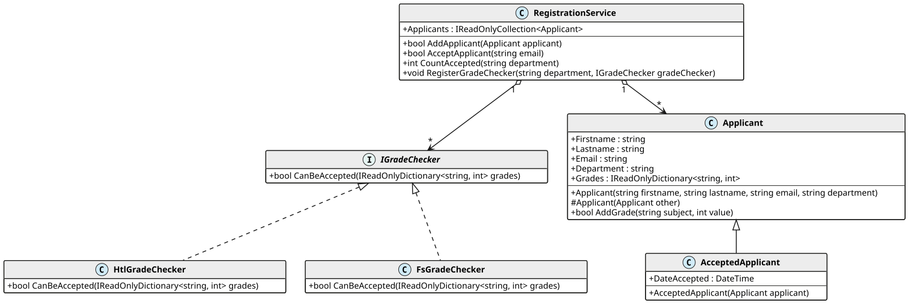

# Ein Anmeldesystem

Im November beginnen die Bewerbungen für einen Schulplatz an unserer Schule. Schülerinnen und
Schüler der 4. Klasse geben ihre Daten und Noten in ein Aufnahmesystem ein. Danach entscheidet
der Abteilungsvorstand (die Leitung der Abteilung), wer aufgenommen wird.

Für jeden Schultyp (HTL oder Fachschule) gibt es gesetzliche Vorschriften, welche Noten ein
Bewerber haben muss. Erfüllt er sie nicht, muss er eine Aufnahmeprüfung machen. Jede Abteilung
gehört zu einem Schultyp: *HIF* ist z. B. eine HTL-Abteilung, *FIT* eine Fachschule.

Folgendes Modell bildet diesen Sachverhalt vereinfacht ab:



<sup>PlantUML Quelle: [klassenmodell.puml](klassenmodell.puml)</sup>

## Klassenbeschreibung

Private Felder, die du für die Implementierung brauchst, legst du selbst an.

#### Interface IGradeChecker

Ein Grade Checker prüft mit der Methode *CanBeAccepted()*, ob ein Bewerber aufgrund seiner Noten
ohne Prüfung aufgenommen werden darf. Die Methode liefert *true*, wenn das der Fall ist, sonst
*false*.

#### Klasse HtlGradeChecker

Prüft, ob eine Aufnahme in eine HTL ohne Prüfung möglich ist. Die echte Regelung berücksichtigt
auch, aus welcher Schule der Bewerber kommt. Das ist eine Vereinfachung.

- **CanBeAccepted()** liefert *true*, wenn alle übergebenen Noten besser als 4 sind (also den
  Wert 1, 2 oder 3 haben).

#### Klasse FsGradeChecker

Prüft, ob eine Aufnahme in eine Fachschule ohne Prüfung möglich ist. Auch hier ist die echte
Regelung komplizierter.

- **CanBeAccepted()** liefert *true*, wenn alle übergebenen Noten positiv sind (also den Wert 1,
  2, 3 oder 4 haben).

#### Klasse Applicant

Speichert einen Bewerber mit seinen Stammdaten. Alle Properties sind read-only.

- **Applicant(firstname, lastname, email, department)** setzt die Stammdaten. Am Anfang hat der
  Bewerber noch keine Noten.
- **Applicant(Applicant other)** ist ein *Copy-Konstruktor*: Er übernimmt alle Werte von *other*.
  Die Noten kopiert er in ein eigenes, neues Dictionary. Er ist *protected*, denn nur abgeleitete Klassen sollen ihn verwenden.
- **Grades** liefert die Noten. Der Schlüssel ist der Gegenstand (z. B. *"M"*), der Wert ist
  die Note (1 bis 5). Den Wert der Note musst du nicht prüfen.
- **AddGrade()** fügt die Note zu einem internen Dictionary hinzu und liefert *true*. Hat der
  Gegenstand schon eine Note, liefert die Methode *false* und ändert nichts.

#### Klasse AcceptedApplicant

Ein Bewerber, der einen Schulplatz bekommen hat.

- **AcceptedApplicant(Applicant applicant)** übernimmt die Daten des übergebenen Bewerbers mit dem
  Copy-Konstruktor von *Applicant*. *DateAccepted* wird auf die aktuelle Zeit
  (*DateTime.UtcNow*) gesetzt.

#### Klasse RegistrationService

Verwaltet die Bewerber und stellt alle Methoden bereit, die Bewerbungen bearbeiten.

- **Applicants** liefert alle Bewerber, auch die aufgenommenen.
- **RegisterGradeChecker()** speichert den Grade Checker für eine Abteilung (z. B. *"HIF"*) in
  einem internen Dictionary vom Typ *Dictionary&lt;string, IGradeChecker&gt;*. Gibt es für die
  Abteilung schon einen Grade Checker, wird er ersetzt.
- **AddApplicant()** fügt den Bewerber zur internen Collection hinzu.
  - Pro E-Mail-Adresse darf es nur eine Bewerbung geben. Stelle das z. B. mit einem Dictionary
    sicher.
  - Liefert *true*, wenn der Bewerber hinzugefügt wurde.
  - Liefert *false*, wenn die E-Mail-Adresse schon existiert.
- **AcceptApplicant()** sucht den Bewerber mit der übergebenen E-Mail-Adresse und nimmt ihn auf:
  - Gibt es die E-Mail-Adresse nicht, liefert die Methode *false*.
  - Ist der Bewerber schon aufgenommen (der Eintrag ist ein *AcceptedApplicant*), liefert sie
    *false*.
  - Danach sucht sie den Grade Checker für die Abteilung des Bewerbers. Liefert dessen
    *CanBeAccepted()* den Wert *false*, liefert auch *AcceptApplicant()* *false*.
  - Gibt es für die Abteilung keinen Grade Checker, entfällt die Prüfung der Noten.
  - Am Ende wird der Bewerber durch eine neue Instanz von *AcceptedApplicant* ersetzt und die
    Methode liefert *true*. Hinweis: Setze den neuen Wert einfach über den Indexer des
    Dictionaries.
- **CountAccepted()** liefert die Anzahl der aufgenommenen Bewerber (*AcceptedApplicant*) einer
  Abteilung.

## Durchzuführende Arbeiten

Öffne die Solution *RegistrationSystem.sln* in diesem Ordner. Lege jede Klasse in einer eigenen
Datei an. Die Dateien *Program.cs* und *TestHelpers.cs* darfst du nicht ändern.

*Program.cs* ist ein Testprogramm. Es kompiliert erst, wenn alle Klassen mit allen Properties und
Methoden aus dem Modell existieren. Lege daher zuerst alle Klassen an und lass die Methoden eine
*NotImplementedException* werfen. Danach startest du das Programm im Ordner
*RegistrationSystem.Application* mit `dotnet run`. Es zeigt dir bei jeder Prüfung *OK* oder
*FAILED*. Wirft eine Prüfung eine Exception, gilt sie als nicht erfüllt. Eine Exception außerhalb
einer Prüfung (z. B. beim Anlegen der Testdaten) beendet das Programm. Programme, die nicht
kompilieren oder abstürzen, werden mit *Nicht genügend* bewertet.

Eine vollständige Lösung liefert folgende Ausgabe:

```text
Checking class implementation
   (1) OK: Applicant does not have a default constructor.
   (2) OK: The copy constructor of Applicant is protected.
   (3) OK: AcceptedApplicant does not have a default constructor.
   (4) OK: AcceptedApplicant extends Applicant.
   (5) OK: All properties of RegistrationService are read-only.
   (6) OK: All properties of Applicant are read-only.
   (7) OK: All properties of AcceptedApplicant are read-only.
   (8) OK: IGradeChecker is an interface.
   (9) OK: HtlGradeChecker implements IGradeChecker.
   (10) OK: FsGradeChecker implements IGradeChecker.
   (11) OK: Applicant.Grades is IReadOnlyDictionary<string, int>.
   (12) OK: RegistrationService.Applicants is IReadOnlyCollection<Applicant>.
Checking grade checkers
   (13) OK: HtlGradeChecker.CanBeAccepted returns the correct result.
   (14) OK: FsGradeChecker.CanBeAccepted returns the correct result.
   (15) OK: HtlGradeChecker.CanBeAccepted checks the grades of all subjects.
   (16) OK: FsGradeChecker.CanBeAccepted checks the grades of all subjects.
Checking applicants
   (17) OK: Constructor of Applicant sets the values.
   (18) OK: Applicant.AddGrade adds the grades and returns true.
   (19) OK: Applicant.AddGrade rejects a subject that already has a grade.
   (20) OK: Constructor of AcceptedApplicant copies the values.
   (21) OK: Constructor of AcceptedApplicant sets DateAccepted to DateTime.UtcNow.
   (22) OK: Each AcceptedApplicant gets its own DateAccepted.
   (23) OK: The copy constructor copies the grades into a new dictionary.
Checking RegistrationService
   (24) OK: RegistrationService.AddApplicant returns true for a new email.
   (25) OK: RegistrationService.Applicants contains all applicants.
   (26) OK: RegistrationService.AddApplicant rejects an existing email.
   (27) OK: RegistrationService.AcceptApplicant accepts an applicant with sufficient grades.
   (28) OK: RegistrationService.AcceptApplicant replaces the applicant with an AcceptedApplicant.
   (29) OK: RegistrationService.AcceptApplicant returns false if the email does not exist.
   (30) OK: RegistrationService.AcceptApplicant returns false if the applicant is already accepted.
   (31) OK: RegistrationService.AcceptApplicant returns false if the grades are not sufficient for the HTL.
   (32) OK: RegistrationService.AcceptApplicant uses the grade checker of the department (FS).
   (33) OK: RegistrationService.AcceptApplicant ignores the grades if no grade checker is registered for the department.
   (34) OK: RegistrationService.CountAccepted counts the accepted applicants of a department.
   (35) OK: RegistrationService.RegisterGradeChecker replaces an existing grade checker.

Result of the program in C:\...\RegistrationSystem.Application:
35 of 35 checks passed.
51 of 51 points. Grade: Sehr gut.
```
