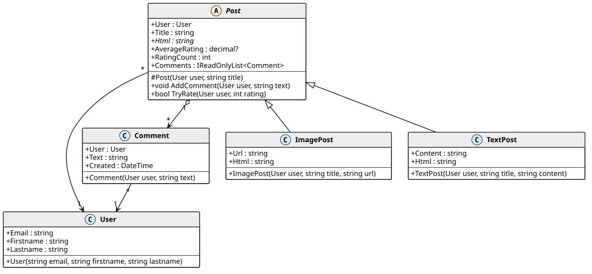

# Ein Blog

Das folgende Klassenmodell zeigt ein kleines Blogsystem. User können Text- und Bildposts
erstellen. User können Posts kommentieren und mit 1 bis 5 bewerten (*Rating*). Auch der Autor
darf seinen eigenen Post bewerten. Die Kommentare werden in einer Liste gespeichert.



<sup>PlantUML Quelle: [klassendiagramm.puml](klassendiagramm.puml)</sup>

## Klassenbeschreibung

Private Felder, die du für die Implementierung brauchst, legst du selbst an. Alle Properties
in allen Klassen sind read-only.

#### Klasse User

Eine reine Datenklasse für die Userdaten. Der Konstruktor setzt alle Properties.

#### Klasse Comment

Speichert einen Kommentar.

- **Comment()** setzt *User* und *Text*. *Created* wird auf die aktuelle Zeit (*DateTime.UtcNow*)
  gesetzt.

#### Klasse Post

Die abstrakte Basisklasse für alle Posts.

- **Html** ist ein abstraktes Property. Es liefert den Post als HTML-String.
- **Comments** liefert alle Kommentare des Posts in der Reihenfolge, in der sie hinzugefügt wurden.
- **AddComment()** erzeugt einen neuen Kommentar und fügt ihn zur internen Liste der Kommentare
  hinzu.
- **TryRate()** versucht, ein Rating hinzuzufügen. Dabei gelten folgende Regeln:
  - Pro E-Mail-Adresse eines Users darf es nur ein Rating geben. Stelle das z. B. mit einem
    Dictionary sicher.
  - Hat ein User mit dieser E-Mail-Adresse schon bewertet, liefert die Methode *false*.
  - Ist das Rating kleiner als 1 oder größer als 5, liefert die Methode *false*.
  - Sonst wird das Rating gespeichert und die Methode liefert *true*.
- **RatingCount** liefert die Anzahl der abgegebenen Ratings.
- **AverageRating** liefert den Durchschnitt aller Ratings als *decimal*, ohne zu runden (die
  Ratings 2 und 3 ergeben 2.5). Gibt es noch kein Rating, liefert das Property *null*.

#### Klasse ImagePost

Ein Post, der aus einem Bild besteht.

- **Html** liefert ein HTML-Element mit dem Aufbau ``. Ersetze *(Url)* durch
  den Wert von *Url*. Hinweis: Anführungszeichen musst du im String mit einem Backslash escapen
  (`\"`).

#### Klasse TextPost

Ein Post, der aus Text besteht.

- **Html** liefert HTML mit dem Aufbau `<h1>(Title)</h1><p>(Content)</p>`. Ersetze *(Title)* und
  *(Content)* durch die Werte der Properties.

## Durchzuführende Arbeiten

Öffne die Solution *BlogManager.sln* in diesem Ordner. Lege jede Klasse in einer eigenen
Datei an. Die Dateien *Program.cs* und *TestHelpers.cs* darfst du nicht ändern.

*Program.cs* ist ein Testprogramm. Es kompiliert erst, wenn alle Klassen mit allen Properties und
Methoden aus dem Modell existieren. Lege daher zuerst alle Klassen an und lass die Methoden eine
*NotImplementedException* werfen. Danach startest du das Programm im Ordner
*BlogManager.Application* mit `dotnet run`. Es zeigt dir bei jeder Prüfung *OK* oder
*FAILED*. Wirft eine Prüfung eine Exception, gilt sie als nicht erfüllt. Eine Exception außerhalb
einer Prüfung (z. B. beim Anlegen der Testdaten) beendet das Programm. Programme, die nicht
kompilieren oder abstürzen, werden mit *Nicht genügend* bewertet.

Eine vollständige Lösung liefert folgende Ausgabe:

```text
Checking class implementation
   (1) OK: User does not have a default constructor.
   (2) OK: User is immutable.
   (3) OK: Comment does not have a default constructor.
   (4) OK: Comment is immutable.
   (5) OK: Post does not have a default constructor.
   (6) OK: Post is immutable.
   (7) OK: ImagePost does not have a default constructor.
   (8) OK: ImagePost is immutable.
   (9) OK: TextPost does not have a default constructor.
   (10) OK: TextPost is immutable.
   (11) OK: Post is abstract.
   (12) OK: Post has a protected constructor.
   (13) OK: Post.Comments is IReadOnlyList<Comment>.
   (14) OK: Post.AverageRating is decimal?.
   (15) OK: Post.Html is abstract.
Checking constructors
   (16) OK: Constructor of User sets the values.
   (17) OK: Constructor of ImagePost sets the values.
   (18) OK: Constructor of TextPost sets the values.
   (19) OK: A new post has no comments and no ratings.
Checking HTML output
   (20) OK: ImagePost.Html returns the correct HTML string.
   (21) OK: TextPost.Html returns the correct HTML string.
Checking comments
   (22) OK: Post.AddComment adds the comments in the correct order.
   (23) OK: Each post has its own comments.
   (24) OK: Constructor of Comment sets Created to DateTime.UtcNow.
Checking ratings
   (25) OK: Post.TryRate rejects invalid values.
   (26) OK: Post.TryRate adds a rating.
   (27) OK: Post.TryRate accepts the rating 5.
   (28) OK: Post.TryRate returns false if the email has already rated.
Checking AverageRating
   (29) OK: Post.AverageRating is null if there is no rating.
   (30) OK: Post.AverageRating returns the average of the ratings (2 and 3).
   (31) OK: Post.AverageRating returns the average of the ratings (2, 3, 1 and 3).
   (32) OK: Post.AverageRating is not rounded (1, 1 and 2 give 1.3333...).

Result of the program in C:\...\BlogManager.Application:
32 of 32 checks passed.
40 of 40 points. Grade: Sehr gut.
```
