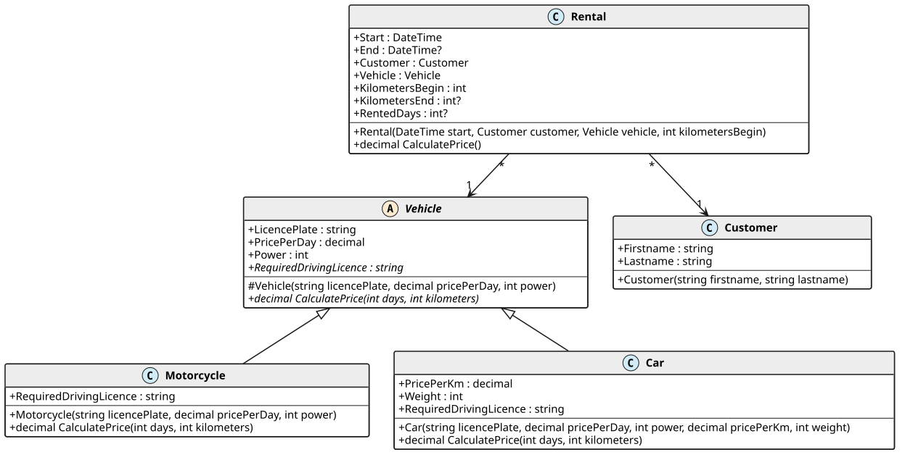

# Ein Autoverleih

Ein Autoverleih vermietet Motorräder und Autos. Bei Motorrädern wird ein Preis pro Tag verrechnet.
Bei Autos werden zusätzlich die gefahrenen Kilometer verrechnet. Das folgende Klassenmodell zeigt
eine einfache Umsetzung.



<sup>PlantUML Quelle: [klassenmodell.puml](klassenmodell.puml)</sup>

## Klassenbeschreibung

Private Felder, die du für die Implementierung brauchst, legst du selbst an.

#### Klasse Vehicle

Die abstrakte Basisklasse für Autos und Motorräder. Alle Properties sind read-only.

- **LicencePlate** ist die Nummerntafel (das Kennzeichen) des Fahrzeuges.
- **PricePerDay** ist der Mietpreis für jeden begonnenen Tag.
- **Power** ist die Leistung des Fahrzeuges in kW.
- **RequiredDrivingLicence** ist ein abstraktes Property. Es gibt an, welche Führerscheinklasse
  man für das Fahrzeug braucht.
- **CalculatePrice()** ist eine abstrakte Methode. Sie berechnet den Preis aus den Miettagen und
  den gefahrenen Kilometern.

#### Klasse Motorcycle

Alle Properties sind read-only.

- **RequiredDrivingLicence** liefert immer *"A"*.
- **CalculatePrice()** berechnet den Preis mit der Formel *Tage × PricePerDay*.

#### Klasse Car

Alle Properties sind read-only.

- **PricePerKm** ist der Preis pro gefahrenem Kilometer.
- **Weight** ist das Gewicht in kg.
- **RequiredDrivingLicence** liefert *"B"*, wenn das Auto weniger als 3500 kg wiegt. Sonst
  liefert es *"C"* (LKW).
- **CalculatePrice()** berechnet den Preis mit der Formel
  *Tage × PricePerDay + Kilometer × PricePerKm*.

#### Klasse Customer

Eine reine Datenklasse mit Vor- und Nachname des Kunden. Der Konstruktor setzt alle Properties.
Alle Properties sind read-only.

#### Klasse Rental

Speichert einen Mietvorgang. *Start*, *Customer*, *Vehicle* und *KilometersBegin* sind
read-only. *End* und *KilometersEnd* werden bei der Rückgabe von außen gesetzt.

- **Start** ist der Beginn der Miete.
- **KilometersBegin** ist der Kilometerstand am Beginn der Miete.
- **End** ist das Ende der Miete. Es ist *null*, solange das Fahrzeug nicht zurückgegeben wurde.
- **KilometersEnd** ist der Kilometerstand am Ende der Miete. Es ist *null*, solange das
  Fahrzeug nicht zurückgegeben wurde.
- **RentedDays** ist die Anzahl der begonnenen Tage. Ist *End* *null*, ist auch *RentedDays*
  *null*. Hinweis: Wenn *start* und *end* vom Typ *DateTime* (nicht *DateTime?*) sind, kannst du
  die Tage mit `(int)(end - start).TotalDays + 1` berechnen.
- **CalculatePrice()**
  - liefert 0, wenn *End* *null* ist.
  - liefert 0, wenn *KilometersEnd* *null* ist.
  - liefert sonst das Ergebnis von *CalculatePrice()* des gemieteten Fahrzeuges. Übergib dabei
    *RentedDays* und die gefahrenen Kilometer (*KilometersEnd − KilometersBegin*).

## Durchzuführende Arbeiten

Öffne die Solution *CarRentalService.sln* in diesem Ordner. Lege jede Klasse in einer eigenen
Datei an. Die Dateien *Program.cs* und *TestHelpers.cs* darfst du nicht ändern.

*Program.cs* ist ein Testprogramm. Es kompiliert erst, wenn alle Klassen mit allen Properties und
Methoden aus dem Modell existieren. Lege daher zuerst alle Klassen an und lass die Methoden eine
*NotImplementedException* werfen. Danach startest du das Programm im Ordner
*CarRentalService.Application* mit `dotnet run`. Es zeigt dir bei jeder Prüfung *OK* oder
*FAILED*. Wirft eine Prüfung eine Exception, gilt sie als nicht erfüllt. Eine Exception außerhalb
einer Prüfung (z. B. beim Anlegen der Testdaten) beendet das Programm. Programme, die nicht
kompilieren oder abstürzen, werden mit *Nicht genügend* bewertet.

Eine vollständige Lösung liefert folgende Ausgabe:

```text
Checking class implementation
   (1) OK: Rental does not have a default constructor.
   (2) OK: Rental.Start is read-only.
   (3) OK: Rental.Customer is read-only.
   (4) OK: Rental.Vehicle is read-only.
   (5) OK: Rental.KilometersBegin is read-only.
   (6) OK: Rental.RentedDays is read-only.
   (7) OK: Rental.End, KilometersEnd and RentedDays are nullable.
   (8) OK: Customer does not have a default constructor.
   (9) OK: Customer is immutable.
   (10) OK: Vehicle does not have a default constructor.
   (11) OK: Vehicle is abstract.
   (12) OK: Vehicle has a protected constructor.
   (13) OK: Vehicle is immutable.
   (14) OK: Vehicle.PricePerDay is decimal and Vehicle.Power is int.
   (15) OK: Vehicle.RequiredDrivingLicence is abstract.
   (16) OK: Vehicle.CalculatePrice() is abstract.
   (17) OK: Motorcycle does not have a default constructor.
   (18) OK: Motorcycle is immutable.
   (19) OK: Car does not have a default constructor.
   (20) OK: Car is immutable.
   (21) OK: Car.PricePerKm is decimal and Car.Weight is int.
Checking constructors
   (22) OK: Constructor of Customer sets the values.
   (23) OK: Constructor of Motorcycle sets the values.
   (24) OK: Constructor of Car sets the values.
   (25) OK: Constructor of Rental sets the values.
Checking Motorcycle
   (26) OK: The required driving licence for motorcycles is A.
   (27) OK: Motorcycle.CalculatePrice() returns days x PricePerDay.
Checking Car
   (28) OK: The required driving licence for cars < 3500 kg is B.
   (29) OK: Car.CalculatePrice() returns days x PricePerDay + km x PricePerKm.
   (30) OK: The required driving licence for cars >= 3500 kg is C.
Checking Rental
   (31) OK: The default value of Rental.KilometersEnd is null.
   (32) OK: The default value of Rental.End is null.
   (33) OK: Without an end date Rental.RentedDays is null.
   (34) OK: Without End and KilometersEnd Rental.CalculatePrice() returns 0.
   (35) OK: Rental.RentedDays returns the number of days started.
   (36) OK: Without KilometersEnd Rental.CalculatePrice() returns 0.
   (37) OK: Rental.CalculatePrice() uses the driven kilometers.
   (38) OK: Without End Rental.CalculatePrice() returns 0.
   (39) OK: Rental.RentedDays is 1 if the vehicle is returned on the same day.
   (40) OK: Rental.RentedDays works across the end of a month.
   (41) OK: Rental.RentedDays works across the end of a year.
   (42) OK: Rental.CalculatePrice() charges the days if no kilometers were driven.
   (43) OK: Rental.CalculatePrice() uses the price calculation of the rented vehicle.

Result of the program in C:\...\CarRentalService.Application:
43 of 43 checks passed.
48 of 48 points. Grade: Sehr gut.
```
