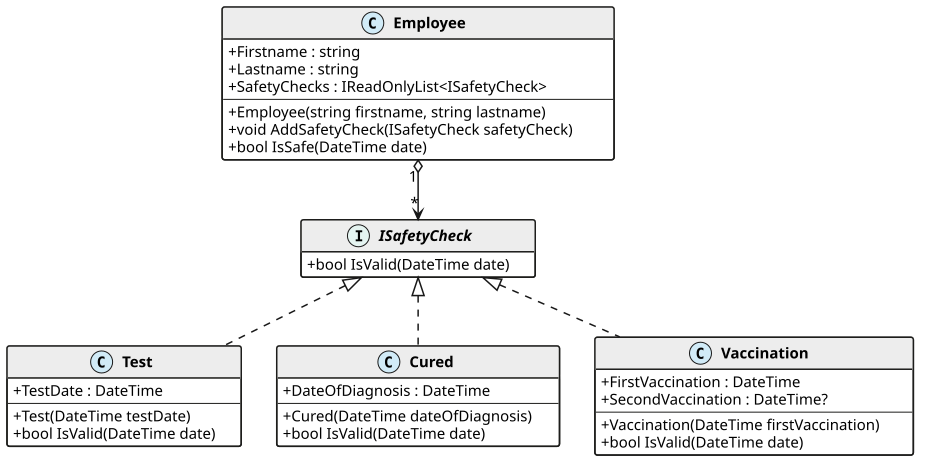

# Health Checker

Ab November 2021 mussten Beschäftigte in Österreich am Arbeitsplatz einen COVID-Nachweis
vorlegen („3G am Arbeitsplatz“: geimpft, genesen oder getestet). Folgende Nachweise wurden
akzeptiert:

- Ein Impfnachweis, bei dem die 2. Dosis schon verabreicht wurde.
- Ein Genesungsnachweis.
- Ein Testnachweis.

Die verschiedenen Testarten und Impfstoffe berücksichtigen wir zur Vereinfachung nicht. Das
folgende Klassenmodell zeigt eine mögliche Umsetzung:



<sup>PlantUML Quelle: [klassenmodell.puml](klassenmodell.puml)</sup>

## Klassenbeschreibung

Private Felder, die du für die Implementierung brauchst, legst du selbst an. Alle Methoden
*IsValid(date)* bekommen den Zeitpunkt der Prüfung im Parameter *date*. Verwende also nie die
aktuelle Systemzeit. Ein Nachweis mit genau dem Zeitpunkt *date* liegt nicht in der Zukunft.

#### Interface ISafetyCheck

Ein Nachweis. *IsValid()* liefert *true*, wenn der Nachweis zum übergebenen Zeitpunkt gültig ist.

#### Klasse Test

Ein Testnachweis. Alle Properties sind read-only.

- **IsValid(date)** prüft, ob der Test zum Zeitpunkt *date* gültig ist.
  - Liegt *TestDate* nach *date* (in der Zukunft), liefert die Methode *false*.
  - Ist der Test älter als 48 Stunden, liefert die Methode *false*. Ein Test, der genau 48 Stunden
    alt ist, ist noch gültig. Hinweis: Verwende *DateTime.AddHours()*.
  - Sonst liefert die Methode *true*.

#### Klasse Cured

Ein Genesungsnachweis. Alle Properties sind read-only.

- **IsValid(date)** prüft, ob der Nachweis zum Zeitpunkt *date* gültig ist.
  - Liegt *DateOfDiagnosis* nach *date* (in der Zukunft), liefert die Methode *false*.
  - Ist die Diagnose älter als 90 Tage, liefert die Methode *false*. Genau 90 Tage sind noch
    gültig. Hinweis: Verwende *DateTime.AddDays()*.
  - Sonst liefert die Methode *true*.

#### Klasse Vaccination

Ein Impfnachweis. *FirstVaccination* ist read-only.

- **SecondVaccination** ist am Anfang *null*. Das Property kann von außen gesetzt werden, es gelten
  aber zwei Regeln:
  - Der Wert muss nach *FirstVaccination* liegen. Derselbe Zeitpunkt ist nicht erlaubt.
  - Wurde der Wert schon einmal gesetzt, kann er nicht mehr geändert werden.

  Verletzt eine Zuweisung eine dieser Regeln, wird sie ignoriert. Es wird also keine Exception
  geworfen.
- **IsValid(date)** prüft, ob die Impfung zum Zeitpunkt *date* gültig ist.
  - Gibt es keine zweite Impfung, liefert die Methode *false*.
  - Liegt die zweite Impfung nach *date* (in der Zukunft), liefert die Methode *false*.
  - Ist die zweite Impfung älter als 360 Tage, liefert die Methode *false*. Genau 360 Tage sind
    noch gültig.
  - Sonst liefert die Methode *true*.

#### Klasse Employee

Alle Properties sind read-only.

- **SafetyChecks** liefert alle Nachweise des Mitarbeiters.
- **AddSafetyCheck(safetyCheck)** fügt einen Nachweis zur internen Liste hinzu.
- **IsSafe(date)** liefert *true*, wenn mindestens ein Nachweis zum Zeitpunkt *date* gültig ist.

## Durchzuführende Arbeiten

Öffne die Solution *HealthChecker.sln* in diesem Ordner. Lege jede Klasse in einer eigenen
Datei an. Die Dateien *Program.cs* und *TestHelpers.cs* darfst du nicht ändern.

*Program.cs* ist ein Testprogramm. Es kompiliert erst, wenn alle Klassen mit allen Properties und
Methoden aus dem Modell existieren. Lege daher zuerst alle Klassen an und lass die Methoden eine
*NotImplementedException* werfen. Danach startest du das Programm im Ordner
*HealthChecker.Application* mit `dotnet run`. Es zeigt dir bei jeder Prüfung *OK* oder
*FAILED*. Wirft eine Prüfung eine Exception, gilt sie als nicht erfüllt. Eine Exception außerhalb
einer Prüfung (z. B. beim Anlegen der Testdaten) beendet das Programm. Programme, die nicht
kompilieren oder abstürzen, werden mit *Nicht genügend* bewertet.

Eine vollständige Lösung liefert folgende Ausgabe:

```text
Checking class implementation
   (1) OK: Employee does not have a default constructor.
   (2) OK: Employee is immutable.
   (3) OK: Employee.SafetyChecks is IReadOnlyList<ISafetyCheck>.
   (4) OK: ISafetyCheck is an interface.
   (5) OK: Test does not have a default constructor.
   (6) OK: Test is immutable.
   (7) OK: Test implements ISafetyCheck.
   (8) OK: Cured does not have a default constructor.
   (9) OK: Cured is immutable.
   (10) OK: Cured implements ISafetyCheck.
   (11) OK: Vaccination does not have a default constructor.
   (12) OK: Vaccination implements ISafetyCheck.
   (13) OK: Vaccination.FirstVaccination is read-only.
   (14) OK: Vaccination.SecondVaccination is DateTime?.
Checking constructors
   (15) OK: Constructor of Employee sets the values.
   (16) OK: Constructor of Test sets the values.
   (17) OK: Constructor of Cured sets the values.
   (18) OK: Constructor of Vaccination sets the values.
Checking Vaccination
   (19) OK: Only 1 vaccination is not a valid proof.
   (20) OK: Vaccination.SecondVaccination can be set.
   (21) OK: Vaccination.IsValid returns true with valid values.
   (22) OK: Vaccination.SecondVaccination cannot be overwritten.
   (23) OK: Vaccination.SecondVaccination cannot be overwritten with an earlier date.
   (24) OK: Vaccination.SecondVaccination cannot be reset to null.
   (25) OK: The vaccination expires after 360 days.
   (26) OK: The vaccination is valid exactly 360 days after the second vaccination.
   (27) OK: Vaccination.IsValid uses the date of the second vaccination.
   (28) OK: Vaccination.SecondVaccination must be after FirstVaccination.
   (29) OK: Vaccination.SecondVaccination cannot be the same date as FirstVaccination.
   (30) OK: Vaccination.SecondVaccination can be set after an ignored assignment.
   (31) OK: Vaccination.IsValid returns false if the second vaccination is in the future.
   (32) OK: Vaccination.IsValid returns true at the time of the second vaccination.
Checking Cured
   (33) OK: Cured.IsValid returns true with a valid date.
   (34) OK: Cured.IsValid returns false with an expired date.
   (35) OK: Cured.IsValid returns false if the date of diagnosis is in the future.
   (36) OK: Cured.IsValid returns true exactly 90 days and 0 days after the diagnosis.
   (37) OK: Cured.IsValid returns false 90 days and 1 hour after the diagnosis.
Checking Test
   (38) OK: Test.IsValid returns true with a valid date.
   (39) OK: Test.IsValid returns false if the test is expired.
   (40) OK: Test.IsValid returns false if the test date is in the future.
   (41) OK: Test.IsValid returns true exactly 48 hours and 0 hours after the test.
Checking Employee
   (42) OK: Employee.IsSafe returns false if there is no safety check.
   (43) OK: Employee.IsSafe returns false if there is only an expired safety check.
   (44) OK: Employee.AddSafetyCheck adds the safety check.
   (45) OK: Employee.IsSafe returns true if there is a valid safety check.
   (46) OK: Employee.IsSafe returns true if any safety check is valid (not only the last one).
   (47) OK: Employee.IsSafe uses the passed date.

Result of the program in C:\...\HealthChecker.Application:
47 of 47 checks passed.
65 of 65 points. Grade: Sehr gut.
```
