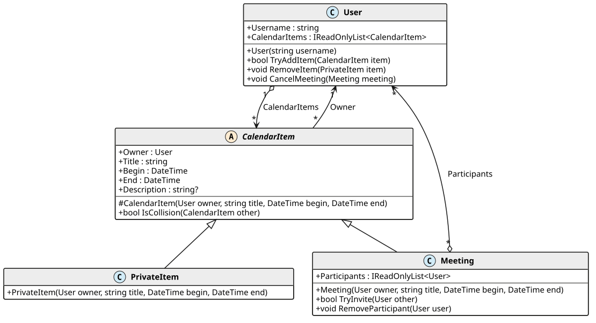

# Ein Kalendersystem

Das folgende Modell zeigt ein kleines Kalendersystem für User. Es gibt 2 Arten von Terminen:
private Termine und Meetings. Zu Meetings kann der Eigentümer andere User als Teilnehmer einladen.
Beim Hinzufügen eines Termines wird immer geprüft, ob er sich mit einem anderen Termin
überschneidet (*Kollision*).



<sup>PlantUML Quelle: [klassendiagramm.puml](klassendiagramm.puml)</sup>

## Klassenbeschreibung

Private Felder, die du für die Implementierung brauchst, legst du selbst an.

#### Klasse CalendarItem

Die abstrakte Basisklasse für alle Kalendereinträge. *Owner*, *Title*, *Begin* und *End* sind
read-only. *Description* ist nullable und kann auch nachträglich von außen gesetzt werden.

- **IsCollision(other)** prüft, ob sich der andere Termin mit diesem Termin überschneidet.
  - Endet der andere Termin spätestens dann, wenn dieser Termin beginnt, gibt es keine
    Kollision. Die Methode liefert *false*.
  - Beginnt der andere Termin frühestens dann, wenn dieser Termin endet, gibt es auch keine
    Kollision. Die Methode liefert *false*.
  - In allen anderen Fällen liefert die Methode *true*.

#### Klasse PrivateItem

Ein privater Termin. Die Klasse hat keine eigenen Daten. Ihr Typ legt die Art des Termines fest:
*User.RemoveItem()* darf nur private Termine löschen, und das stellt der Parametertyp
*PrivateItem* schon beim Kompilieren sicher.

#### Klasse Meeting

Ein Meeting. Es hat eine Liste der eingeladenen User (*Participants*). Der Eigentümer (*Owner*)
steht nicht in dieser Liste.

- **Meeting()** setzt nur die Werte. Der Eigentümer trägt das Meeting danach selbst mit
  *TryAddItem()* in seinen Kalender ein.

- **TryInvite(other)** lädt den übergebenen User ein:
  - Das Meeting wird mit *TryAddItem()* in den Kalender des anderen Users eingetragen. Gelingt das
    nicht (der andere User ist zu dieser Zeit belegt), liefert die Methode *false* und ändert
    nichts.
  - Ist der User schon eingeladen, liefert die Methode *false* und ändert nichts.
  - Sonst wird der User zur Liste der Teilnehmer hinzugefügt und die Methode liefert *true*.
- **RemoveParticipant()** entfernt den übergebenen User aus der Liste der Teilnehmer.

#### Klasse User

Repräsentiert den Kalender eines Users. *Username* und *CalendarItems* sind read-only.

- **TryAddItem()** fügt den übergebenen Termin nach folgenden Regeln zur Liste der
  Kalendereinträge (*CalendarItems*) hinzu:
  - Ist der Termin kein Meeting, muss der Eigentümer (*Owner*) dieser User sein. Sonst liefert
    die Methode *false*. So kann niemand private Termine anderer User eintragen. Ein Meeting
    eines anderen Users darf eingetragen werden (Einladung).
  - Kollidiert der Termin mit einem vorhandenen Termin (auch mit einem Meeting), liefert die
    Methode *false*. Ein Termin, der schon im Kalender steht, kollidiert mit sich selbst.
  - Sonst wird der Termin hinzugefügt und die Methode liefert *true*.
- **RemoveItem()** löscht den übergebenen privaten Termin aus der Liste der Kalendereinträge.
- **CancelMeeting()** sagt ein Meeting ab:
  - Ist der User der Eigentümer des Meetings, wird das Meeting aus seinem Kalender und aus dem
    Kalender aller Teilnehmer gelöscht. Es findet ja nicht statt.
  - Ist der User nur Teilnehmer, wird das Meeting nur aus seinem eigenen Kalender gelöscht. Bei
    den anderen Teilnehmern und beim Eigentümer bleibt das Meeting im Kalender. Der User wird
    außerdem aus der Liste der Teilnehmer entfernt.

## Durchzuführende Arbeiten

Öffne die Solution *TeamCalendar.sln* in diesem Ordner. Lege jede Klasse in einer eigenen
Datei an. Die Dateien *Program.cs* und *TestHelpers.cs* darfst du nicht ändern.

*Program.cs* ist ein Testprogramm. Es kompiliert erst, wenn alle Klassen mit allen Properties und
Methoden aus dem Modell existieren. Lege daher zuerst alle Klassen an und lass die Methoden eine
*NotImplementedException* werfen. Danach startest du das Programm im Ordner
*TeamCalendar.Application* mit `dotnet run`. Es zeigt dir bei jeder Prüfung *OK* oder
*FAILED*. Wirft eine Prüfung eine Exception, gilt sie als nicht erfüllt. Eine Exception außerhalb
einer Prüfung (z. B. beim Anlegen der Testdaten) beendet das Programm. Programme, die nicht
kompilieren oder abstürzen, werden mit *Nicht genügend* bewertet.

Eine vollständige Lösung liefert folgende Ausgabe:

```text
Checking class implementation
   (1) OK: User does not have a default constructor.
   (2) OK: User is immutable.
   (3) OK: CalendarItem does not have a default constructor.
   (4) OK: PrivateItem does not have a default constructor.
   (5) OK: Meeting does not have a default constructor.
   (6) OK: CalendarItem is abstract.
   (7) OK: CalendarItem has a protected constructor.
   (8) OK: CalendarItem.Owner, Title, Begin and End are read-only.
   (9) OK: User.CalendarItems is IReadOnlyList<CalendarItem>.
   (10) OK: Meeting.Participants is IReadOnlyList<User>.
Checking constructors
   (11) OK: Constructor of User sets the values.
   (12) OK: Constructor of Meeting sets the values.
   (13) OK: Constructor of Meeting does not add the meeting to the calendar of the owner.
   (14) OK: CalendarItem.Description can be set.
Checking CalendarItem.IsCollision
   (15) OK: CalendarItem.IsCollision detects overlapping items.
   (16) OK: CalendarItem.IsCollision detects an item inside another item.
   (17) OK: CalendarItem.IsCollision detects an item with the same time.
   (18) OK: CalendarItem.IsCollision returns false if the items do not overlap.
   (19) OK: CalendarItem.IsCollision returns false if one item ends when the other begins.
Checking User.TryAddItem
   (20) OK: User.TryAddItem adds the item to CalendarItems.
   (21) OK: User.TryAddItem rejects a collision.
   (22) OK: User.TryAddItem adds an item that begins when another item ends.
   (23) OK: User.TryAddItem compares the item with all items in the calendar.
   (24) OK: User.TryAddItem rejects an item that is already in the calendar.
   (25) OK: User.TryAddItem rejects a private item of another user.
   (26) OK: User.TryAddItem accepts a meeting of another user.
   (27) OK: User.TryAddItem rejects an item that collides with a meeting.
Checking User.RemoveItem
   (28) OK: User.RemoveItem removes only the passed item.
Checking Meeting.TryInvite
   (29) OK: Meeting.TryInvite adds the user to the participants.
   (30) OK: Meeting.TryInvite adds the meeting to the calendar of the user.
   (31) OK: Meeting.TryInvite does not change the calendar of the owner.
   (32) OK: Meeting.TryInvite returns false if the user is busy.
   (33) OK: Meeting.TryInvite returns false if the user is already invited.
   (34) OK: Meeting.RemoveParticipant removes only the passed user.
Checking User.CancelMeeting (participant)
   (35) OK: User.CancelMeeting removes the participant from the meeting.
   (36) OK: User.CancelMeeting removes only the meeting from the calendar of the participant.
   (37) OK: User.CancelMeeting keeps the meeting in the calendar of the owner.
   (38) OK: User.CancelMeeting keeps the meeting in the calendar of the other participant.
Checking User.CancelMeeting (owner)
   (39) OK: User.CancelMeeting removes the meeting from the calendar of the owner.
   (40) OK: User.CancelMeeting removes the meeting from the calendars of all participants.
Checking User.CancelMeeting (several meetings)
   (41) OK: User.CancelMeeting removes only the passed meeting from the calendar of the participant.
   (42) OK: User.CancelMeeting removes only the passed meeting from the calendar of the owner.

Result of the program in C:\...\TeamCalendar.Application:
42 of 42 checks passed.
66 of 66 points. Grade: Sehr gut.
```
