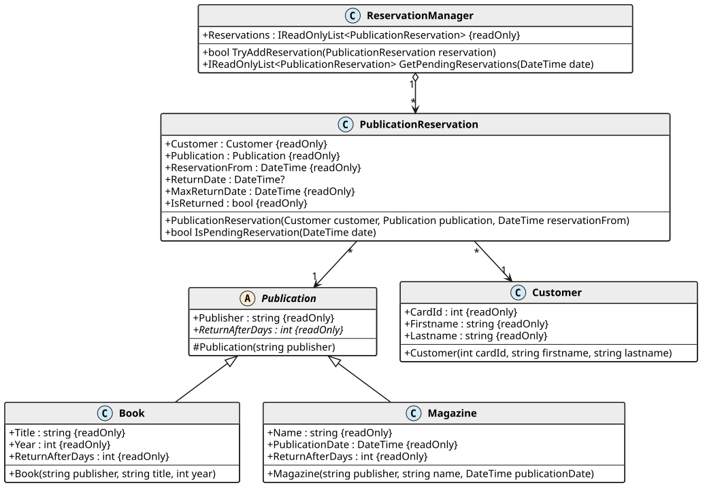

# Entleihsystem für eine Bibliothek

Eine Bibliothek möchte ihren Kunden ein Reservierungssystem anbieten. Jeder Kunde kann ein Buch
oder eine Zeitschrift reservieren. Nach einer bestimmten Frist muss er das Werk zurückgeben.
Versäumt er die Frist, soll er benachrichtigt werden. Ein Kunde kann nur ein Werk gleichzeitig
entleihen. Eine Reservierung (*PublicationReservation*) steht in diesem Modell für eine
Entlehnung: Sie beginnt mit *ReservationFrom* und endet mit der Rückgabe.



<sup>PlantUML Quelle: [modell_1837.puml](modell_1837.puml)</sup>

## Klassenbeschreibung

Private Felder, die du für die Implementierung brauchst, legst du selbst an. *{readOnly}* im
Modell bedeutet, dass das Property von außen nicht gesetzt werden kann.

#### Klasse ReservationManager

- **Reservations** liefert alle Reservierungen in der Reihenfolge, in der sie hinzugefügt wurden.
- **TryAddReservation()** fügt eine Reservierung hinzu.
  - Hat **der betroffene Kunde** (dasselbe *Customer*-Objekt) noch eine Reservierung, deren Werk
    nicht zurückgegeben wurde (*IsReturned* ist *false*), liefert die Methode *false* und fügt
    nichts ein.
  - Sonst fügt sie die Reservierung ein und liefert *true*.
- **GetPendingReservations()** liefert eine Liste aller Reservierungen, die zum übergebenen Datum
  überfällig sind. Verwende dafür die Methode *IsPendingReservation()* der Reservierung.

#### Klasse PublicationReservation

- **Customer** ist der Kunde dieser Reservierung.
- **Publication** ist das reservierte Werk.
- **ReservationFrom** ist der Beginn der Reservierung.
- **ReturnDate** ist *null*, solange das Werk nicht zurückgebracht wurde. Bei der Rückgabe wird
  es von außen auf das Rückgabedatum gesetzt.
- **MaxReturnDate** ist ein berechnetes Property: das späteste Rückgabedatum. Es ergibt sich aus
  *ReservationFrom* und dem Property *ReturnAfterDays* des Werkes. Hinweis: Verwende
  *AddDays()*.
- **IsReturned** ist ein berechnetes Property. Es ist *true*, wenn *ReturnDate* gesetzt ist, sonst
  *false*.
- **IsPendingReservation(date)** liefert *true*, wenn die Reservierung zum Zeitpunkt *date*
  überfällig ist. Das ist der Fall, wenn kein Rückgabedatum gesetzt ist und *date* nach
  *MaxReturnDate* liegt. Am Tag *MaxReturnDate* selbst ist die Reservierung noch nicht
  überfällig.

#### Klasse Customer

Eine reine Datenklasse für den Kunden. Der Konstruktor setzt alle Properties.

#### Klasse Publication

Die abstrakte Basisklasse für alle Werke.

- **Publisher** ist der Verlag.
- **ReturnAfterDays** ist ein abstraktes, berechnetes Property. Es liefert die Anzahl der Tage,
  nach denen das Werk zurückgegeben werden muss.

#### Klasse Book

- **Title** ist der Titel.
- **Year** ist das Erscheinungsjahr.
- **ReturnAfterDays** liefert 14.

#### Klasse Magazine

- **Name** ist der Name der Zeitschrift.
- **PublicationDate** ist der Tag, an dem die Ausgabe erschienen ist.
- **ReturnAfterDays** liefert 7.

## Durchzuführende Arbeiten

Öffne die Solution *LibraryManager.sln* in diesem Ordner. Lege jede Klasse in einer eigenen
Datei an. Die Dateien *Program.cs* und *TestHelpers.cs* darfst du nicht ändern.

*Program.cs* ist ein Testprogramm. Es kompiliert erst, wenn alle Klassen mit allen Properties und
Methoden aus dem Modell existieren. Lege daher zuerst alle Klassen an und lass die Methoden eine
*NotImplementedException* werfen. Danach startest du das Programm im Ordner
*LibraryManager.Application* mit `dotnet run`. Es zeigt dir bei jeder Prüfung *OK* oder
*FAILED*. Wirft eine Prüfung eine Exception, gilt sie als nicht erfüllt. Eine Exception außerhalb
einer Prüfung (z. B. beim Anlegen der Testdaten) beendet das Programm. Programme, die nicht
kompilieren oder abstürzen, werden mit *Nicht genügend* bewertet.

Eine vollständige Lösung liefert folgende Ausgabe:

```text
Checking class implementation
   (1) OK: ReservationManager is immutable.
   (2) OK: ReservationManager.Reservations is IReadOnlyList<PublicationReservation>.
   (3) OK: PublicationReservation does not have a default constructor.
   (4) OK: PublicationReservation.Customer, Publication and ReservationFrom are read-only.
   (5) OK: PublicationReservation.MaxReturnDate and IsReturned are read-only.
   (6) OK: PublicationReservation.ReturnDate is DateTime?.
   (7) OK: Customer does not have a default constructor.
   (8) OK: Customer is immutable.
   (9) OK: Publication does not have a default constructor.
   (10) OK: Publication is abstract.
   (11) OK: Publication has a protected constructor.
   (12) OK: Publication.ReturnAfterDays is abstract.
   (13) OK: Publication is immutable.
   (14) OK: Book does not have a default constructor.
   (15) OK: Book extends Publication.
   (16) OK: Book is immutable.
   (17) OK: Magazine does not have a default constructor.
   (18) OK: Magazine extends Publication.
   (19) OK: Magazine is immutable.
Checking constructors
   (20) OK: Constructor of Customer sets the values.
   (21) OK: Constructor of Book sets the values.
   (22) OK: Constructor of Magazine sets the values.
   (23) OK: Constructor of PublicationReservation sets the values.
Checking Magazine and Book
   (24) OK: Magazine.ReturnAfterDays is 7.
   (25) OK: Book.ReturnAfterDays is 14.
Checking PublicationReservation
   (26) OK: PublicationReservation.MaxReturnDate is correct for books.
   (27) OK: PublicationReservation.MaxReturnDate is correct for magazines.
   (28) OK: PublicationReservation.IsReturned is false if ReturnDate is null.
   (29) OK: PublicationReservation.IsPendingReservation returns false if the date is not too late.
   (30) OK: PublicationReservation.IsPendingReservation returns false on MaxReturnDate.
   (31) OK: PublicationReservation.IsPendingReservation returns true if the date is too late.
   (32) OK: PublicationReservation.IsReturned is true if ReturnDate is set.
   (33) OK: PublicationReservation.MaxReturnDate does not change when ReturnDate is set.
   (34) OK: PublicationReservation.IsPendingReservation returns false if ReturnDate is set (1).
   (35) OK: PublicationReservation.IsPendingReservation returns false if ReturnDate is set (2).
   (36) OK: PublicationReservation.IsPendingReservation returns false if the publication was returned late.
Checking ReservationManager
   (37) OK: A new ReservationManager has no reservations.
   (38) OK: ReservationManager.TryAddReservation adds the first reservation of customer 1.
   (39) OK: ReservationManager.TryAddReservation adds a reservation of customer 2 while customer 1 has a reservation.
   (40) OK: ReservationManager.TryAddReservation rejects a reservation of customer 1 if a publication is not returned.
   (41) OK: ReservationManager.TryAddReservation rejects a reservation of customer 1 before the publication is overdue.
   (42) OK: ReservationManager.GetPendingReservations returns 0 pending reservations on 2000-01-10.
   (43) OK: ReservationManager.GetPendingReservations returns 0 pending reservations on MaxReturnDate (2000-01-15).
   (44) OK: ReservationManager.GetPendingReservations returns 1 pending reservation on 2000-01-20.
   (45) OK: ReservationManager.GetPendingReservations returns 2 pending reservations on 2000-03-20.
   (46) OK: ReservationManager.GetPendingReservations ignores returned publications.
   (47) OK: ReservationManager.TryAddReservation adds a reservation of customer 1 after the publication is returned.
   (48) OK: ReservationManager.Reservations contains the reservations in the order they were added.
   (49) OK: ReservationManager.TryAddReservation rejects customer 1 if a later publication is not returned.
   (50) OK: ReservationManager.TryAddReservation compares the Customer object, not the CardId.

Result of the program in C:\...\LibraryManager.Application:
50 of 50 checks passed.
70 of 70 points. Grade: Sehr gut.
```
