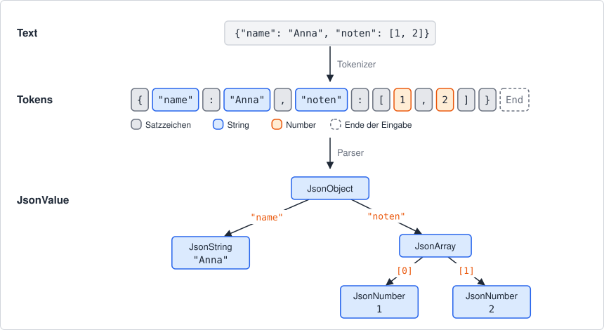

# Ein JSON-Parser

JSON begegnet dir überall: in der *appsettings.json* einer ASP.NET-Core-App, in jeder REST-API
und in vielen Konfigurationsdateien. Im Kapitel *Parser* im Kurs hast du einen rekursiven
Abstiegsparser für arithmetische Ausdrücke kennengelernt. In dieser Übung baust du nach demselben
Muster einen Parser für eine Teilmenge von JSON. Zuerst schreibst du die Grammatik als EBNF,
dann den Tokenizer und zuletzt den Parser. Als Referenz dient die Klasse `JsonDocument` aus
`System.Text.Json`: Die Tests vergleichen dein Ergebnis mit ihrem.



## Aufbau der Solution

Öffne die Solution *JsonParser.sln* in diesem Ordner.

| Projekt | Inhalt |
|---|---|
| *JsonParser.Application* | Class Library. Hier programmierst du. |
| *JsonParser.Tests* | xUnit-Tests und Beispieldateien. Die Tests darfst du nicht ändern. |

In *JsonParser.Application* findest du folgende Dateien:

| Datei | Was du tun musst |
|---|---|
| *Tokenizer.cs* | `Tokenize` implementieren (Schritt 2). |
| *Parser.cs* | `Parse` und `ParseDocument` implementieren (Schritt 3). |
| *Token.cs*, *TokenType.cs* | Vorgegeben, nicht ändern. |
| *JsonParseException.cs* | Vorgegeben, nicht ändern. |
| *Values/\*.cs* | Die Klassen für die JSON-Werte. Vorgegeben, nicht ändern. |

Du darfst private Felder, private Methoden und eigene `internal`-Klassen ergänzen. Die öffentlichen
Signaturen bleiben so, wie sie sind.

## Die JSON-Teilmenge

Die Regeln orientieren sich an echtem JSON (RFC 8259), lassen aber einiges weg. Lies sie genau,
die Tests prüfen jede einzelne.

### Dokument und Werte

- Ein Dokument besteht aus **genau einem Wert**. Davor und danach darf Whitespace stehen, sonst
  nichts. Auch ein einzelner String oder eine einzelne Zahl ist ein gültiges Dokument.
- Ein Wert ist ein Objekt, ein Array, ein String, eine Zahl oder eines der Wörter `true`,
  `false` und `null`. Die drei Wörter gibt es nur in Kleinbuchstaben.
- Ein **Objekt** steht in `{ }` und enthält beliebig viele Paare *Schlüssel: Wert*, getrennt durch
  Kommas. Der Schlüssel ist immer ein String. `{}` ist ein gültiges, leeres Objekt.
- Ein **Array** steht in `[ ]` und enthält beliebig viele Werte, getrennt durch Kommas. `[]` ist
  ein gültiges, leeres Array.
- Kommas stehen nur **zwischen** zwei Elementen. `[1, 2,]`, `{"a": 1,}`, `[,1]` und `[1,,2]` sind
  Fehler.
- Ein Schlüssel darf in einem Objekt **nur einmal** vorkommen. `{"a": 1, "a": 2}` ist ein Fehler.
  In verschiedenen Objekten darf derselbe Schlüssel natürlich vorkommen.

### Strings

- Ein String beginnt und endet mit `"`.
- Dazwischen darf jedes Zeichen ab U+0020 stehen, außer `"` und `\`. Umlaute, `€` und Emojis
  stehen also direkt im String.
- Steuerzeichen (U+0000 bis U+001F) sind im String nicht erlaubt. Ein echter Zeilenumbruch oder
  ein echter Tabulator im String ist daher ein Fehler.
- Es gibt genau vier Escape-Sequenzen: `\"` (Anführungszeichen), `\\` (Backslash), `\n`
  (Zeilenumbruch) und `\t` (Tabulator). Jede andere Sequenz ist ein Fehler, also auch `\/`,
  `\r`, `\b`, `\f` und `\u` mit vier Hexziffern, die es in echtem JSON gibt.

### Zahlen

- Eine Zahl beginnt optional mit `-`. Ein `+` gibt es nicht.
- Danach kommt der ganzzahlige Teil: entweder genau eine `0` oder eine Ziffernfolge, die nicht
  mit `0` beginnt.
- Optional folgt ein `.` mit **mindestens einer** Ziffer dahinter.
- Einen Exponenten gibt es nicht.
- Gültig: `0`, `-0`, `42`, `-17`, `3.14`, `-0.5`, `10.250`, `12345678901234567890`.
- Fehler: `01`, `-01`, `+1`, `.5`, `1.`, `-`, `1e5`, `2.5E-3`.
- Der Wert wird als `decimal` gespeichert. Eine Zahl, die außerhalb des Wertebereichs von
  `decimal` liegt, ist ein Fehler.

### Whitespace

- Zwischen zwei Tokens dürfen beliebig viele Leerzeichen, Tabulatoren, `\n` und `\r` stehen.
  Andere Zeichen (zum Beispiel ein geschütztes Leerzeichen U+00A0) sind kein Whitespace.
- **Innerhalb** eines Tokens gibt es keinen Whitespace: `tr ue` und `- 1` sind Fehler.
- Kommentare gibt es nicht.

## Schritt 1: Die Grammatik als EBNF

Bevor du Code schreibst, hältst du die Regeln oben als EBNF fest. Verwende die Notation aus dem
Kapitel *Darstellungsformen von Grammatiken* im Kurs:

- eine Regel pro Zeile in der Form `name = definition`,
- Verkettung durch Leerzeichen, Terminale in doppelten Anführungszeichen,
- `{ }` für Wiederholung (0- bis n-mal), `[ ]` für optional, `( | )` für Gruppe und Alternative.

Zeichenmengen, die man schlecht aufzählen kann, darfst du zwischen `?` in Worten beschreiben
(*special sequence* aus ISO 14977), zum Beispiel `letter = ? ein Buchstabe von a bis z ?`.

Überlege dir, welche Regeln der **Tokenizer** umsetzt (wie ein einzelnes Token aufgebaut ist)
und welche der **Parser** (wie die Tokens zusammenpassen). Whitespace überspringt der
Tokenizer, er kommt in den Regeln für den Parser also nicht vor. Schreibe zuerst die Regeln für
den Parser und darunter die Regeln für die Tokens.

Trage deine EBNF hier ein:

```text

```

Kontrolle: Jede Regel für den Parser wird in Schritt 3 zu einer Methode. Jede Regel für ein
Token wird in Schritt 2 zu einem Zweig im Tokenizer. Wenn das nicht aufgeht, passt die Grammatik
noch nicht.

## Schritt 2: Der Tokenizer

`Tokenizer.Tokenize(string input)` zerlegt den Text in eine Liste von Tokens. Die Klassen dafür
sind vorgegeben:

```c#
public enum TokenType
{
    LeftBrace, RightBrace, LeftBracket, RightBracket, Colon, Comma,
    String, Number, True, False, Null, End
}

public sealed record Token(TokenType Type, string Text, int Position, int Line, int Column);
```

- `Position` ist der Index des ersten Zeichens des Tokens im Eingabetext (ab 0).
- `Line` und `Column` geben dieselbe Stelle als Zeile und Spalte an (beide ab 1, siehe unten).
- `Text` hängt vom Typ ab:

| Typ | `Text` | Beispiel: Eingabe → `Text` |
|---|---|---|
| `String` | Inhalt **ohne** Anführungszeichen, Escapes aufgelöst | `"a\"b"` → `a"b` |
| `Number` | Die Zahl genau so, wie sie im Text steht | `-0.50` → `-0.50` |
| `End` | Leerer String | |
| alle anderen | Die Zeichen des Tokens | `{` → `{`, `true` → `true` |

Whitespace erzeugt keine Tokens. Das letzte Token ist **immer** `End` an der Position
`input.Length`, auch bei einer leeren Eingabe.

Der Tokenizer prüft nur, ob jedes einzelne Token gültig ist. Ob die Tokens in einer sinnvollen
Reihenfolge stehen, ist Aufgabe des Parsers. `] 1 true :` ergibt also ohne Fehler die Tokens
`RightBracket`, `Number`, `True`, `Colon` und `End`.

Eine Zahl endet, sobald das nächste Zeichen nicht mehr zur Regel passt. Was danach kommt, ist das
nächste Token. Ausnahmen sind eine `0` mit einer weiteren Ziffer dahinter und ein `.` ohne Ziffer
dahinter: Diese beiden Fälle sind Fehler der Zahl selbst. Ein Wort aus Buchstaben (a bis z, A bis Z),
das nicht genau `true`, `false` oder `null` ist, ist ein Fehler.

## Schritt 3: Der Parser

Der Parser baut aus den Tokens einen Baum aus `JsonValue`-Objekten. Die Hierarchie ist
vorgegeben und liegt im Namespace `JsonParser.Application.Values`:

| Typ | Inhalt |
|---|---|
| `JsonValue` | Abstrakte Basisklasse (`abstract record`) |
| `JsonObject` | `IReadOnlyDictionary<string, JsonValue> Members` |
| `JsonArray` | `IReadOnlyList<JsonValue> Items` |
| `JsonString` | `string Value` (Escapes aufgelöst) |
| `JsonNumber` | `decimal Value` |
| `JsonBool` | `bool Value` |
| `JsonNull` | keine Daten |

Alle Typen sind Records mit **Wertgleichheit**. `JsonArray` und `JsonObject` überschreiben dafür
`Equals`, weil ein Record Listen und Dictionaries sonst nur über die Referenz vergleicht. Bei
`JsonObject` spielt die Reihenfolge der Schlüssel keine Rolle, bei `JsonArray` schon. `ToString()`
liefert den Wert als kompaktes JSON. Das hilft dir beim Debuggen und macht die Meldungen
fehlgeschlagener Tests lesbar.

Die Klasse `Parser` bekommt im Konstruktor die Tokens:

```c#
public sealed class Parser(IReadOnlyList<Token> tokens)
{
    public static JsonValue Parse(string json);   // Tokenize + ParseDocument
    public JsonValue ParseDocument();             // exactly one value, then End
}
```

Schreibe für jede Parser-Regel deiner EBNF eine private Methode, so wie im
Kapitel *Parser* für `expr`, `term` und `factor`. `ParseDocument` liest genau einen
Wert und erwartet danach das Token `End`.

> `System.Text.Json.Nodes` enthält ebenfalls Klassen namens `JsonObject`, `JsonArray` und
> `JsonValue`. Wenn du beide Namespaces in derselben Datei brauchst, verwende einen Alias, zum
> Beispiel `using Nodes = System.Text.Json.Nodes;`. Für diese Übung brauchst du
> `System.Text.Json` in der Class Library nicht.

## Fehler mit Position

Ungültige Eingaben melden Tokenizer und Parser mit einer `JsonParseException`. Die Klasse ist
vorgegeben:

```c#
public sealed class JsonParseException(string message, int position, int line, int column)
    : Exception($"{message} (line {line}, column {column})")
{
    public int Position { get; }
    public int Line { get; }
    public int Column { get; }
}
```

- `Position` ist der Index im Eingabetext (ab 0).
- `Line` beginnt bei 1. Nach jedem `\n` beginnt eine neue Zeile. Ein `\r` vor dem `\n` zählt als
  normales Zeichen am Zeilenende, `\r\n` ergibt also ebenfalls genau einen Zeilenwechsel.
- `Column` ist die Anzahl der Zeichen seit dem letzten `\n` plus 1. Ein Tabulator zählt als ein
  Zeichen.

Die Nachricht formulierst du selbst, die Tests prüfen nur `Position`, `Line` und `Column`. Diese
Stelle wird gemeldet:

| Fehler | Gemeldete Stelle | Beispiel → `Position` |
|---|---|---|
| Zeichen, mit dem kein Token beginnt | dieses Zeichen | `[1, @]` → 4 |
| Unbekanntes Wort | erster Buchstabe des Wortes | `[true, fals]` → 7 |
| String ohne schließendes `"` (auch wenn er mit `\` endet) | das öffnende `"` | `[ "abc` → 2 |
| Unbekannte Escape-Sequenz | der `\` | `"a\x"` → 2 |
| Steuerzeichen im String | das Steuerzeichen | `"a` + Zeilenumbruch + `b"` → 2 |
| Ungültige Zahl (`-` ohne Ziffer, `0` mit weiterer Ziffer, `.` ohne Ziffer) | erstes Zeichen der Zahl | `[1.]` → 1 |
| Zahl außerhalb des Bereichs von `decimal` | erstes Zeichen der Zahl | `[1, -79228162514264337593543950336]` → 4 |
| Token, das an dieser Stelle nicht erlaubt ist | erstes Zeichen dieses Tokens | `[1,]` → 3 |
| Eingabe endet zu früh | Token `End`, also `input.Length` | `[1,` → 3 |
| Weiterer Inhalt nach dem Wert | erstes Zeichen danach | `1 2` → 2 |
| Schlüssel kommt doppelt vor | das öffnende `"` des zweiten Schlüssels | `{"a":1,"a":2}` → 7 |

Ob du den Wertebereich der Zahl im Tokenizer oder im Parser prüfst, entscheidest du selbst.

## Tests

Starte die Tests im Ordner dieser Datei mit

```text
dotnet test
```

Am Anfang schlagen fast alle Tests fehl. Mit jedem Schritt werden es weniger. Einzelne
Testklassen startest du mit einem Filter, zum Beispiel
`dotnet test --filter "FullyQualifiedName~TokenizerTests"`.

| Testklasse | Was geprüft wird |
|---|---|
| `JsonValueTests` | Die vorgegebenen Werte-Klassen. Diese Tests laufen von Anfang an. |
| `TokenizerTests` | Tokens, `Text`, Positionen und lexikalische Fehler (Schritt 2) |
| `ParserTests` | Der Baum für gültige Eingaben (Schritt 3) |
| `ParserErrorTests` | Fehlerpositionen beim Parsen (Schritt 3) |
| `SampleFileTests` | Die Dateien in *JsonParser.Tests/data* |

`SampleFileTests` liest jede Datei in *data/valid* mit deinem Parser und mit `JsonDocument` ein.
Die Hilfsklasse `JsonAssert` im Testprojekt vergleicht beide Ergebnisse rekursiv und meldet die
erste Abweichung mit Pfad, zum Beispiel `Difference at $.tage[2].gerichte`. Du kannst eigene
Dateien in *data/valid* legen, sie werden automatisch mitgetestet. Sie müssen sich aber an die
Teilmenge halten. Die Dateien in *data/invalid* enthalten je einen Fehler.

## Erweiterungen

Wenn alle Tests grün sind, kannst du den Parser erweitern. Ergänze dafür zuerst die EBNF.

- Exponenten bei Zahlen (`1e10`, `2.5E-3`) wie in echtem JSON.
- Die Escape-Sequenz `\u` mit vier Hexziffern sowie `\/`, `\b`, `\f` und `\r`.
- Eine Methode, die einen `JsonValue` eingerückt und mehrzeilig ausgibt.
