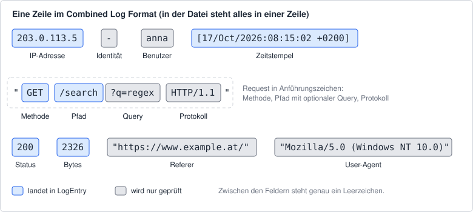

# RegexLogAnalyzer

Ein Webserver schreibt jede Anfrage als eine Zeile in eine Logdatei. Wer wissen will, welche
Seiten gefragt sind oder wann der Server Probleme hatte, muss diese Zeilen zerlegen. Genau dafür
sind reguläre Ausdrücke gemacht. In dieser Übung liest du eine Logdatei im *Apache Combined Log
Format* ein und wertest sie aus. Danach schreibst du drei Validatoren für österreichische
Kennzeichen, IBANs und E-Mail-Adressen.

Die Grundlagen findest du im Kapitel *Reguläre Ausdrücke* im Kurs.

## Projektaufbau

| Datei | Inhalt |
|---|---|
| `RegexLogAnalyzer.Application/Data/access.log` | Beispiel-Log mit 200 Zeilen (erfunden, alle Adressen fiktiv) |
| `RegexLogAnalyzer.Application/LogEntry.cs` | Record für einen geparsten Eintrag (fertig) |
| `RegexLogAnalyzer.Application/LogParseResult.cs` | Record für das Ergebnis einer ganzen Datei (fertig) |
| `RegexLogAnalyzer.Application/PathCount.cs`, `HourlyErrorRate.cs` | Records für die Auswertungen (fertig) |
| `RegexLogAnalyzer.Application/LogParser.cs` | **zu implementieren** |
| `RegexLogAnalyzer.Application/LogAnalyzer.cs` | **zu implementieren** |
| `RegexLogAnalyzer.Application/LicensePlateValidator.cs` | **zu implementieren** |
| `RegexLogAnalyzer.Application/IbanValidator.cs` | **zu implementieren** |
| `RegexLogAnalyzer.Application/EmailValidator.cs` | **zu implementieren** |
| `RegexLogAnalyzer.Tests/` | xUnit-Tests, nicht verändern |

Die Methoden in den zu implementierenden Klassen werfen im Moment `NotImplementedException`.
Die Signaturen und die Records bleiben unverändert. Hilfsmethoden darfst du ergänzen.

Die Logdatei wird beim Build in den Ausgabeordner kopiert (siehe `.csproj`). Die Tests lesen sie
von dort.

## Vorgabe: `[GeneratedRegex]` mit Timeout

- Die Klassen `LogParser`, `LicensePlateValidator`, `IbanValidator` und `EmailValidator`
  verwenden ihre regulären Ausdrücke **nur** über `[GeneratedRegex]`. Das Attribut steht auf
  einer `partial`-Methode (oder `partial`-Property), die **in der jeweiligen Klasse selbst**
  deklariert ist. Die Klassen sind dafür schon als `partial` deklariert. `new Regex(...)` und
  die statischen Methoden wie `Regex.IsMatch(input, pattern)` verwendest du nicht.
- Jedes `[GeneratedRegex]` bekommt einen Timeout über den Parameter `matchTimeoutMilliseconds`.
  Der Wert liegt zwischen 1 und 1000 ms.
- Kommt es trotzdem zu einer `RegexMatchTimeoutException`, gilt die Zeile als kaputt bzw. der
  Wert als ungültig. Die Exception darf nicht nach außen dringen. (Das wird nicht getestet.)
- „Ziffer“ heißt in dieser Angabe immer eines der Zeichen `0`–`9`, „Buchstabe“ immer `A`–`Z`
  bzw. `a`–`z` ohne Umlaute.
- Bei allen Methoden muss der **ganze** String der Regel entsprechen. Zusätzliche Zeichen
  davor oder danach machen ihn ungültig, auch ein abschließender Zeilenumbruch `\n`.

Der Test `GeneratedRegexTests` prüft per Reflection, dass jede der vier Klassen mindestens ein
`[GeneratedRegex]` mit gültigem Timeout enthält.

## Teil 1: Logzeilen parsen (`LogParser`)

So sieht eine gültige Zeile aus:

```text
203.0.113.5 - anna [17/Oct/2026:08:15:02 +0200] "GET /search?q=regex HTTP/1.1" 200 2326 "https://www.example.at/" "Mozilla/5.0 (Windows NT 10.0)"
```



### Regeln für eine gültige Zeile

Die Felder stehen in dieser Reihenfolge und sind durch **genau ein Leerzeichen** getrennt. Vor
dem ersten und nach dem letzten Feld steht nichts.

| Nr. | Feld | Regel | Im `LogEntry` |
|---|---|---|---|
| 1 | IP-Adresse | IPv4: vier Zahlen von 0 bis 255, getrennt durch `.`. Jede Zahl hat 1–3 Ziffern **ohne führende Null** (`0` ist erlaubt, `01` nicht). IPv6 gilt als ungültig. | `IpAddress` |
| 2 | Identität | mindestens ein Zeichen, kein Whitespace (meist `-`) | – |
| 3 | Benutzer | mindestens ein Zeichen, kein Whitespace (`-` oder ein Name wie `anna`) | – |
| 4 | Zeitstempel | in eckigen Klammern: `dd/MMM/yyyy:HH:mm:ss ±hhmm` (siehe unten) | `Timestamp` |
| 5 | Request | in doppelten Anführungszeichen: `Methode Ziel Protokoll`, getrennt durch je ein Leerzeichen (siehe unten) | `Method`, `Path` |
| 6 | Status | genau drei Ziffern, die erste ist `1`–`5` (also 100–599) | `Status` |
| 7 | Bytes | eine oder mehrere Ziffern **oder** `-` | `Bytes` |
| 8 | Referer | in doppelten Anführungszeichen, beliebige Zeichen außer `"`, darf leer sein | – |
| 9 | User-Agent | in doppelten Anführungszeichen, beliebige Zeichen außer `"`, darf leer sein | – |

**Zeitstempel:** Tag zweistellig (`07`, nicht `7`), Monat als englische Abkürzung mit großem
Anfangsbuchstaben (`Jan`, `Feb`, `Mar`, `Apr`, `May`, `Jun`, `Jul`, `Aug`, `Sep`, `Oct`, `Nov`,
`Dec`), Jahr vierstellig, Stunde, Minute und Sekunde zweistellig. Danach folgen ein Leerzeichen,
`+` oder `-` und vier Ziffern für den Abstand zu UTC (`+0200` = zwei Stunden vor UTC). Der
Zeitpunkt muss im Kalender existieren: `24:15:02` oder `31/Sep/2026` sind ungültig.
`Timestamp` enthält den Zeitpunkt **mit dem Offset aus der Zeile** (`+0200` → `Offset` = 2 h).

**Request:**

- Methode: ein oder mehrere Großbuchstaben (`GET`, `POST`, `DELETE`, …). `get` ist ungültig.
- Ziel: beginnt mit `/` und enthält weder Whitespace noch `"`. Ab dem ersten `?` folgt der
  optionale Query-String (er darf auch leer sein). `Path` ist das Ziel **ohne** den Query-String:
  aus `/search?q=regex` wird `/search`.
- Protokoll: `HTTP/`, eine Ziffer, `.`, eine Ziffer (z. B. `HTTP/1.1`, `HTTP/2.0`).

**Bytes:** Apache schreibt `-`, wenn keine Daten gesendet wurden (z. B. bei `304 Not Modified`).
Das ist gültig und wird als `0` gespeichert.

**Vereinfachung:** Echte Apache-Logs können `\"` innerhalb von Referer und User-Agent enthalten.
Das unterstützt diese Übung nicht. Ein `"` im Feld macht die Zeile ungültig.

### Methoden

- **`LogEntry? ParseLine(string line)`** liefert den Eintrag oder `null`, wenn die Zeile gegen
  eine der Regeln verstößt. Verwende **benannte Gruppen** für IP, Zeitstempel, Methode, Pfad,
  Status und Bytes.
- **`LogParseResult ParseLines(IEnumerable<string> lines)`** parst alle Zeilen der Reihe nach.
  - Die Zeilen werden ab 1 gezählt.
  - Leere Zeilen und Zeilen, die nur aus Whitespace bestehen, werden übersprungen. Sie sind
    weder Eintrag noch kaputte Zeile, zählen aber bei der Nummerierung mit.
  - `Entries` enthält die gültigen Einträge in der Reihenfolge der Eingabe.
  - `BrokenLineNumbers` enthält die Nummern der kaputten Zeilen aufsteigend.
- **`LogParseResult ParseFile(string path)`** liest die Datei (UTF-8) und arbeitet wie
  `ParseLines`.

## Teil 2: Auswertungen (`LogAnalyzer`)

- **`IReadOnlyList<PathCount> TopPaths(IEnumerable<LogEntry> entries, int count)`**
  - Zählt die Einträge pro `Path`. Groß- und Kleinschreibung zählt: `/News` und `/news` sind
    verschiedene Pfade. Der Statuscode spielt keine Rolle.
  - Sortiert absteigend nach der Anzahl. Bei gleicher Anzahl entscheidet der Pfad aufsteigend
    nach **ordinalem** Vergleich (Vergleich der Zeichencodes, `StringComparer.Ordinal`).
    Daher steht `/Zebra` vor `/apple`.
  - Liefert höchstens `count` Elemente. Gibt es weniger Pfade, kommen alle zurück.
  - Ist `count` kleiner als 1, wirft die Methode eine `ArgumentOutOfRangeException`.
- **`IReadOnlyList<HourlyErrorRate> ErrorRatesByHour(IEnumerable<LogEntry> entries)`**
  - Ein Request ist ein **Fehler**, wenn sein Status **400 oder größer** ist (Client- und
    Serverfehler). Weiterleitungen (3xx) sind keine Fehler.
  - Die Einträge werden nach der Stunde ihres Zeitstempels gruppiert. `Hour` ist der Beginn
    dieser Stunde: Minuten, Sekunden und Sekundenbruchteile sind 0, der Offset bleibt der aus
    dem Log. `08:59:59` gehört zu `08:00`, `09:00:00` zu `09:00`.
  - `Requests` ist die Anzahl der Einträge der Stunde, `Errors` die Anzahl der Fehler.
    `ErrorRate` berechnet der Record selbst (`Errors / Requests`).
  - Stunden ohne Einträge kommen nicht vor. Das Ergebnis ist aufsteigend nach `Hour` sortiert.

Wenn alles läuft: In welcher Stunde hatte der Server im Beispiel-Log Probleme? Welche Pfade
waren betroffen?

## Teil 3: Validatoren

### Österreichische Kennzeichen (`LicensePlateValidator.IsValid`)

Geprüft werden nur **normale Kennzeichen**. Wunschkennzeichen (`W-ANNA1`), Behörden-, Diplomaten-
und Oldtimerkennzeichen sind ungültig. Statt des Landeswappens steht wie in Zulassungsscheinen
und Parkkarten ein Bindestrich: `W-12345A`.

1. **Unterscheidungszeichen:** 1 oder 2 Großbuchstaben. Ob es den Bezirk wirklich gibt, wird
   nicht geprüft.
2. Genau ein `-`.
3. **Vormerkzeichen:** zuerst ein Ziffernblock, dann ein Buchstabenblock. Ziffern und Buchstaben
   werden nicht gemischt.
   - Ziffernblock: mindestens eine Ziffer, die erste Ziffer ist nicht `0`.
   - Buchstabenblock: 1 bis 3 Großbuchstaben ohne `Q`. Der erste Buchstabe ist nicht `O`.
   - Länge des Vormerkzeichens: **5 oder 6** Zeichen bei einem Unterscheidungszeichen mit einem
     Buchstaben, **4 oder 5** Zeichen bei einem mit zwei Buchstaben.
4. Keine Leerzeichen, keine Kleinbuchstaben, keine Umlaute.

| gültig | ungültig | Grund |
|---|---|---|
| `W-12345A` | `W-123A` | Vormerkzeichen bei `W` zu kurz |
| `GU-123AB` | `GU-12345A` | Vormerkzeichen bei `GU` zu lang |
| `WZ-1BAA` | `W-01234A` | führende `0` |
| `KO-123AO` | `GU-123OA` | Buchstabenblock beginnt mit `O` |
| `IL-11AAA` | `W-AB123` | Buchstaben vor Ziffern (Wunschkennzeichen) |

Die Regel ist eine Vereinfachung der Kraftfahrgesetz-Durchführungsverordnung (KDV 1967), siehe
[Kfz-Kennzeichen (Österreich)](https://de.wikipedia.org/wiki/Kfz-Kennzeichen_%28%C3%96sterreich%29),
Abschnitt *Vormerkzeichen*.

### Österreichische IBAN (`IbanValidator`)

**`bool IsValidFormat(string iban)`** prüft nur das Format:

- `AT` in Großbuchstaben, dann 2 Prüfziffern, dann 16 Ziffern (5 Ziffern Bankleitzahl,
  11 Ziffern Kontonummer). Das sind 20 Zeichen.
- Die IBAN steht entweder **kompakt** ohne Leerzeichen (`AT611904300234573201`) oder in
  **Vierergruppen** mit genau einem Leerzeichen dazwischen (`AT61 1904 3002 3457 3201`).
  Teilweise gruppierte IBANs, doppelte Leerzeichen oder Bindestriche sind ungültig.
- Die Prüfziffern werden **nicht** nachgerechnet: `AT00 0000 0000 0000 0000` hat ein gültiges
  Format.

**Zusatzaufgabe (optional): `bool HasValidChecksum(string iban)`** prüft zusätzlich die
Prüfziffern nach ISO 13616 (Verfahren MOD 97-10):

1. Hat die IBAN kein gültiges Format, ist das Ergebnis `false`.
2. Leerzeichen entfernen.
3. Die ersten vier Zeichen (`AT61`) ans Ende stellen.
4. Jeden Buchstaben durch eine Zahl ersetzen: `A` = 10, `B` = 11, …, `Z` = 35. Aus `AT` wird
   also `1029`.
5. Die entstandene Ziffernfolge als Zahl lesen. Die IBAN ist korrekt, wenn der Rest bei der
   Division durch 97 genau **1** ist. Die Zahl hat 24 Stellen und passt nicht in einen `long`.

`AT61 1904 3002 3457 3201` ist eine bekannte Beispiel-IBAN mit korrekten Prüfziffern.

### E-Mail-Adressen, vereinfacht (`EmailValidator.IsValid`)

Eine Adresse hat die Form `lokalerTeil@domain` mit **genau einem** `@`.

- **Lokaler Teil:** ein oder mehrere Blöcke, getrennt durch je einen Punkt. Ein Block besteht
  aus mindestens einem der Zeichen `A`–`Z`, `a`–`z`, `0`–`9`, `_`, `%`, `+`, `-`. Damit darf der
  lokale Teil nicht mit einem Punkt beginnen oder enden und keine zwei Punkte hintereinander
  enthalten.
- **Domain:** mindestens zwei Labels, getrennt durch je einen Punkt.
  - Jedes Label besteht aus Buchstaben, Ziffern und `-`, hat mindestens ein Zeichen und
    beginnt und endet nicht mit `-`.
  - Das letzte Label (Top-Level-Domain) besteht nur aus Buchstaben und hat mindestens zwei
    Zeichen.
- Groß- und Kleinschreibung sind erlaubt. Es gibt keine Längenbeschränkung.

Gültig sind z. B. `max.mustermann@spengergasse.at`, `first_last+tag@mail.example.com` und
`a@b.co`. Ungültig sind z. B. `max..m@example.com`, `max@example`, `max@-example.com` und
`müller@example.at`.

Echte E-Mail-Adressen (RFC 5322) erlauben viel mehr. Ob eine Adresse wirklich existiert, kann
ohnehin nur eine Bestätigungsmail zeigen.

## Tests ausführen

Im Ordner `RegexLogAnalyzer`:

```text
dotnet test
```

Am Anfang schlagen alle Tests fehl. Mit jeder fertigen Methode werden es weniger.

| Testklasse | prüft |
|---|---|
| `LogParserTests` | einzelne Zeilen und `ParseLines` |
| `LogFileTests` | das Beispiel-Log `access.log` inkl. Auswertungen |
| `LogAnalyzerTests` | `TopPaths` und `ErrorRatesByHour` mit eigenen Daten |
| `LicensePlateValidatorTests` | Kennzeichen |
| `IbanValidatorTests` | IBAN-Format; die Tests `HasValidChecksum_*` gehören zur Zusatzaufgabe |
| `EmailValidatorTests` | E-Mail-Adressen |
| `GeneratedRegexTests` | `[GeneratedRegex]` mit Timeout in jeder Klasse |

Ohne die Zusatzaufgabe startest du die Tests so:

```text
dotnet test --filter "FullyQualifiedName!~HasValidChecksum"
```
