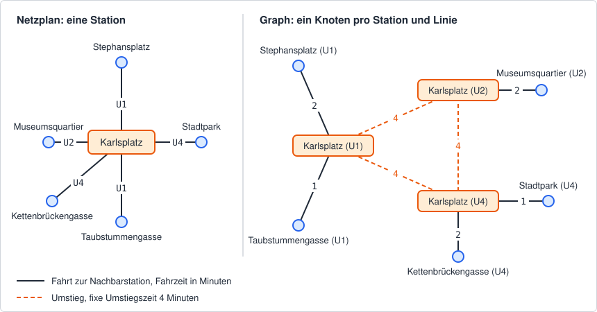

# Ein Routenplaner für die Wiener U-Bahn

Jede Fahrplan-App beantwortet zwei Fragen: Wie komme ich mit möglichst wenigen Stationen ans
Ziel, und wie komme ich am schnellsten hin? Im Kapitel *Graphen* im Kurs hast du
gesehen, wie man ein Verkehrsnetz als Graph modelliert. In den Kapiteln
*Breiten- und Tiefensuche* und *Kürzeste Wege mit Dijkstra* hast du die passenden Algorithmen
kennengelernt. In dieser Übung setzt du alles zusammen: Du liest das Wiener U-Bahn-Netz aus einer
CSV-Datei, baust daraus einen Graphen und suchst darin Verbindungen. Das Ergebnis ist eine
lesbare Wegbeschreibung wie „U1 bis Stephansplatz, umsteigen in U3, U3 bis Westbahnhof“.



## Aufbau der Solution

Öffne die Solution *Routenplaner.sln* in diesem Ordner.

| Projekt | Inhalt |
|---|---|
| *Routenplaner.Application* | Class Library mit den Stubs und der Netzdatei. Hier programmierst du. |
| *Routenplaner.Tests* | xUnit-Tests. Die Tests darfst du nicht ändern. |

In *Routenplaner.Application* findest du folgende Dateien:

| Datei | Was du tun musst |
|---|---|
| *ConnectionReader.cs* | `Parse` und `ReadFile` implementieren (Teil 1). |
| *TransitNetwork.cs* | Konstruktor, Properties, `StopsAt` und `EdgesFrom` implementieren (Teil 2). |
| *Route.cs* | `FromEdges` und `Describe` implementieren (Teil 3). |
| *RoutePlanner.cs* | `FewestStations` (Teil 4) und `Fastest` (Teil 5) implementieren. |
| *Connection.cs*, *Stop.cs*, *Edge.cs*, *Leg.cs* | Records für Daten, Knoten, Kanten und Teilstrecken. Vorgegeben, nicht ändern. |
| *CsvFormatException.cs* | Exception für Fehler in der Netzdatei. Vorgegeben, nicht ändern. |
| *ViennaMetro.cs* | Lädt das Wiener Netz mit der Umstiegszeit. Vorgegeben, nicht ändern. |
| *Data/ubahn_wien.csv* | Das U-Bahn-Netz. Nicht ändern, die Tests verlassen sich auf die Daten. |

Du darfst private Felder, private Methoden und eigene `internal`-Klassen ergänzen. Die
öffentlichen Signaturen bleiben so, wie sie sind.

## Die Netzdatei

Die Datei *Data/ubahn_wien.csv* enthält die Linien U1, U2, U3, U4 und U6 mit 98 Stationen. Die
Daten sind **vereinfacht und nicht offiziell**. Sie eignen sich zum Üben, aber nicht zur Planung
einer echten Fahrt:

- Die Fahrzeiten sind geschätzt und auf ganze Minuten gerundet.
- Das Netz entspricht ungefähr dem Stand vor dem Umbau für die U5. Die U2 fährt also noch von
  Karlsplatz bis Seestadt, eine U5 gibt es nicht.
- Wartezeiten auf den Zug und Intervalle gibt es nicht. Jeder Umstieg dauert gleich lang.
- Die Station heißt in der Datei *Hauptbahnhof* (offiziell *Südtiroler Platz-Hauptbahnhof*) und
  *Landstraße* (bei Wien Mitte).

So beginnt die Datei:

```text
# Wiener U-Bahn-Netz U1 bis U6 - vereinfacht, nicht offiziell.
# Fahrzeiten in ganzen Minuten, geschätzt. Netz ungefähr vor dem Umbau für die U5.
# Jede Zeile ist ein Abschnitt zwischen zwei benachbarten Stationen, befahrbar in beide Richtungen.
Linie;Von;Nach;Minuten
U1;Oberlaa;Neulaa;2
U1;Neulaa;Alaudagasse;1
...
```

Jede Datenzeile beschreibt einen **Abschnitt** zwischen zwei benachbarten Stationen einer Linie.
Die Abschnitte einer Linie stehen in der Reihenfolge der Stationen. Ein Abschnitt gilt in beide
Richtungen: `U1;Oberlaa;Neulaa;2` heißt auch, dass man in 2 Minuten von Neulaa nach Oberlaa
kommt.

Die Datei wird beim Build in den Ausgabeordner kopiert (siehe *Routenplaner.Application.csproj*).
`ViennaMetro.DataFile` liefert den Pfad dorthin.

## Teil 1: Die Datei einlesen

`ConnectionReader.Parse(lines)` bekommt die Zeilen der Datei (ohne Zeilenumbruch) und liefert für
jede Datenzeile ein `Connection`-Record, in der Reihenfolge der Datei:

```c#
public sealed record Connection(string Line, string From, string To, int Minutes);
```

Es gelten diese Regeln:

- Zuerst werden bei jeder Zeile die Leerzeichen am Anfang und am Ende entfernt.
- Leere Zeilen und Zeilen, die mit `#` beginnen (Kommentare), werden übersprungen.
- Die erste Zeile, die übrig bleibt, ist die **Kopfzeile**. Sie muss genau
  `Linie;Von;Nach;Minuten` lauten, sonst ist das ein Fehler. Die Konstante
  `ConnectionReader.Header` enthält diesen Text.
- Alle weiteren Zeilen sind Datenzeilen. Eine Datenzeile hat genau vier Felder, getrennt durch
  `;`. Leerzeichen am Anfang und am Ende jedes Feldes werden entfernt.
- Linie, Von und Nach dürfen nicht leer sein. Von und Nach müssen verschieden sein.
- Minuten ist eine ganze Zahl ab 1, nur aus den Ziffern `0` bis `9`. `1.5`, `-2` und `zwei` sind
  Fehler.
- Gibt es weder Kopfzeile noch Daten (leere Eingabe, nur Kommentare), ist das Ergebnis eine leere
  Liste. Nur eine Kopfzeile ohne Daten ergibt ebenfalls eine leere Liste.

Bei einem Fehler wirft `Parse` eine `CsvFormatException`. Die Klasse ist vorgegeben:

```c#
public sealed class CsvFormatException(string message, int lineNumber)
    : FormatException($"Line {lineNumber}: {message}")
{
    public int LineNumber { get; }
}
```

`LineNumber` ist die Nummer der fehlerhaften Zeile, beginnend bei 1. Kommentare und leere Zeilen
zählen mit, damit man die Zeile im Editor sofort findet. Die Nachricht formulierst du selbst, die
Tests prüfen nur `LineNumber`. Ist `lines` gleich `null`, wirft `Parse` eine
`ArgumentNullException`.

`ConnectionReader.ReadFile(path)` liest die Datei (UTF-8) und arbeitet danach wie `Parse`.

## Teil 2: Der Graph

Eine Station, an der mehrere Linien halten, kann **nicht** ein einziger Knoten sein. Sonst
wüsste der Graph nicht, dass man am Karlsplatz von der U1 in die U4 umsteigen muss und dass das
Zeit kostet. Deshalb gibt es im Graphen einen Knoten pro **Station und Linie**:

```c#
public sealed record Stop(string Station, string Line);   // z. B. new Stop("Karlsplatz", "U1")
public sealed record Edge(Stop From, Stop To, int Minutes)
{
    public bool IsTransfer => From.Station == To.Station;
}
```

Die Grafik oben zeigt das für den Karlsplatz. `TransitNetwork` baut den Graphen im Konstruktor
auf:

- Für jede `Connection` gibt es die Knoten `(From, Line)` und `(To, Line)` und zwei
  **Fahrkanten**, eine pro Richtung, mit den Minuten aus der Datei.
- An einer Station mit mehreren Linien hat jeder Knoten eine **Umstiegskante** zu jedem anderen
  Knoten derselben Station. Der Karlsplatz hat also 3 · 2 = 6 Umstiegskanten.
- Jede Umstiegskante dauert gleich lang, nämlich `transferMinutes` aus dem Konstruktor. Für das
  Wiener Netz ist die Umstiegszeit **4 Minuten** (`ViennaMetro.TransferMinutes`).

Der Graph ist danach **unveränderlich**. Ändert der Aufrufer die übergebene Liste später, darf
das den Graphen nicht verändern.

| Member | Bedeutung |
|---|---|
| `TransferMinutes` | Die Umstiegszeit aus dem Konstruktor. |
| `Stops` | Alle Knoten, in beliebiger Reihenfolge. |
| `Stations` | Alle Stationsnamen, jeder genau einmal, in beliebiger Reihenfolge. |
| `StopsAt(station)` | Alle Knoten einer Station, **sortiert nach dem Namen der Linie** (ordinal). Für eine unbekannte Station eine leere Liste. |
| `EdgesFrom(stop)` | Alle Kanten, die bei `stop` beginnen: Fahrkanten und Umstiegskanten, in beliebiger Reihenfolge. |

Fehlerfälle:

| Fehler | Exception |
|---|---|
| `connections` ist `null` | `ArgumentNullException` |
| `transferMinutes` ist kleiner als 1 | `ArgumentOutOfRangeException` |
| `EdgesFrom` mit einem Knoten, den es nicht gibt, z. B. `new Stop("Alpha", "B")`, wenn die Linie B nicht in Alpha hält | `ArgumentException` |

`ViennaMetro.Load()` liest die Netzdatei und baut damit den Graphen. Sobald Teil 1 und Teil 2
fertig sind, funktioniert diese Methode.

## Teil 3: Die Route

Eine Suche findet einen Weg im Graphen, also eine Liste von Kanten. Für Fahrgäste ist das zu
kleinteilig. Sie wollen wissen, mit welcher Linie sie bis wohin fahren. `Route.FromEdges(edges)`
fasst den Weg deshalb zu **Teilstrecken** (`Leg`) zusammen:

```c#
public sealed record Leg(string Line, string From, string To, int Stations, int Minutes);
public sealed record Route(IReadOnlyList<Leg> Legs, int Minutes)
{
    public string From { get; }      // Legs[0].From
    public string To { get; }        // Legs[^1].To
    public int Stations { get; }     // sum of Legs[i].Stations
    public int Transfers { get; }    // Legs.Count - 1
    public static Route FromEdges(IReadOnlyList<Edge> edges);
    public string Describe();
}
```

- Aufeinanderfolgende Fahrkanten auf derselben Linie bilden **eine** Teilstrecke. `Stations` ist
  die Anzahl dieser Fahrkanten, `Minutes` die Summe ihrer Minuten.
- Eine Umstiegskante beendet die aktuelle Teilstrecke. Ihre Minuten zählen nur zu
  `Route.Minutes`, nicht zu einer Teilstrecke.
- `Route.Minutes` ist die Summe **aller** Kanten, also Fahrten und Umstiege.

`FromEdges` wirft eine `ArgumentException`, wenn der Weg leer ist, nicht zusammenhängt (eine
Kante beginnt nicht dort, wo die vorige endet), mit einem Umstieg beginnt oder endet oder zwei
Umstiege direkt hintereinander enthält. Für `null` kommt eine `ArgumentNullException`.

### Die Wegbeschreibung

`Describe()` liefert die Route als Text. Die Zeilen sind durch `\n` getrennt, am Ende steht kein
Zeilenumbruch:

```text
Von Hauptbahnhof nach Westbahnhof
U1 bis Stephansplatz (3 Stationen, 5 min)
umsteigen in U3
U3 bis Westbahnhof (5 Stationen, 7 min)
Gesamt: 8 Stationen, 1 Umstieg, 16 min
```

- Die erste Zeile nennt Start und Ziel der Route.
- Danach kommt pro Teilstrecke eine Zeile `<Linie> bis <Station> (<Stationen>, <Minuten> min)`.
- Zwischen zwei Teilstrecken steht die Zeile `umsteigen in <Linie>` mit der Linie der nächsten
  Teilstrecke.
- Die letzte Zeile fasst zusammen. Die Minuten enthalten die Umstiege: Im Beispiel sind es
  5 + 7 Minuten Fahrt und 4 Minuten Umstieg.
- Einzahl und Mehrzahl: `1 Station`, aber `0 Stationen` und `2 Stationen`. Ebenso `1 Umstieg`,
  aber `0 Umstiege` und `2 Umstiege`. Minuten heißen immer `min`.

## Teil 4: Wenigste Stationen (Breitensuche)

`RoutePlanner.FewestStations(from, to)` sucht die Verbindung, bei der man **an den wenigsten
Stationen vorbeifährt**. Gezählt werden die Fahrkanten, also `Route.Stations`. Die Fahrzeit
spielt keine Rolle.

- **Ein Umstieg zählt nicht als Station.** Kommt die Suche an einer Station an, ist sie damit auf
  allen Linien dieser Station mit derselben Anzahl an Stationen. Überlege, was das für die
  Breitensuche bedeutet: Eine Umstiegskante ist keine gewöhnliche Kante mit Länge 1.
- **Start auf mehreren Linien:** Hält an der Startstation mehr als eine Linie, darfst du auf jeder
  davon losfahren. Du stehst einfach am richtigen Bahnsteig. Eine Route beginnt deshalb nie mit
  einem Umstieg.
- **Ziel auf mehreren Linien:** Die Suche ist fertig, sobald sie die Zielstation auf irgendeiner
  Linie erreicht. Eine Route endet deshalb nie mit einem Umstieg.
- Ist das Ziel nicht erreichbar, liefert die Methode `null`. Im Wiener Netz kommt das nicht vor,
  in den Tests mit einem kleinen Netz schon.

Für die Breitensuche brauchst du zu jedem besuchten Knoten die Kante, über die du ihn erreicht
hast. Damit rekonstruierst du am Ende den Weg und machst mit `Route.FromEdges` eine Route daraus.

## Teil 5: Die schnellste Verbindung (Dijkstra)

`RoutePlanner.Fastest(from, to)` sucht die Verbindung mit der kürzesten Gesamtzeit, also dem
kleinsten `Route.Minutes`. Jetzt zählen Fahrkanten und Umstiegskanten mit ihren Minuten. Die
Regeln für Start und Ziel auf mehreren Linien und für ein unerreichbares Ziel gelten wie in
Teil 4. Ein Umstieg am Start oder am Ziel kostet also nichts.

Die beiden Suchen liefern oft verschiedene Routen. Vom Hauptbahnhof zum Westbahnhof:

| Suche | Route | Stationen | Umstiege | Minuten |
|---|---|---|---|---|
| `FewestStations` | U1 bis Karlsplatz, U2 bis Volkstheater, U3 bis Westbahnhof | 7 | 2 | 19 |
| `Fastest` | U1 bis Stephansplatz, U3 bis Westbahnhof | 8 | 1 | 16 |

### Fehlerfälle beider Suchen

| Fehler | Exception | `ParamName` |
|---|---|---|
| `from` oder `to` ist `null` | `ArgumentNullException` | `from` bzw. `to` |
| Die Startstation gibt es nicht | `ArgumentException` | `from` |
| Die Zielstation gibt es nicht | `ArgumentException` | `to` |
| Start und Ziel sind gleich | `ArgumentException` | `to` |
| `network` im Konstruktor ist `null` | `ArgumentNullException` | `network` |

Geprüft wird in dieser Reihenfolge, `from` vor `to`.

### Gleich gute Routen

Manchmal gibt es mehrere gleich gute Routen, zum Beispiel zwei Wege mit gleich vielen Stationen.
Dann darf deine Suche jede davon liefern. Die Testfälle sind so gewählt, dass es **genau eine**
beste Route gibt. Wenn dein Ergebnis bei einem Test abweicht, liegt der Fehler also nicht an der
Reihenfolge der Nachbarn.

## Tests ausführen

Öffne ein Terminal im Ordner dieser README und starte die Tests:

```text
dotnet test
```

Am Anfang schlagen fast alle Tests fehl, weil die Stubs eine `NotImplementedException` werfen.
Gehe in der Reihenfolge der Teile vor. Einzelne Testklassen startest du mit einem Filter, zum
Beispiel `dotnet test --filter "FullyQualifiedName~ConnectionReaderTests"`.

| Testklasse | Was geprüft wird |
|---|---|
| `ConnectionReaderTests` | Einlesen und Fehlerzeilen (Teil 1) |
| `TransitNetworkTests` | Knoten und Kanten eines kleinen Netzes (Teil 2) |
| `RouteTests` | `FromEdges` und `Describe` mit selbst gebauten Wegen (Teil 3) |
| `RoutePlannerTests` | Beide Suchen in einem kleinen Netz (Teil 4 und 5) |
| `ViennaNetworkTests` | Die Netzdatei und der Graph des Wiener Netzes |
| `ViennaRouteTests` | Beide Suchen im Wiener Netz, dazu eine Prüfung über alle Paare von Stationen |

Das kleine Netz steht in *Routenplaner.Tests/MiniNetwork.cs*. Zeichne es auf Papier, bevor du
die Tests in `RoutePlannerTests` liest. Es ist so gebaut, dass eine Suche, die einen Umstieg als
Station zählt, eine andere Route findet als die richtige.

Lies bei einem Fehler die Meldung des Tests. Die Routen werden dort kompakt ausgegeben, zum
Beispiel `U1: Hauptbahnhof -> Stephansplatz (3, 5) | U3: Stephansplatz -> Westbahnhof (5, 7)`.
Die Zahlen in Klammern sind Stationen und Minuten der Teilstrecke.

## Erweiterungen (ohne Tests)

- Schreibe eine Konsolen-App, die Start und Ziel abfragt und beide Routen mit `Describe`
  ausgibt.
- Suche die Verbindung mit den **wenigsten Umstiegen**. Bei gleich vielen Umstiegen soll die
  schnellere gewinnen. Überlege, welche Gewichte du den Kanten dafür geben kannst.
- In Wirklichkeit dauert ein Umstieg nicht überall gleich lang. Erweitere die Netzdatei um eine
  zweite Datei mit Umstiegszeiten pro Station und verwende sie im Konstruktor.
- Gib in der Wegbeschreibung die Fahrtrichtung an („U1 Richtung Leopoldau bis Stephansplatz“).
  Die Richtung ist die Endstation der Linie, zu der du fährst.
