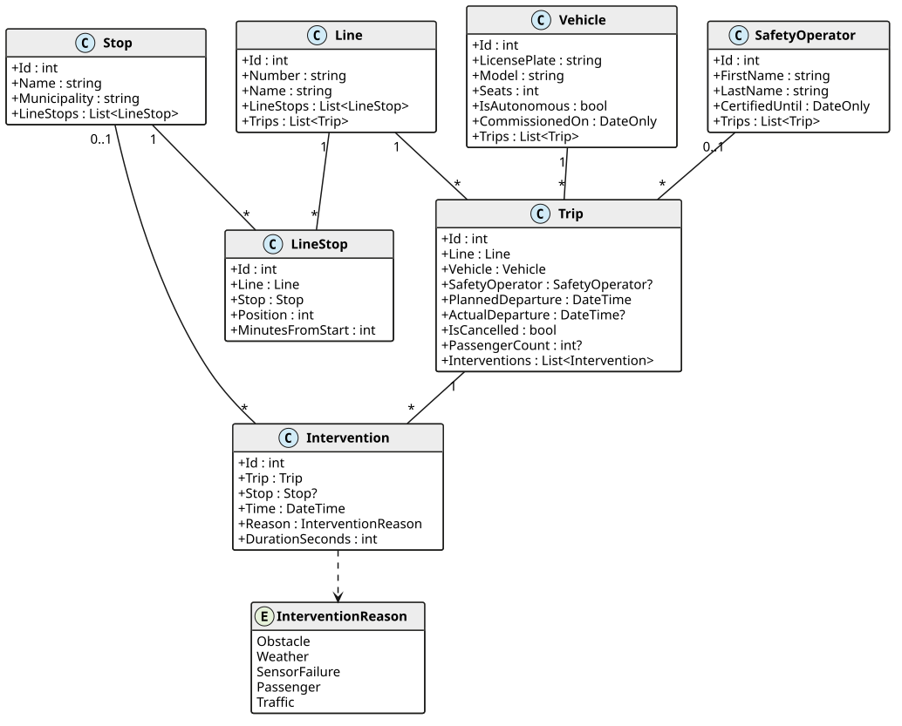

# BusQueries: Abfragen mit Where, Select und Any

In Vorarlberg fährt ein automatisierter Linienbus. Er lenkt selbst, aber eine
**Sicherheitsfahrerin** oder ein **Sicherheitsfahrer** (Safety Operator) sitzt immer an Bord. Wird
es kritisch, übernimmt diese Person die Steuerung. Das nennen wir einen **Eingriff**
(Intervention). Die Leitstelle möchte wissen: Welche Fahrten liefen ohne Eingriff? Welche Busse
hatten Sensorprobleme? Wie viele Fahrgäste hatte eine Linie?

Du schreibst dafür die Klasse `BusQueryService`. Sie enthält nur lesende Methoden. Alle Daten
sind erfunden.

## Das Modell



| Klasse | Bedeutung |
|---|---|
| `Line` | Eine Buslinie, z. B. *A1 Bahnhof - FH Campus*. |
| `Stop` | Eine Haltestelle. Mehrere Linien können dieselbe Haltestelle anfahren. |
| `LineStop` | Eine Haltestelle einer Linie. `Position` 1 ist die erste Haltestelle. `MinutesFromStart` ist die Fahrzeit ab der ersten Haltestelle. |
| `Vehicle` | Ein Bus. `IsAutonomous` ist `true` bei automatisierten Bussen und `false` bei normalen Bussen mit Fahrer. |
| `SafetyOperator` | Eine Person, die automatisierte Busse überwacht. |
| `Trip` | Eine Fahrt einer Linie. `ActualDeparture` ist `null`, solange der Bus nicht abgefahren ist. `PassengerCount` ist `null`, wenn niemand gezählt hat. Normale Busse haben keinen `SafetyOperator` (`null`). |
| `Intervention` | Ein Eingriff während einer Fahrt. `Stop` ist `null`, wenn der Eingriff zwischen zwei Haltestellen war. |

Die Musterdaten umfassen eine Woche: Montag, 5. Oktober, bis Freitag, 9. Oktober 2026. Die Fahrten
am Freitag sind geplant, aber noch nicht abgefahren. Die Daten enthalten bewusst Sonderfälle,
z. B. eine Linie ohne Fahrten, eine Haltestelle ohne Linie, stornierte Fahrten und eine Person
ohne Fahrten.

## Aufbau der Solution

Öffne die Solution *BusQueries.sln*.

| Projekt / Datei | Inhalt |
|---|---|
| *BusQueries.Application/Model* | Die Entity-Klassen. Nicht ändern. |
| *BusQueries.Application/Infrastructure/BusContext.cs* | Der DbContext mit der Methode `Seed()` für die Musterdaten. Nicht ändern. |
| *BusQueries.Application/Results* | Records für die Rückgabewerte. Nicht ändern. |
| *BusQueries.Application/Services/BusQueryService.cs* | **Hier programmierst du.** |
| *BusQueries.Tests* | Die Tests. Nicht ändern. |
| *bus.db* | Die Musterdaten als SQLite-Datenbank. Du kannst sie mit DBeaver oder DataGrip öffnen und deine Ergebnisse mit SQL prüfen. |

Die Methoden enthalten im Moment nur `throw new NotImplementedException()`. Ersetze diese Zeile
durch deine Implementierung. Die öffentlichen Signaturen bleiben gleich.

## Die Methoden

Die Reihenfolge geht von leicht nach schwer. Halte dich an die verlangte Sortierung, die Tests
prüfen sie.

### List\<Stop\> GetStopsInMunicipality(string municipality)

Liefert alle Haltestellen der Gemeinde `municipality`, sortiert nach dem Namen. Gibt es die
Gemeinde nicht, ist die Liste leer.

### List\<string\> GetLicensePlates(bool autonomous)

Liefert die Kennzeichen aller automatisierten Busse (`autonomous` ist `true`) oder aller normalen
Busse (`autonomous` ist `false`). Sortiere die Kennzeichen alphabetisch.

### List\<SafetyOperator\> GetOperatorsWithoutTrips()

Liefert alle Sicherheitsfahrer:innen, die keiner einzigen Fahrt zugeteilt sind.

### List\<Trip\> GetTripsWithoutInterventions(DateOnly date)

Liefert alle Fahrten, die am Tag `date` geplant waren, bereits abgefahren sind und keinen Eingriff
hatten. Stornierte Fahrten sind nicht abgefahren. Sortiere nach der geplanten Abfahrt.

### List\<Vehicle\> GetVehiclesWithInterventionReason(InterventionReason reason)

Liefert alle Fahrzeuge, die bei mindestens einer Fahrt einen Eingriff mit dem Grund `reason`
hatten. Sortiere nach dem Kennzeichen.

### bool IsLineOperatedAutonomously(string lineNumber)

Liefert `true`, wenn **jede** nicht stornierte Fahrt der Linie mit einem automatisierten Bus
gefahren ist. Hat die Linie keine nicht stornierten Fahrten, ist das Ergebnis ebenfalls `true`:
Es gibt dann keine Fahrt, die die Bedingung verletzt.

### List\<LineStopInfo\> GetStopsOfLine(string lineNumber)

Liefert die Haltestellen der Linie mit der Nummer `lineNumber` als `LineStopInfo`, sortiert nach
der Position. Für eine unbekannte Linie ist die Liste leer.

```c#
public record LineStopInfo(int Position, string StopName, string Municipality, int MinutesFromStart);
```

### List\<TripSummary\> GetTripSummaries(DateOnly date)

Liefert alle Fahrten des Tages `date` (auch stornierte), sortiert nach der geplanten Abfahrt.
`OperatorName` ist Vorname und Nachname mit einem Leerzeichen dazwischen, z. B. `Lena Moser`. Hat
die Fahrt keinen Safety Operator, ist `OperatorName` `null`. `InterventionCount` ist die Anzahl
der Eingriffe der Fahrt.

```c#
public record TripSummary(
    int TripId, string LineNumber, string LicensePlate, string? OperatorName,
    DateTime PlannedDeparture, bool IsCancelled, int InterventionCount);
```

### Trip? GetNextDeparture(string lineNumber, DateTime after)

Liefert die nächste nicht stornierte Fahrt der Linie, deren geplante Abfahrt **nach** `after`
liegt. Gibt es keine solche Fahrt, liefert die Methode `null`.

### int CountPassengers(string lineNumber, DateOnly from, DateOnly to)

Liefert die Summe der Fahrgäste aller Fahrten der Linie, die zwischen dem Tag `from` und dem Tag
`to` geplant waren. **Beide Tage zählen dazu**, also auch alle Fahrten am Tag `to` bis Mitternacht.
Fahrten ohne Zählung (`PassengerCount` ist `null`) zählen als 0.

### List\<DelayedTrip\> GetDelayedTrips(int minDelayMinutes)

Die Verspätung einer Fahrt ist die Differenz zwischen `ActualDeparture` und `PlannedDeparture` in
ganzen Minuten. Liefere alle abgefahrenen Fahrten, deren Verspätung mindestens `minDelayMinutes`
Minuten beträgt. Sortiere absteigend nach der Verspätung, bei gleicher Verspätung aufsteigend
nach der Id der Fahrt.

```c#
public record DelayedTrip(int TripId, string LineNumber, DateTime PlannedDeparture, int DelayMinutes);
```

> [!NOTE]
> Kann EF Core einen Ausdruck nicht in SQL übersetzen, wirft es eine
> `InvalidOperationException` mit dem Text *could not be translated*. Im Kapitel *LINQ: Where,
> Select und Any* im Kurs steht, wie du damit umgehst.

## Testen

Führe im Ordner der Solution

```text
dotnet test
```

aus oder verwende den Test Explorer. Zu jeder Methode gibt es einen Test, der mehrere Fälle prüft.
Am Anfang sind alle Tests rot. Ändere die Tests nicht. Die erwarteten Werte berechnen die Tests
mit SQL direkt aus der Datenbank. Die Meldung eines roten Tests sagt dir, welcher Aufruf das
falsche Ergebnis geliefert hat.
