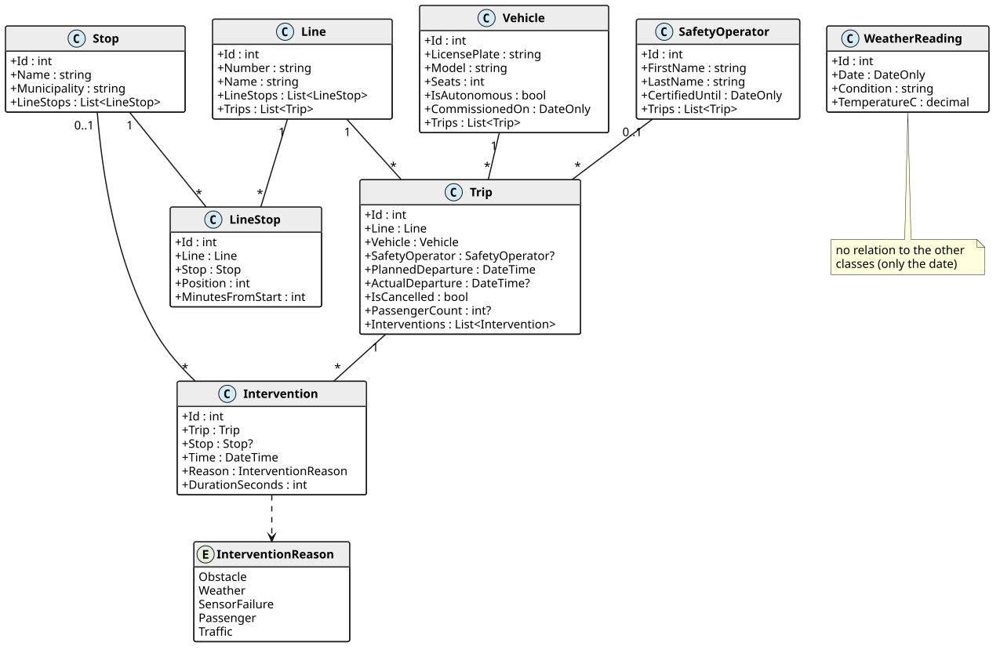

# BusStatistics: GroupBy, SelectMany, Join und Aggregate

Diese Übung ist **optional** und für das Selbststudium gedacht. Sie vertieft das Kapitel
*Erweiterte LINQ Techniken* im Kurs.

In Vorarlberg fährt ein automatisierter Linienbus. Eine **Sicherheitsfahrerin** oder ein
**Sicherheitsfahrer** (Safety Operator) sitzt immer an Bord und übernimmt im Notfall die
Steuerung. Das nennen wir einen **Eingriff** (Intervention). Der Betreiber möchte Statistiken:
Welche Gründe für Eingriffe sind am häufigsten? Wie viele Fahrgäste hat eine Linie im Schnitt?
Gibt es bei Regen mehr Eingriffe? Du schreibst dafür die Klasse `StatisticsService`. Alle Daten
sind erfunden.

## Das Modell



| Klasse | Bedeutung |
|---|---|
| `Line` | Eine Buslinie, z. B. *A1 Bahnhof - FH Campus*. |
| `Stop` | Eine Haltestelle. Mehrere Linien können dieselbe Haltestelle anfahren. |
| `LineStop` | Eine Haltestelle einer Linie. `Position` 1 ist die erste Haltestelle. |
| `Vehicle` | Ein Bus. `IsAutonomous` ist `true` bei automatisierten Bussen. |
| `SafetyOperator` | Eine Person, die automatisierte Busse überwacht. |
| `Trip` | Eine Fahrt einer Linie. `PassengerCount` ist `null`, wenn niemand gezählt hat. |
| `Intervention` | Ein Eingriff während einer Fahrt mit Grund (`Reason`) und Dauer in Sekunden. |
| `WeatherReading` | Das Wetter eines Tages. Die Daten kommen von einem Wetterdienst. Es gibt **keine Beziehung** zu den anderen Klassen, nur das Datum verbindet sie. |

Die Musterdaten umfassen eine Woche: Montag, 5. Oktober, bis Freitag, 9. Oktober 2026. Für
Donnerstag, den 8. Oktober, fehlt die Wettermeldung.

## Aufbau der Solution

Öffne die Solution *BusStatistics.sln*.

| Projekt / Datei | Inhalt |
|---|---|
| *BusStatistics.Application/Model* | Die Entity-Klassen. Nicht ändern. |
| *BusStatistics.Application/Infrastructure/BusContext.cs* | Der DbContext mit der Methode `Seed()` für die Musterdaten. Nicht ändern. |
| *BusStatistics.Application/Dtos* | Records für die Rückgabewerte. Nicht ändern. |
| *BusStatistics.Application/Services/StatisticsService.cs* | **Hier programmierst du.** |
| *BusStatistics.Tests* | Die Tests. Nicht ändern. |
| *bus.db* | Die Musterdaten als SQLite-Datenbank zum Ansehen mit DBeaver oder DataGrip. |

## Die Methoden

### GroupBy

**List\<ReasonStatistics\> GetInterventionsByReason()** liefert pro Grund die Anzahl der
Eingriffe und ihre Gesamtdauer in Sekunden. Sortiere absteigend nach der Anzahl und bei gleicher
Anzahl absteigend nach der Gesamtdauer. Gründe ohne Eingriff kommen nicht vor.

```c#
public record ReasonStatistics(InterventionReason Reason, int Count, int TotalDurationSeconds);
```

**List\<LinePassengerStatistics\> GetPassengerStatisticsPerLine()** betrachtet nur Fahrten mit
Fahrgastzählung (`PassengerCount` ist nicht `null`). Liefere pro Linie die Anzahl dieser Fahrten,
die Summe und den Durchschnitt der Fahrgäste. Sortiere nach der Liniennummer.

```c#
public record LinePassengerStatistics(string LineNumber, int TripCount, int TotalPassengers, double AveragePassengers);
```

**List\<DailyInterventions\> GetInterventionsPerDay()** liefert pro Tag die Anzahl der Eingriffe
und ihre Gesamtdauer in Sekunden, sortiert nach dem Datum.

```c#
public record DailyInterventions(DateOnly Date, int Count, int TotalDurationSeconds);
```

### SelectMany

**List\<string\> GetStopNamesServedByVehicle(string licensePlate)** liefert die Namen aller
Haltestellen, die das Fahrzeug angefahren hat. Das sind alle Haltestellen der Linien seiner nicht
stornierten Fahrten. Jeder Name kommt nur einmal vor, sortiert alphabetisch. Für ein Fahrzeug
ohne Fahrten ist die Liste leer.

**List\<Intervention\> GetInterventionsOfOperator(int safetyOperatorId)** liefert alle Eingriffe
bei den Fahrten des Safety Operators, sortiert nach der Zeit.

### Join und LeftJoin

**List\<WeatherStatistics\> GetInterventionsByWeather()** verbindet jeden Eingriff über sein
Datum mit der Wettermeldung dieses Tages. Liefere pro Wetterlage (`Condition`) die Anzahl der
Eingriffe und ihre Gesamtdauer. Eingriffe an Tagen ohne Wettermeldung fallen weg. Sortiere
absteigend nach der Anzahl, bei gleicher Anzahl alphabetisch nach `Condition`.

```c#
public record WeatherStatistics(string Condition, int InterventionCount, int TotalDurationSeconds);
```

**List\<DayWeather\> GetInterventionDaysWithWeather()** liefert jeden Tag, an dem es Eingriffe
gab, mit der Anzahl der Eingriffe und der Wetterlage. Gibt es für den Tag keine Wettermeldung,
ist `Condition` `null`. Der Tag fällt also **nicht** weg. Sortiere nach dem Datum.

```c#
public record DayWeather(DateOnly Date, int InterventionCount, string? Condition);
```

### Aggregate

Verwende in diesen beiden Methoden `Aggregate()`.

**string GetRouteDescription(string lineNumber)** liefert die Namen der Haltestellen der Linie in
der Reihenfolge ihrer Position, getrennt durch ` -> `. Beispiel für eine Linie mit drei
Haltestellen: `Bahnhof Dornbirn -> Marktplatz -> FH Campus`. Für eine unbekannte Linie liefert die
Methode einen leeren String.

**TimeSpan GetTotalInterventionTime(int tripId)** liefert die Gesamtdauer aller Eingriffe einer
Fahrt als `TimeSpan`. Hat die Fahrt keine Eingriffe oder gibt es sie nicht, ist das Ergebnis
`TimeSpan.Zero`.

> [!NOTE]
> Nicht jeder LINQ-Ausdruck lässt sich in SQL übersetzen. Wirft EF Core eine
> `InvalidOperationException` mit dem Text *could not be translated*, lies im Kapitel nach, wie du
> damit umgehst.

## Testen

Führe im Ordner der Solution

```text
dotnet test
```

aus oder verwende den Test Explorer. Am Anfang sind alle Tests rot. Ändere die Tests und die
öffentlichen Signaturen nicht. Die Tests berechnen die erwarteten Werte mit SQL direkt aus der
Datenbank.
