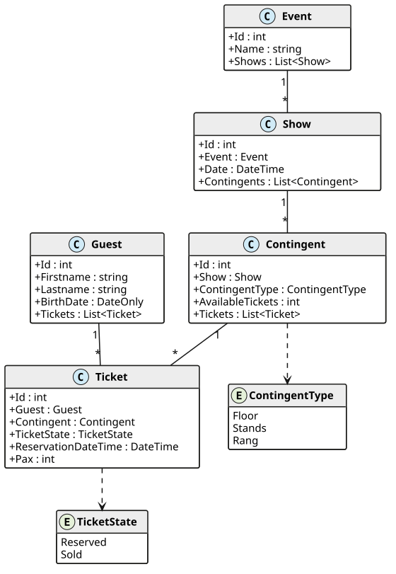

# Eventmanager: Demoprojekt zu LINQ und Serviceklassen

Dieses Projekt ist **keine Übung**, sondern das Beispiel zu den Kapiteln *LINQ: Where, Select und
Any*, *Serviceklassen mit EF Core* und *Erweiterte LINQ Techniken* im Kurs. Du kannst alle
Abfragen aus den Kapiteln ausführen, das erzeugte SQL ansehen und eigene Abfragen ausprobieren.

## Das Modell

Ein Veranstalter verkauft Tickets für Events. Ein Event (z. B. eine Musikrichtung) findet in
mehreren Shows statt. Jede Show hat drei Kontingente (Floor, Stands, Rang) mit einer bestimmten
Anzahl an Plätzen. Gäste reservieren oder kaufen Tickets. `Pax` ist die Anzahl der Begleitpersonen,
ein Ticket gilt also für `Pax + 1` Personen.



Die Musterdaten erzeugt die Methode `Seed()` im `EventContext` mit dem Paket *Bogus*. Der
Zufallsgenerator startet immer mit demselben Wert, daher sind die Daten bei jedem Lauf gleich.

## Aufbau der Solution

Öffne die Solution *Eventmanager.sln*.

| Projekt / Datei | Inhalt |
|---|---|
| *Eventmanager.Application/Model* | Die Entity-Klassen. |
| *Eventmanager.Application/Infrastructure/EventContext.cs* | Der DbContext mit der Methode `Seed()`. |
| *Eventmanager.Application/Dtos* | Die DTO-Records für die Serviceklasse. |
| *Eventmanager.Application/Services/EventService.cs* | Die Serviceklasse aus dem Kapitel *Serviceklassen mit EF Core*. |
| *Eventmanager.Tests/DatabaseTest.cs* | Basisklasse: erzeugt für jeden Test eine SQLite-Datenbank im Speicher und schreibt das SQL in die Ausgabe des Tests. |
| *Eventmanager.Tests/PersonQueryTests.cs* | LINQ mit einer Liste im Speicher (Beginn des LINQ-Kapitels). |
| *Eventmanager.Tests/LinqPlaygroundTests.cs* | Die Abfragen aus dem Kapitel *LINQ: Where, Select und Any*. |
| *Eventmanager.Tests/EventServiceTests.cs* | Tests für die Serviceklasse. |
| *Eventmanager.Tests/LinqAdvancedTests.cs* | GroupBy, SelectMany, Join und Aggregate. |

## Abfragen ausführen und das SQL ansehen

1. Öffne den Test Explorer (*Test* > *Test Explorer*) und führe einen Test aus.
2. Klicke auf den Test. Im unteren Bereich siehst du die Ausgabe (*Standard Output*). Dort steht
   jede SQL-Anweisung, die EF Core an die Datenbank geschickt hat.
3. Schreibe eigene Abfragen als neuen Test in *LinqPlaygroundTests.cs*. Mit `Print(...)` gibst du
   Werte in der Ausgabe des Tests aus.

In der Konsole führst du alle Tests mit

```text
dotnet test
```

im Ordner der Solution aus.
