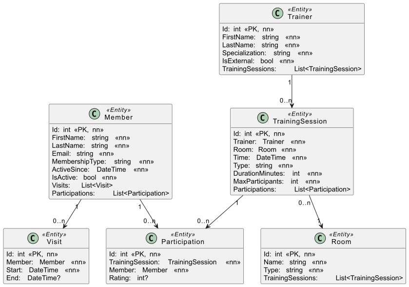

# Fitnesscenter: Serviceklasse mit EF Core

Ein Fitnesscenter verwaltet seine Mitglieder, Besuche und Trainings mit EF Core. Das Modell und
der DbContext sind fertig. Deine Aufgabe ist die Serviceklasse `FitnessService`. Sie liefert
Abfragen für die App des Studios und setzt einige Use Cases um, zum Beispiel die Anmeldung zu
einem Training.

> [!NOTE]
> Die Aufgabe eignet sich gut zur Vorbereitung auf eine Prüfung. Du solltest sie ohne
> KI-Unterstützung lösen können.

## Das Fitnesscenter

- Die Kundendaten sind im Entity `Member` gespeichert. Es gibt 2 Arten von Memberships:
  *Basic* und *Premium*. Nur Mitglieder mit `IsActive = true` sind aktiv.
- Bei jedem Besuch meldet sich das Mitglied an der Tür mit einem QR-Code an. Dabei entsteht ein
  Datensatz in `Visit`. Verlässt das Mitglied das Studio, wird `Visit.End` auf diesen Zeitpunkt
  gesetzt. Solange `End` den Wert `null` hat, ist der Besuch *offen*.
- Das Studio bietet auch begleitete Trainings an. Alle Trainerinnen und Trainer sind im Entity
  `Trainer` gespeichert. `Specialization` gibt ihren bevorzugten Bereich an (Yoga,
  Krafttraining, ...).
- Ein Trainer bietet Trainings an (`TrainingSession`). Eine Session findet zu einer bestimmten
  Zeit (`Time`) in einem bestimmten Raum (`Room`) statt. `MaxParticipants` begrenzt die Anzahl
  der Teilnehmer.
- Mitglieder melden sich über eine App zu einer Session an. Dabei entsteht ein Datensatz in
  `Participation`. Nach der Session können sie den Trainer bewerten. `Participation.Rating` ist
  ein Wert von 1 (schlecht) bis 5 (super). Ohne Bewertung ist der Wert `null`.



## Aufbau der Solution

Öffne die Solution *Fitnesscenter.sln* in diesem Ordner.

| Ordner / Datei | Inhalt |
|---|---|
| *Fitnesscenter.Application/Model* | Die Entities aus dem Klassendiagramm. |
| *Fitnesscenter.Application/Infrastructure/FitnessContext.cs* | Der DbContext. `Seed()` schreibt die Musterdaten. |
| *Fitnesscenter.Application/Dtos* | Die Records, die manche Methoden zurückgeben. |
| *Fitnesscenter.Application/Services/FitnessService.cs* | Die Serviceklasse. **Hier programmierst du.** |
| *Fitnesscenter.Application/Services/FitnessServiceException.cs* | Die Exception für verletzte Regeln. |
| *Fitnesscenter.Tests/FitnessServiceTests.cs* | Die Tests für alle Methoden. |
| *fitness.db* | Die Musterdaten als SQLite-Datenbank. |

Du änderst nur die Datei *FitnessService.cs*. Das Modell und der DbContext sind fertig. Den
`FitnessContext` bekommt das Service über den Konstruktor (Dependency Injection). Verwende das
Feld `_db` für alle Abfragen.

Die Datei *fitness.db* kannst du mit einem Datenbank-Viewer (z. B. DBeaver) öffnen. So siehst du
die Musterdaten. Die Tests verwenden diese Datei nicht. Sie erzeugen bei jedem Test eine neue
In-Memory-Datenbank mit denselben Daten.

## Allgemeine Regeln

- Die Reihenfolge der zurückgegebenen Listen spielt keine Rolle.
- Findet eine Abfrage nichts, liefert sie eine leere Liste (nicht `null`).
- Eine verletzte Regel meldest du mit einer `FitnessServiceException`. Übernimm den Text der
  Fehlermeldung genau (mit dem Punkt am Ende). Die Tests vergleichen ihn Zeichen für Zeichen.
- Schreibende Methoden speichern ihre Änderungen in der Datenbank.

## Lesende Methoden

### `List<ActiveMemberDto> GetActiveMembers()`

Liefert alle aktiven Mitglieder (`Member.IsActive` ist `true`).

```csharp
public record ActiveMemberDto(int Id, string FirstName, string LastName, string Email);
```

`Id` ist die ID des Mitglieds, `FirstName` und `LastName` sind sein Name, `Email` ist seine
E-Mail-Adresse.

### `List<Participation> GetParticipationsOfMember(int memberId)`

Liefert alle Teilnahmen (`Participation`) des Mitglieds mit der ID `memberId`.

### `List<Trainer> GetTrainerWithTrainingSessionsOnDate(DateOnly date)`

Liefert alle Trainer, die an dem Tag `date` mindestens eine Training Session abhalten. Die
Uhrzeit in `TrainingSession.Time` spielt keine Rolle, nur der Tag zählt.

### `List<Member> GetMembersWithoutParticipation()`

Liefert alle Mitglieder, die sich noch zu keiner Training Session angemeldet haben. Für sie gibt
es also keinen Datensatz in `Participation`.

### `List<TrainingSession> GetSessionsWithMembershipType(string membershipType)`

Liefert alle Training Sessions, an denen mindestens ein Mitglied mit dem Membership
`membershipType` teilnimmt. Vergleiche dafür `Member.MembershipType` mit dem Parameter.

### `List<TrainingSession> GetFullTrainingSessions()`

Liefert alle Training Sessions, die voll sind. Eine Session ist voll, wenn die Anzahl ihrer
Teilnahmen gleich `MaxParticipants` ist.

### `List<TrainingSessionWithCountDto> GetTrainingSessionsWithParticipantCounts()`

Liefert alle Training Sessions mit der Anzahl ihrer Teilnahmen.

```csharp
public record TrainingSessionWithCountDto(
    int Id, string RoomName, DateTime DateTime,
    string TrainerFirstName, string TrainerLastName, int ParticipantCount);
```

`Id` ist die ID der Session, `RoomName` der Name des Raumes und `DateTime` der Wert von
`TrainingSession.Time`. `TrainerFirstName` und `TrainerLastName` sind der Name des Trainers.
`ParticipantCount` ist die Anzahl der Teilnahmen.

### `MemberWithVisitsDto? GetMemberWithVisits(int memberId)`

Liefert die Daten des Mitglieds mit der ID `memberId` und alle seine Besuche. Gibt es kein
Mitglied mit dieser ID, liefert die Methode `null`.

```csharp
public record VisitDto(DateTime Start, DateTime? End);
public record MemberWithVisitsDto(int Id, string FirstName, string LastName, string Email, List<VisitDto> Visits);
```

### `List<MaxRatingCountPerTrainerDto> GetMaxRatingCountPerTrainer()`

Ermittelt für jeden Trainer, wie viele Bestnoten (`Participation.Rating` ist 5) er bekommen hat.
Zähle dafür die Teilnahmen mit dem Rating 5 über alle Training Sessions des Trainers. Auch
Trainer ohne Bestnote sind im Ergebnis, dann mit dem Wert 0.

```csharp
public record MaxRatingCountPerTrainerDto(int Id, string FirstName, string LastName, int MaxRatingCount);
```

`Id` ist die ID des Trainers, `FirstName` und `LastName` sind sein Name. `MaxRatingCount` ist die
Anzahl der Ratings mit dem Wert 5.

### `List<Trainer> GetTrainersWithMinimalRatingCount(int count)`

Liefert alle Trainer, die **genau** `count` schlechteste Bewertungen (`Participation.Rating` ist
1) bekommen haben. Zähle dafür die Teilnahmen mit dem Rating 1 über alle Training Sessions des
Trainers. Bei `count = 0` liefert die Methode also alle Trainer ohne ein Rating 1.

### `List<RoomWithTrainingSessionsDto> GetRoomsWithTrainingSessions(DateTime timeFrom, DateTime timeTo)`

Liefert alle Räume mit ihren Training Sessions. Dabei zählen nur die Sessions im angegebenen
Zeitraum: `TrainingSession.Time` muss >= `timeFrom` und <= `timeTo` sein. Ein Raum ohne Session
in diesem Zeitraum ist trotzdem im Ergebnis, dann mit einer leeren Liste.

```csharp
public record RoomWithTrainingSessionsDto(int RoomId, string RoomName, List<TrainingSessionDto> Sessions);
public record TrainingSessionDto(int TrainerId, string TrainerFirstName, string TrainerLastName, DateTime Time);
```

`TrainerId`, `TrainerFirstName` und `TrainerLastName` beschreiben den Trainer der Session.
`Time` ist der Wert von `TrainingSession.Time`.

## Schreibende Methoden

### `Participation RegisterMemberToTrainingSession(int memberId, int trainingSessionId)`

Meldet ein Mitglied zu einer Training Session an. Dafür legst du einen Datensatz in
`Participation` an. Das Rating ist `null`. Prüfe die Regeln in dieser Reihenfolge:

1. Gibt es kein Mitglied mit der ID `memberId`, wirf eine `FitnessServiceException` mit dem Text
   *Member not found.*
2. Gibt es keine Training Session mit der ID `trainingSessionId`, wirf eine
   `FitnessServiceException` mit dem Text *TrainingSession not found.*
3. Ist das Mitglied schon zu dieser Session angemeldet, wirf eine `FitnessServiceException` mit
   dem Text *Member already registered.*
4. Ist die Session schon voll (es sind so viele Mitglieder angemeldet, wie `MaxParticipants`
   angibt), wirf eine `FitnessServiceException` mit dem Text *Training Session is already full.*

Gib das neue Entity zurück.

### `void UpdateRating(int memberId, int trainingSessionId, int rating)`

Setzt das Rating eines Mitglieds für eine Training Session. Dafür bekommt `Participation.Rating`
den Wert von `rating`. Prüfe die Regeln in dieser Reihenfolge:

1. Das Rating muss zwischen 1 und 5 liegen (inklusive). Sonst wirf eine
   `FitnessServiceException` mit dem Text *Rating must be between 1 and 5.*
2. Hat das Mitglied an der Session gar nicht teilgenommen (es gibt keinen Datensatz in
   `Participation`), wirf eine `FitnessServiceException` mit dem Text *Participation not found.*

### `Visit AddVisit(int memberId, DateTime dateTime)`

Ein Mitglied meldet sich an der Tür an. Die Methode legt dafür einen Datensatz in `Visit` an.

1. Gibt es kein Mitglied mit der ID `memberId`, wirf eine `FitnessServiceException` mit dem Text
   *Invalid member id.*
2. Schließe zuerst alle offenen Besuche **dieses** Mitglieds. Jeder Besuch des Mitglieds mit
   `End = null` bekommt als `End` den Wert von `dateTime`. Besuche anderer Mitglieder bleiben
   unverändert.
3. Lege danach den neuen Besuch an. `Start` ist `dateTime`, `End` ist `null`.

Gib den neuen Besuch zurück.

### `TrainingSession AddTrainingSession(Trainer trainer, Room room, string type, DateTime time, int durationMinutes, int maxParticipants)`

Legt eine neue Training Session mit den übergebenen Werten an. Die Parameter `trainer` und
`room` sind Entities aus der Datenbank. Das Studio ist von 8:00 bis 20:00 Uhr geöffnet. Es gelten
diese Regeln:

| Regel | Text der `FitnessServiceException` |
|---|---|
| Die Session darf nicht vor 8:00 Uhr beginnen. | *Invalid time.* |
| Die Session darf nicht nach 20:00 Uhr enden. Das Ende ist `time` plus `durationMinutes`. Eine Session, die genau um 20:00 Uhr endet, ist erlaubt. | *Invalid time.* |
| `maxParticipants` darf nicht kleiner als 3 sein. | *Invalid max participants.* |
| `time` muss nach der letzten Training Session **dieses** Trainers liegen. Sessions anderer Trainer zählen nicht. Hat der Trainer noch keine Session, gilt die Regel nicht. | *Time must be after the last training session.* |

Sind alle Regeln erfüllt, speichere die neue Session in der Datenbank und gib sie zurück.

## Testen

Die Datei *Fitnesscenter.Tests/FitnessServiceTests.cs* enthält Tests für alle Methoden. Am
Anfang sind alle Tests rot, weil die Methoden nur eine `NotImplementedException` werfen. Mit

```text
dotnet test
```

im Ordner der Solution oder im Test Explorer siehst du, welche Methoden schon funktionieren.
Du bist fertig, wenn alle Tests grün sind.

- Ändere die Tests nicht. Sie prüfen genau die Anforderungen aus dieser Angabe.
- Die öffentlichen Signaturen in *FitnessService.cs* und die Records in *Dtos* bleiben
  unverändert. Sonst kompilieren die Tests nicht mehr.
- Ist ein Test rot, zeigt dir die Meldung, welche Werte erwartet werden und was deine Methode
  geliefert hat.
