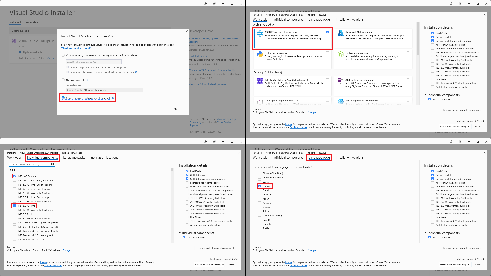
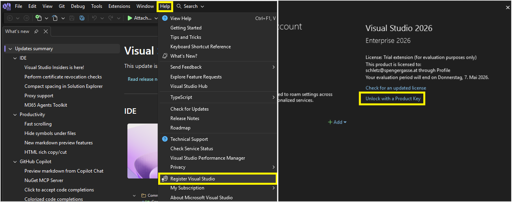
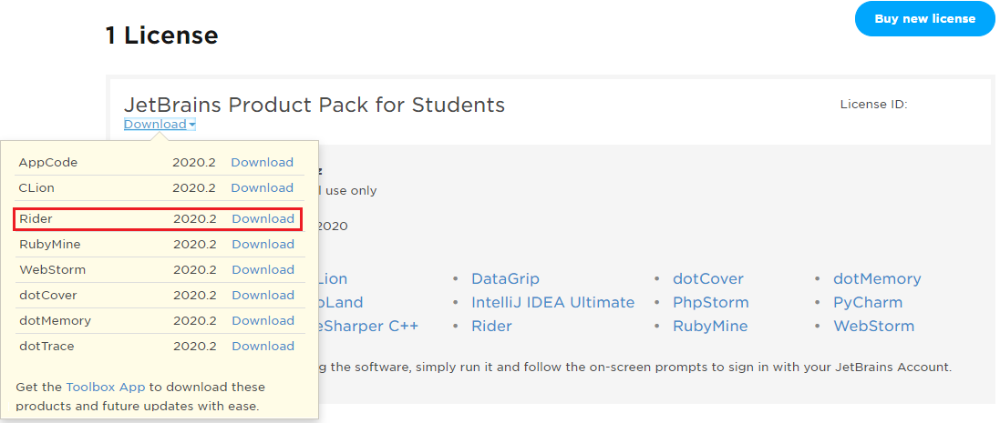

# Softwareentwicklung mit C# und .NET

> [!NOTE]
> Diesen Kurs gibt es auch als **PDF** zum offline Nachlesen und als Unterlage für die Prüfung:
> [🖺 Download](https://github.com/Die-Spengergasse/course-pos-csharp_basics/raw/refs/heads/master/dotnet_book.pdf)

## Lehrinhalte

#### Types in C#
  - [Value Types](01%20Types/01_ValueTypes.adoc)
  - [Reference Types](01%20Types/02_ReferenceTypes.adoc)
  - [Properties](01%20Types/03_Properties.adoc)
  - [Collections](01%20Types/04_Collections.adoc)
  - [Vererbung](01%20Types/05_Vererbung.adoc)
  - [Interfaces](01%20Types/06_Interfaces.adoc)
  - [Equality](01%20Types/07_Equality.adoc)
  - *[Übungsaufgaben](01%20Types/Uebungen/README.md)*
  - [Lambda Expressions](01%20Types/08_Lambdas.adoc)
#### Unittests mit xUnit
  - [Warum testen?](15%20Unittests/01_Warum_Testen.adoc)
  - [Unit Tests mit xUnit](15%20Unittests/02_xUnit.adoc)
  - [Testfälle finden](15%20Unittests/03_Testfaelle_finden.adoc)
  - *[Übungsprojekt BugHunt](15%20Unittests/Uebungen/README.md)*
#### ○ SOLID und DRY: Schlechten und guten Code erkennen
  - [Programmieren im Zeitalter der Agents](16%20SOLID/01_Einfuehrung.adoc)
  - [DRY: Don't Repeat Yourself](16%20SOLID/02_DRY.adoc)
  - [S: Single Responsibility](16%20SOLID/03_Single_Responsibility.adoc)
  - [O, Teil 1: Werte und Regeln an genau einer Stelle](16%20SOLID/04_Open_Closed_Werte.adoc)
  - [O, Teil 2: Erweitern statt ändern](16%20SOLID/05_Open_Closed_Polymorphie.adoc)
  - [L: Liskov Substitution](16%20SOLID/06_Liskov.adoc)
  - [I: Interface Segregation](16%20SOLID/07_Interface_Segregation.adoc)
  - [D: Dependency Inversion](16%20SOLID/08_Dependency_Inversion.adoc)
#### [Der OR Mapper EF Core](03%20EF%20Core/README.md)
  - [Warum OR Mapping?](03%20EF%20Core/01_WhyORMapping/README.adoc)
  - [Code first](03%20EF%20Core/02_CodeFirstEfCore5/README.adoc)
  - [Enhanced code first](03%20EF%20Core/03_EnhancedCodeFirst/README.adoc)
  - [Vererbung und andere OOP Konzepte](03%20EF%20Core/03b_EfCoreInheritance/README.adoc)
  - 💡[Übungen zu Domain Modelling](03%20EF%20Core/Uebungen/README.adoc) 💡
  - [○ Musterdaten erzeugen mit Bogus](03%20EF%20Core/03a_Bogus/README.adoc)
  - [○ Rich domain models](03%20EF%20Core/04_RichDomainModels/README.adoc)
  - [○ Database first](03%20EF%20Core/07_DatabaseFirst/README.adoc)
  - [○ Migrations](03%20EF%20Core/08_Migrations/README.adoc)
#### Serviceklassen – Datenbankgetriebene Business Logik
  - [LINQ: Where, Select und Any](17%20Serviceklassen/02_Linq_Where_Select_Any.adoc)
  - [Serviceklassen mit EF Core](17%20Serviceklassen/03_Serviceklassen.adoc)
  - [○ Erweiterte LINQ Techniken (Selbststudium)](17%20Serviceklassen/04_Linq_Erweitert.adoc)
#### ○ WPF - Windows Presentation Foundation (nur HIF)
  -  [Intro - Catch the ball](04%20WPF/01_CatchTheBall/Readme.md)
  -  [ViewModels](04%20WPF/02_ViewModelDemoApp/Readme.md)
  -  [Relay Command](04%20WPF/03_RelayCommand/Readme.md)
  -  [Lists](04%20WPF/04_Lists/README.md)
  -  [EF Core und WPF](04%20WPF/05_EF_Core/README.md)
  -  [Validations](04%20WPF/06_Validation/README.md)
#### ○ [TPL - Task Parallel Library](05%20TPL/Readme.md)
  -  [CPU bound work](05%20TPL/01%20CpuBoundWork/README.md)
  -  [Await und async](05%20TPL/02%20AwaitAsyncDemo/Readme.md)
  -  [IO und TPL: der file writer](05%20TPL/03%20FileWriterApp)
#### Git
  - [Installation von git, Git Bash](06%20Git/01_installation.md)
  - [Extensions und Arbeit mit git](06%20Git/02_work_with_git.md)
  - [Arbeiten mit Branches](06%20Git/03_branches.md)
  - [Merge Konflikte, rebase](06%20Git/04_conflicts.md)
  - [git reset](06%20Git/05_reset.md)
  - [Bearbeiten der History: amend commit und interaktives Rebase](06%20Git/06_history.md)
  - [Howto: Bereinigung des Repos, nachträgliches Ändern der .gitignore Datei](06%20Git/07_gitignore.md)
  - [Howto: Löschen der History, Ändern des Autors](06%20Git/10_reset_history.md)
  - [Für Lehrende: Exportieren des git logs](06%20Git/20_check_logs.md) :fearful:
#### ○ Asciidoctor
  - [Verwenden von Asciidoctor unter Windows/macOS](07%20Asciidoctor/01_install.adoc)
  - [Die AsciiDoc Productivity Extension für VS Code](07%20Asciidoctor/04_adoc_productivity.adoc)
  - [Schreiben der Diplomarbeit mit AsciiDoc](07%20Asciidoctor/02_diplomarbeit.adoc)
  - [AsciiDoc cheat sheet](https://raw.githubusercontent.com/Die-Spengergasse/course-pos-csharp_basics/refs/heads/master/07%20Asciidoctor/asciidoc_quick_reference.svg)
#### ○ Theoretische Informatik: Formale Sprachen
  - [Alphabet, Wort und Sprache](08%20Theoretische%20Informatik/10_Grundbegriffe.adoc)
  - [Grammatiken](08%20Theoretische%20Informatik/11_Grammatiken.adoc)
  - [BNF, EBNF und Syntaxdiagramme](08%20Theoretische%20Informatik/12_Darstellungsformen.adoc)
  - [Endliche Automaten](08%20Theoretische%20Informatik/13_Endliche_Automaten.adoc)
  - [Reguläre Ausdrücke](08%20Theoretische%20Informatik/14_Regulaere_Ausdruecke.adoc)
  - [Parser: Lexer und rekursiver Abstieg](08%20Theoretische%20Informatik/15_Parser.adoc)
  - *[Übungsprojekte](08%20Theoretische%20Informatik/Uebungen/README.md)*
#### ○ Theoretische Informatik: Algorithmen
  - [Graphen](08%20Theoretische%20Informatik/20_Graphen.adoc)
  - [Breiten- und Tiefensuche](08%20Theoretische%20Informatik/21_Breiten_und_Tiefensuche.adoc)
  - [Kürzeste Wege mit Dijkstra](08%20Theoretische%20Informatik/22_Kuerzeste_Wege.adoc)
  - [Topologische Sortierung](08%20Theoretische%20Informatik/23_Topologische_Sortierung.adoc)
  - [Divide and Conquer](08%20Theoretische%20Informatik/24_Divide_and_Conquer.adoc)
  - [Backtracking](08%20Theoretische%20Informatik/25_Backtracking.adoc)
  - [Greedy-Algorithmen](08%20Theoretische%20Informatik/26_Greedy.adoc)
  - [Dynamische Programmierung](08%20Theoretische%20Informatik/27_Dynamische_Programmierung.adoc)
  - *[Übungsprojekte](08%20Theoretische%20Informatik/Uebungen/README.md)*
#### ○ Theoretische Informatik: Komplexität
  - [Laufzeit messen](08%20Theoretische%20Informatik/30_Laufzeit_messen.adoc)
  - [Die O-Notation](08%20Theoretische%20Informatik/31_O_Notation.adoc)
  - [Code analysieren](08%20Theoretische%20Informatik/32_Code_analysieren.adoc)
  - [Datenstrukturen in .NET](08%20Theoretische%20Informatik/33_Datenstrukturen_in_NET.adoc)
  - [Optimierung](08%20Theoretische%20Informatik/34_Optimierung.adoc)
  - [P und NP](08%20Theoretische%20Informatik/35_P_und_NP.adoc)
#### ○ Erweiterungskapitel: Professional C#
  - [Extension methods](Professional%20C%23/10_ExtensionMethods/README.md)
  - [Generics](Professional%20C%23/20_Generics/README.md)
  - [Fluent APIs](Professional%20C%23/30_FluentApi/README.md)
  - [ML.NET Demo](Professional%20C%23/40_LocationDemo/README.md)
  - [Bildverarbeitung mit OpenCV](Professional%20C%23/50_OpenCv/README.md)
  - [Performanceoptimierung und Speichermanagement](Professional%20C%23/60_LogAnalyzer/README.md)
  - [Benchmarking](Professional%20C%23/70_Benchmark/README.md)
  - [HolidayCalendar - Feiertage und Ferien ermitteln](HolidayCalendar/README.md)

## Wichtiges zum Start

### Installation der IDE Visual Studio 2026

Die verbreitetste IDE zur Entwicklung im .NET Bereich ist Visual Studio. Microsoft stellt unserer
Schule eine Lizenz von Visual Studio Enterprise zur Verfügung.

Lade von https://visualstudio.microsoft.com/de/downloads/ die *Enterprise* Version von Visual Studio 2026 herunter.
Falls du unter macOS arbeitest, stelle sicher, dass du die neueste Rider Installation besitzt, die .NET 10 unterstützt.

Wähle im Installer den Workload *ASP.NET* and web development_ aus.
Installiere unter *Individual options* zusätzlich die .NET 8 Runtime, um ältere Projekte ausführen zu können.
Unter *Language packs* wähle das englische Sprachpaket.



Starte nach der Installation Visual Studio 2026.
Du kannst mit *Help* - *Register Visual Studio* den Key eingeben.




### Alternativ: Verwenden von JetBrains Rider

Eine andere weit verbreitete Entwicklungsumgebung - gerade unter macOS - ist Rider von JetBrains.
Wer mit IntelliJ gut arbeiten konnte, kann auch mit der Schullizenz Rider beziehen. Logge dich dafür
auf https://account.jetbrains.com/login ein. Wer noch keinen Zugang hat, kann mit der Schul Mailadresse
eine Lizenz gratis beziehen. Nach dem Login steht Rider als Download zur Verfügung.



## Weiterführende Unterlagen:

- YouTube Channels: [dotNET](https://www.youtube.com/channel/UCvtT19MZW8dq5Wwfu6B0oxw),
  [Nick Chapsas](https://www.youtube.com/channel/UCrkPsvLGln62OMZRO6K-llg),
  [NDC Conferences](https://www.youtube.com/channel/UCTdw38Cw6jcm0atBPA39a0Q)
- [C# 8.0 in a Nutshell: The Definitive Reference](https://www.amazon.de/C-8-0-Nutshell-Definitive-Reference-dp-1492051136/dp/1492051136/ref=dp_ob_title_bk)
- [Functional Programming in C#: How to write better C# code](https://www.amazon.de/Functional-Programming-C-Enrico-Buonanno/dp/1617293954/ref=sr_1_1?__mk_de_DE=%C3%85M%C3%85%C5%BD%C3%95%C3%91&crid=18ZFWZ2G0KO0J&dchild=1&keywords=functional+programming+c%23&qid=1600494628&sprefix=Functional+programmin%2Caps%2C174&sr=8-1)

## Synchronisieren des Repositories in einen Ordner

Installiere die neueste Version von [git](https://git-scm.com/downloads) mit den Standardeinstellungen.
Gehe danach in die Windows Eingabeaufforderung (cmd) und führe in einem geeigneten Ordner
(z. B. *C:\Github*) den Befehl
```
git clone https://github.com/Die-Spengergasse/course-pos-csharp_basics
```

Soll der neueste Stand vom Server geladen werden, führe die Datei *reset_git.cmd* aus. Achtung:
alle lokalen Änderungen werden dabei zurückgesetzt.

> [!NOTE]
> **KI generierte Inhalte**  
> Inhalte dieses Kurses wurden mit KI erstellt oder überarbeitet.

